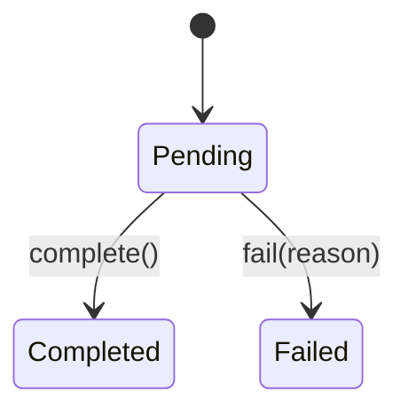
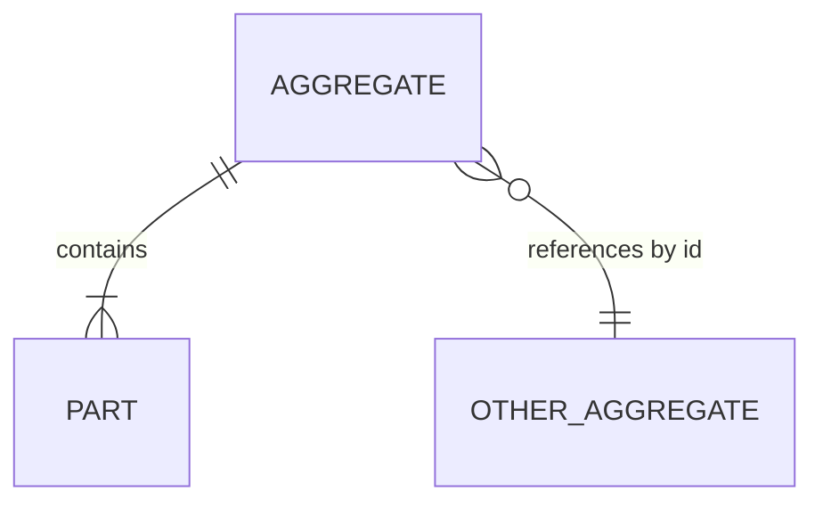

# {{TITLE}}

| Field | Value |
|---|---|
| Bounded Context | {{CONTEXT}} |
| DDD Type | <Aggregate Root / Entity / Value Object / Domain Service> |
| Aggregate | <Entities only: the owning Aggregate Root; otherwise —> |
| Ontology | <the ontology concept this models, e.g. `TestCase`; — if purely technical> |
| Status | Draft |
| Introduced in | {{RELEASE}} |
| Code | `<module.ClassName>` |
| Related | Contains: `<Model>` · References: `<OtherAggregateId>` · Emits: `<DomainEvent>` |

<!--
DDD Type:
  Aggregate Root: consistency boundary and the only entry point for changes; enforces the invariants below.
  Entity: has identity over time; changed only through its Aggregate Root (name it in "Aggregate").
  Value Object: immutable, compared by value, no identity (e.g. a verdict, a model identifier).
  Domain Service: stateless domain operation that doesn't belong to one entity.
Ontology: the problem-space concept (docs/ontology/) this model implements. One ontology concept may be
  modelled differently in several contexts; say here what this context cares about.
Related: name the relationship type. Reference other aggregates by ID, not by containment.
Models from another bounded context: write Context:Model and don't reuse its model directly.
-->

## Definition

<!-- One or two sentences in this context's ubiquitous language. -->

## Lifecycle

<!--
Optional: only for models with states. Label transitions with the commands below.

-->

## Structure

<!--
Optional: only for aggregates with several parts. Immediate neighbours only, with cardinality.

-->

## Attributes

| Attribute | Type | DDD Kind | Required | Description |
|---|---|---|---|---|
| | | Identity / Entity / Value Object | | |

## Behaviours (commands)

<!-- State-changing operations, in the ubiquitous language. Value objects usually have none. -->

- `command(args)`: effect. Preconditions: …

## Invariants

<!-- Rules the aggregate guarantees after every command, written so a test can check them. -->

-

## Domain events emitted

| Event | Emitted when | Consumed by |
|---|---|---|
| | | |

## Not to be confused with

<!-- **OtherModel** (Context): how it differs. -->

-
