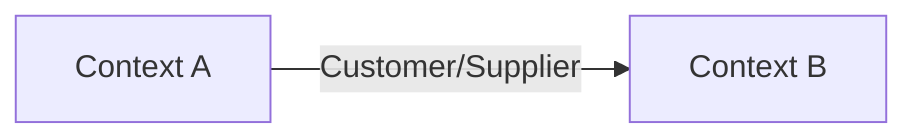

# Domain Model

The DDD design of JudgeLab, built on the [ontology](../ontology/).

| Layer | Question it answers | Organised by |
|---|---|---|
| [Ontology](../ontology/) | What exists in the problem, in plain terms? | Concept |
| Domain (this folder) | How do we model it: boundaries, aggregates, behaviour, consistency? | Bounded context |

**Workflow:** define or refine the term in the ontology → decide which bounded context owns it (a term can appear in several, with a different meaning in each) → model it in `domain/<context>/` as an aggregate, entity, value object, service or event, linking back through its `Ontology` field.

**Layout:**

```text
domain/
├── README.md               # this page: context map + list of contexts
└── <context>/              # one folder per bounded context, kebab-case
    ├── README.md           # purpose, ubiquitous language, relationships, events
    ├── <model>.md          # aggregate root, entity, value object, or domain service
    └── <event>.md          # domain event (past tense)
```

Create contexts, models, and events with the `vbench-docs` script (`new context`, `new model`, `new event`); `check` validates DDD types, context membership, entity → aggregate ownership, and ontology links.

## Context map

<!--
How the bounded contexts relate. Label each edge with the relationship
(Customer/Supplier, Conformist, ACL, Shared Kernel, OHS/PL) and keep it in sync with each context's README.


-->

## Bounded contexts

| Context | Responsibility | Code module | Status |
|---|---|---|---|
| | | | |
