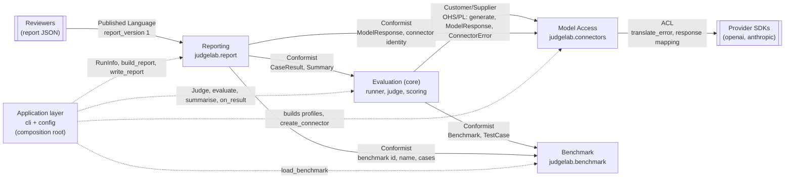

# Domain Model

The DDD design of JudgeLab, built on the [ontology](../ontology/).

| Layer | Question it answers | Organised by |
|---|---|---|
| [Ontology](../ontology/) | What exists in the problem, in plain terms? | Concept |
| Domain (this folder) | How do we model it: boundaries, aggregates, behaviour, consistency? | Bounded context |

**Workflow:** define or refine the term in the ontology → decide which bounded context owns it (a term can appear in several, with a different meaning in each) → model it in `domain/<context>/` as an aggregate, entity, value object, service or event, linking back through its `Ontology` field.

**Layout:**

```text
domain/
├── README.md               # this page: context map + list of contexts
└── <context>/              # one folder per bounded context, kebab-case
    ├── README.md           # purpose, ubiquitous language, relationships, events
    ├── <model>.md          # aggregate root, entity, value object, or domain service
    └── <event>.md          # domain event (past tense)
```

Create contexts, models, and events with the `vbench-docs` script (`new context`, `new model`, `new event`); `check` validates DDD types, context membership, entity → aggregate ownership, and ontology links.

## Context map

Arrows point from the downstream context to the upstream one it depends on. The application layer is not a bounded context; it wires the contexts together.



| Downstream | Upstream | Pattern | What crosses |
|---|---|---|---|
| Evaluation | Model Access | Customer/Supplier; Model Access is an Open Host Service with a Published Language | `ModelConnector.generate()`, `ModelResponse`, the `ConnectorError` family |
| Model Access | Provider SDKs | Anti-Corruption Layer | Each adapter maps SDK responses and exceptions to JudgeLab types |
| Evaluation | Benchmark | Conformist | `Benchmark`, `TestCase` used as is |
| Reporting | Evaluation, Model Access, Benchmark | Conformist | `CaseResult`, `Summary`, `ModelResponse`, connector `provider`/`model`/`base_url`, benchmark fields |
| Reviewers | Reporting | Published Language | Report JSON, `report_version` "1" |

## Bounded contexts

| Context | Responsibility | Code module | Status |
|---|---|---|---|
| [Model Access](model-access/README.md) | Reach foundation models: one prompt in, one `ModelResponse` or `ConnectorError` out; keep secrets inside | `judgelab.connectors` | Draft |
| [Benchmark](benchmark/README.md) | Own test data and its validity; load a whole valid benchmark or report every problem | `judgelab.benchmark` | Draft |
| [Evaluation](evaluation/README.md) | Decide each case's Outcome (PASS, FAIL, ERROR) with a target, a judge and a rubric; summarise the run | `judgelab.runner`, `judgelab.judge`, `judgelab.scoring` | Draft |
| [Reporting](reporting/README.md) | Publish a finished run as reviewable JSON evidence, never with secrets | `judgelab.report` | Draft |

The application layer (`judgelab.cli`, `judgelab.config`) is not a context. The CLI is the driving adapter and composition root: it reads the YAML config into an `EvaluationConfig`, builds connectors through an injected `connector_factory`, runs the evaluation and writes the report.

## Subdomains

- **Evaluation is the core domain.** Deciding honestly whether an answer is correct, and refusing to call "we don't know" a failure, is what JudgeLab exists to do. This is where design effort goes.
- **Benchmark and Reporting are supporting subdomains.** They are specific to JudgeLab and the core needs them, but they are simple: validate some JSON, write some JSON.
- **Model Access is a generic subdomain.** Every LLM tool needs to call models. It holds no JudgeLab insight, so it stays thin, hides the SDKs behind one port, and could be replaced by a library.
