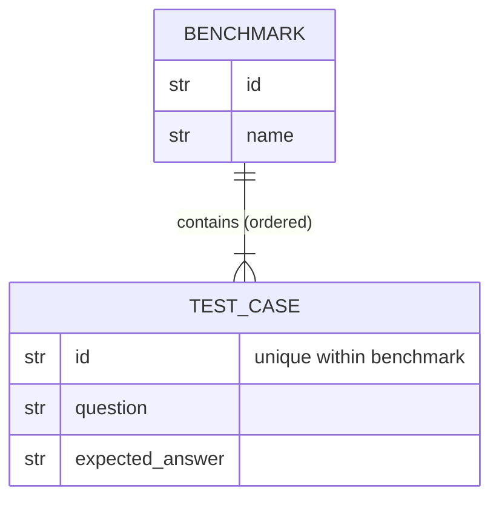

# Benchmark

| Field | Value |
|---|---|
| Bounded Context | Benchmark |
| DDD Type | Aggregate Root |
| Aggregate | — |
| Ontology | `Benchmark` |
| Status | Draft |
| Introduced in | v0.1 |
| Code | `benchmark.Benchmark` |
| Related | Contains: [TestCase](test-case.md) · Built by: [BenchmarkLoader](benchmark-loader.md) · Referenced by: Evaluation:EvaluationRun, Reporting:RunInfo |

## Definition

A named collection of test cases, in file order, that is run as one evaluation. It is the consistency boundary for case identity: case ids are unique only inside one benchmark.

## Structure

## Attributes

| Attribute | Type | DDD Kind | Required | Description |
|---|---|---|---|---|
| `id` | `str` | Identity | yes | Stable benchmark id, such as `"capitals-v1"`. |
| `name` | `str` | Value Object | yes | Human-readable name. |
| `cases` | `tuple[TestCase, ...]` | Entity | yes | The test cases, in file order. A tuple, so it cannot change. |

## Behaviours (commands)

None. The aggregate is immutable (a frozen dataclass with a tuple). It is created once by `load_benchmark` and only read afterwards. "Changing" a benchmark means editing the file and loading it again.

## Invariants

These are enforced by [BenchmarkLoader](benchmark-loader.md), not by the class itself.

- `id` and `name` are non-empty strings (AC-002-04).
- There is at least one case (AC-002-07).
- Case ids are unique. A duplicate names the id and both positions (AC-002-05).
- No unknown fields at the top level or in any case (AC-002-06).
- `cases` keeps file order (AC-002-01).

## Domain events emitted

| Event | Emitted when | Consumed by |
|---|---|---|
| — | — | — |

## Not to be confused with

- **EvaluationRun** (Evaluation): one *execution* of a benchmark. The same benchmark can be run many times.
- **BenchmarkLoader** (Benchmark): the factory and validator. The aggregate is the result.
- **The JSON file**: the storage format. The aggregate is the in-memory, validated model.

## Design note (candidate)

The invariants live in the loader, so `Benchmark(id="", name="", cases=())` can still be built directly in code. A candidate refactoring is a `__post_init__` check (or a `Benchmark.create(...)` factory), so the aggregate guards itself no matter how it is built. The loader would then only translate JSON and collect problems.
