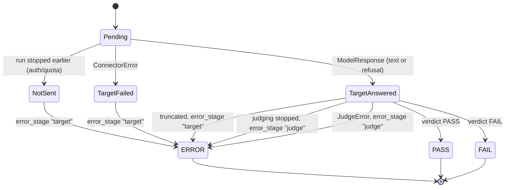

# CaseResult

| Field | Value |
|---|---|
| Bounded Context | Evaluation |
| DDD Type | Entity |
| Aggregate | EvaluationRun |
| Ontology | `CaseResult` |
| Status | Draft |
| Introduced in | v0.1 |
| Code | `scoring.CaseResult` |
| Related | Owned by: [EvaluationRun](evaluation-run.md) · Holds: [Outcome](outcome.md), Model Access:ModelResponse, [JudgeEvaluation](judge-evaluation.md) · References: Benchmark:TestCase · Emitted in: [CaseEvaluated](case-evaluated.md) |

## Definition

Everything that happened to one test case in one run: its final Outcome, the target's response, the judge's evaluation, and, for an ERROR, the stage that failed and why. Its identity is its test case's id within the run.

## Lifecycle

The CaseResult object is created once, already in its final state. The states below are the case's journey inside `runner.evaluate`; only the last one becomes a CaseResult.

## Attributes

| Attribute | Type | DDD Kind | Required | Description |
|---|---|---|---|---|
| `case` | `benchmark.TestCase` | Identity | yes | The test case. `case.id` is the identity. |
| `outcome` | `scoring.Outcome` | Value Object | yes | PASS, FAIL or ERROR. |
| `target` | `connectors.ModelResponse \| None` | Value Object | no | The target's response, kept even for a truncated answer. |
| `judgement` | `judge.JudgeEvaluation \| None` | Value Object | no | Set only for PASS or FAIL. |
| `error_stage` | `str \| None` | Value Object | no | `"target"` or `"judge"`, for ERROR only. |
| `error` | `str \| None` | Value Object | no | A message such as `ConnectorUnavailableError: HTTP 500`. Never a secret. |

## Behaviours (commands)

None on the class (a frozen dataclass). It is built by `runner._judge(answered, judge, judge_stopped_by) -> tuple[CaseResult, BaseException | None]`, which decides the outcome.

## Invariants

- `outcome` is PASS or FAIL **only if** `judgement` is set, and then `outcome == Outcome(judgement.verdict)` (AC-006-01).
- `outcome` is ERROR **only if** `error_stage` and `error` are set (AC-006-02, AC-006-03).
- A target ConnectorError gives ERROR at `"target"` with `target=None` (AC-006-02).
- A truncated target answer gives ERROR at `"target"` with the response kept and the message `answer was cut off by its length limit` (AC-006-02).
- A judge failure gives ERROR at `"judge"`, never FAIL (AC-006-03, AC-004-03).
- A refused target answer is judged like any other answer (AC-006-04).

## Domain events emitted

| Event | Emitted when | Consumed by |
|---|---|---|
| [CaseEvaluated](case-evaluated.md) | right after this result is built (emitted by the run, with this result as payload) | CLI progress line |

## Not to be confused with

- **TargetResult** (Evaluation): the intermediate step, before judging.
- **JudgeEvaluation** (Evaluation): the judge's part only. A CaseResult may have none.
- **Benchmark:TestCase**: the input. A CaseResult is what happened to it in one run.

## Design note (candidate)

The invariants above hold because `_judge` builds every CaseResult, not because the class checks them. Named constructors such as `CaseResult.passed_or_failed(case, response, judgement)` and `CaseResult.error(case, stage, message, response=None)`, or a `__post_init__` check, would make an invalid combination impossible to build.
