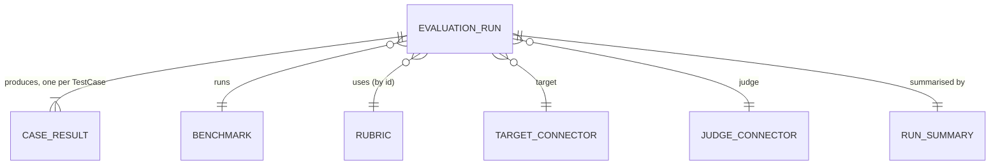

# EvaluationRun

| Field | Value |
|---|---|
| Bounded Context | Evaluation |
| DDD Type | Aggregate Root |
| Aggregate | — |
| Ontology | `EvaluationRun` |
| Status | Draft |
| Introduced in | v0.1 |
| Code | Implicit in v0.1, no single class: `runner.evaluate()` returns `list[scoring.CaseResult]`; its id and times live in `report.RunInfo` |
| Related | Contains: [CaseResult](case-result.md) · References: Benchmark:Benchmark (by value), [Rubric](rubric.md) (by id), target and judge Model Access:ModelConnector · Summarised by: [RunSummary](run-summary.md) · Emits: [CaseExecuted](case-executed.md), [CaseEvaluated](case-evaluated.md) |

## Definition

One execution of a benchmark against a target model, with a judge model and a rubric. It owns one CaseResult per test case, and it is the boundary inside which "every case ends with exactly one outcome" must hold.

## Structure

In v0.1 these parts are spread over several objects:

| Part of the aggregate | Where it lives in v0.1 |
|---|---|
| The case results | the `list[CaseResult]` returned by `runner.evaluate()` |
| Run id, `started_at`, `finished_at` | `report.RunInfo` (Reporting), built by `cli.run_command` |
| Benchmark, rubric id, target and judge | arguments to `evaluate()` and fields of `RunInfo` |
| Summary | `scoring.summarise(results)`, called by the CLI |
| Stop-the-run state | local variables `stopped_by` and `judge_stopped_by` inside `runner` |

## Attributes

These are the attributes of the conceptual aggregate, with the types the v0.1 code uses for each part.

| Attribute | Type | DDD Kind | Required | Description |
|---|---|---|---|---|
| `run_id` | `str` | Identity | yes | `uuid4().hex`. Today in `RunInfo.run_id`. |
| `benchmark` | `benchmark.Benchmark` | Value Object | yes | What is run. |
| `rubric_id` | `str` | Value Object | yes | Which rubric the judge used. |
| `target` | `connectors.ModelConnector` | Value Object | yes | The model under test. |
| `judge` | `judge.Judge` | Value Object | yes | The judge service (judge connector + rubric). |
| `results` | `list[scoring.CaseResult]` | Entity | yes | One per test case, in benchmark order. |
| `started_at`, `finished_at` | `datetime` (UTC) | Value Object | yes | Taken by the CLI with `report.utc_now()` around `evaluate()`. |

## Behaviours (commands)

In v0.1 the commands are module-level application services in `runner`:

- `run_target(benchmark: Benchmark, target: ModelConnector, *, on_result: Callable[[TargetResult], None] | None = None) -> list[TargetResult]`: sends each case's question to the target, in order, one call per case. Stops sending after an auth or quota error. Emits CaseExecuted per case.
- `evaluate(benchmark: Benchmark, target: ModelConnector, judge: Judge, *, on_target: Callable[[TargetResult], None] | None = None, on_result: Callable[[CaseResult], None] | None = None) -> list[CaseResult]`: runs the target over the benchmark, then decides each case's outcome with the judge. Stops judging after an auth or quota error from the judge. Emits CaseExecuted and CaseEvaluated.

## Invariants

- `len(results) == len(benchmark.cases)`, and `results[i].case` is `benchmark.cases[i]` (AC-003-01, AC-006-01).
- Each question is sent to the target at most once (AC-003-01).
- After an auth or quota error from the target, no later case is sent (AC-003-03). After one from the judge, no later case is judged (AC-006-03).
- A case is judged only if the target gave a non-truncated response (AC-006-02).
- A non-`ConnectorError` exception escapes and no results are returned (AC-003-05).
- `started_at <= finished_at`.

## Domain events emitted

| Event | Emitted when | Consumed by |
|---|---|---|
| [CaseExecuted](case-executed.md) | after each case's target step, including "not sent" | tests; no production consumer in v0.1 |
| [CaseEvaluated](case-evaluated.md) | after each case's final Outcome is decided | CLI progress line |

## Not to be confused with

- **Reporting:RunInfo**: holds the run's id, times and connections *for the report*. It is a record of the run, not the run.
- **Benchmark:Benchmark**: the data that is run. One benchmark, many runs.
- **RunSummary** (Evaluation): the counts derived from a finished run.

## Design note: the main candidate refactoring

In v0.1 the run has no class. Its state is a list, two local variables in `runner`, and a `RunInfo` built later by the CLI. This works, but nothing owns the run's invariants in one place, and the run's identity is created in the Reporting context.

A candidate `EvaluationRun` class (in Evaluation, not Reporting) would:

- **hold** `run_id`, `benchmark`, `rubric_id`, the target and judge identities, `started_at`, `finished_at`, and the ordered `CaseResult`s;
- **guarantee** one result per case in benchmark order, at most one target call per case, and the stop-the-run rules, all in one object;
- **expose** `summary() -> Summary`, so the counts are always taken from the run's own results;
- **record** domain events (CaseExecuted, CaseEvaluated, and perhaps a new RunCompleted) instead of taking two callbacks with different names;
- let `RunInfo` shrink to a mapping from `EvaluationRun` to report data, so Reporting conforms to Evaluation instead of owning part of it.

This is not built yet. The codealongs teach the v0.1 shape.
