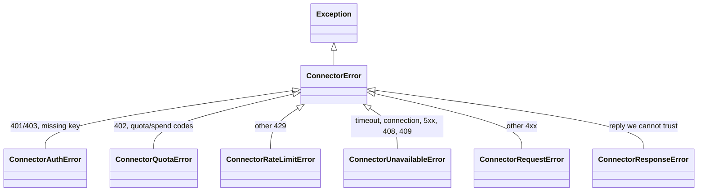

# ConnectorError

| Field | Value |
|---|---|
| Bounded Context | Model Access |
| DDD Type | Value Object |
| Aggregate | — |
| Ontology | `ConnectorError` |
| Status | Draft |
| Introduced in | v0.1 |
| Code | `connectors.errors.ConnectorError` + `ConnectorAuthError`, `ConnectorQuotaError`, `ConnectorRateLimitError`, `ConnectorUnavailableError`, `ConnectorRequestError`, `ConnectorResponseError` |
| Related | Raised by: [ModelConnector](model-connector.md), [CredentialResolver](credential-resolver.md) |

## Definition

A model call failed, so we do not know what the model would have said. It is a family of exceptions. The subclass names the kind of failure, and the kind decides what the caller should do.

## Structure

## Attributes

| Attribute | Type | DDD Kind | Required | Description |
|---|---|---|---|---|
| `args[0]` (message) | `str` | Value Object | yes | Short detail such as `"HTTP 401"` or `"HTTP 429 (insufficient_quota)"`. |
| `status_code` | `int \| None` | Value Object | no | The HTTP status, when there was one. |
| `request_id` | `str \| None` | Value Object | no | The provider's request id, when there was one. |

## Behaviours (commands)

None. Errors are created and raised. Each adapter's `translate_error(e) -> ConnectorError` maps SDK exceptions onto this family. That function is the anti-corruption layer.

## Invariants

- Messages carry the status, the provider's short error code and the request id, never the key or the provider's free-text message (AC-001-08).
- The mapping is the same for every provider: 401/403 auth; 402 or a quota code quota; other 429 rate limit; 5xx, 408, 409, timeout or connection failure unavailable; other 4xx request (AC-001-06).
- A reply with no choices, or with neither text nor refusal, is `ConnectorResponseError` (AC-001-05).
- A missing or blank key variable is `ConnectorAuthError` naming the variable (AC-001-01).

Python exceptions are not frozen, so "Value Object" here means: created once, never changed, compared by kind and message.

## Domain events emitted

| Event | Emitted when | Consumed by |
|---|---|---|
| — | — | — |

## Not to be confused with

- **`judge.JudgeError`** (Evaluation): the judge could not produce a valid verdict. It may *wrap* a ConnectorError as its `__cause__`.
- **`ProfileError`** (Model Access): the configuration is invalid. Raised before any call.
- **Refusal**: the model answered by declining. That is a ModelResponse, not an error.
