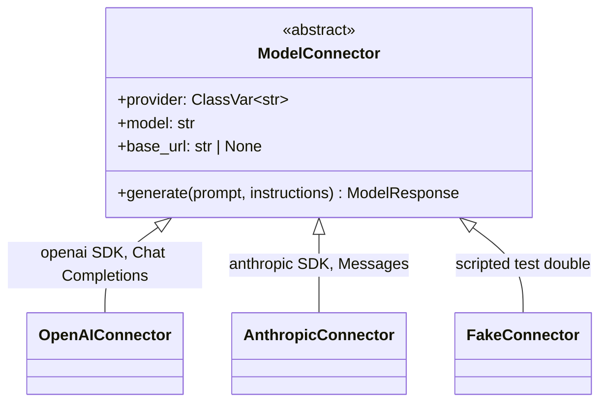

# ModelConnector

| Field | Value |
|---|---|
| Bounded Context | Model Access |
| DDD Type | Domain Service |
| Aggregate | — |
| Ontology | `ModelConnector` |
| Status | Draft |
| Introduced in | v0.1 |
| Code | `connectors.base.ModelConnector` (adapters: `connectors.openai_connector.OpenAIConnector`, `connectors.anthropic_connector.AnthropicConnector`, `connectors.fake.FakeConnector`) |
| Related | Returns: [ModelResponse](model-response.md) · Raises: [ConnectorError](connector-error.md) · Built by: [ConnectorRegistry](connector-registry.md) |

## Definition

The driven port of the hexagon. It sends one prompt, with optional instructions, to one model and returns a `ModelResponse`, or raises a `ConnectorError`. Each adapter is an interchangeable strategy for "call a model".

## Structure

## Attributes

| Attribute | Type | DDD Kind | Required | Description |
|---|---|---|---|---|
| `provider` | `ClassVar[str]` | Value Object | yes | `"openai_compatible"`, `"anthropic"` or `"fake"`. |
| `default_base_url` | `ClassVar[str \| None]` | Value Object | no | Used when the profile sets no `base_url`. |
| `model` | `str` | Value Object | yes | Requested model id. Must not be blank. |
| `base_url` | `str \| None` | Value Object | no | The endpoint actually used. |

The live adapters also hold a private SDK client built with the key from `read_secret`. `AnthropicConnector` adds `max_tokens: int` (default 16000). `FakeConnector` adds `replies`, `default`, and the recorded `prompts` and `instructions` lists.

## Behaviours (commands)

- `generate(prompt: str, *, instructions: str | None = None) -> ModelResponse`: sends `prompt` as one user message. Instructions go as a `system` message (OpenAI) or the `system` parameter (Anthropic) (AC-004-06). Raises a `ConnectorError` subclass on failure.

## Invariants

- `generate()` returns a `ModelResponse` with `text` or `refusal` set, or raises a `ConnectorError`. No other exception escapes (AC-001-09).
- Configuration comes only from constructor arguments. Provider environment variables have no effect (AC-001-02).
- The key never appears in `repr()`, responses or error messages (AC-001-08).
- No retry happens unless `max_retries` is set (AC-001-07).
- A length-limited answer has `truncated=True`, for every provider (AC-001-11).
- `FakeConnector` answers from its script, records every prompt and instruction, and raises `ConnectorRequestError` for an unscripted prompt with no default (AC-001-10).

## Domain events emitted

| Event | Emitted when | Consumed by |
|---|---|---|
| — | — | — |

## Not to be confused with

- **ConnectionProfile** (Model Access): the settings, not the caller.
- **Judge** (Evaluation): a domain service that *uses* a ModelConnector to reach the judge model. The connector does not know it is judging.
- **ConnectorRegistry** (Model Access): builds connectors; it does not call models.
