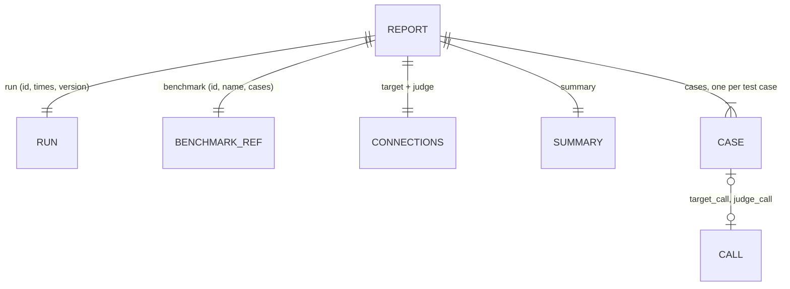

# Report

| Field | Value |
|---|---|
| Bounded Context | Reporting |
| DDD Type | Value Object |
| Aggregate | — |
| Ontology | `Report` |
| Status | Draft |
| Introduced in | v0.1 |
| Code | `report.build_report` -> `dict` (+ `report.write_report`, `report.REPORT_VERSION`) |
| Related | Built from: [RunInfo](run-info.md), Evaluation:CaseResult, Evaluation:RunSummary |

## Definition

The JSON document for one run: metadata, summary and per-case evidence. It is a Published Language. Its shape is a contract with reviewers, marked by `report_version: "1"`.

## Structure

## Attributes

The report is a plain `dict` with these top-level keys.

| Attribute | Type | DDD Kind | Required | Description |
|---|---|---|---|---|
| `report_version` | `str` | Value Object | yes | Always `"1"`. |
| `run` | `dict` | Value Object | yes | `id`, `started_at`, `finished_at` (ISO 8601), `judgelab_version`. |
| `benchmark` | `dict` | Value Object | yes | `id`, `name`, `cases` (count). |
| `rubric` | `str` | Value Object | yes | The rubric id. |
| `connections` | `dict` | Value Object | yes | `target` and `judge`, each `provider`, `model`, `base_url`. |
| `summary` | `dict` | Value Object | yes | `total`, `passed`, `failed`, `errors`, `evaluated`, `pass_rate`, `coverage`. |
| `cases` | `list[dict]` | Value Object | yes | Per case: `id`, `question`, `expected_answer`, `outcome`, `actual_answer`, `refusal`, `verdict`, `justification`, `target_call`, `judge_call`, `error` (`stage`, `message`). |

Each `*_call` holds `requested_model`, `served_model`, `finish_reason`, `prompt_tokens`, `completion_tokens`, `request_id` and `latency_ms` (rounded to 0.1).

## Behaviours (commands)

None on the value. Two functions produce and store it:

- `build_report(run: RunInfo, results: list[CaseResult], summary: Summary) -> dict`: a pure mapping to plain data.
- `write_report(report: dict, directory: str | Path) -> Path`: creates the directory if needed and writes the file.

## Invariants

- Every case carries its full evidence. Fields that do not apply are `null` (AC-005-04).
- The run's id, times, benchmark, rubric and connections are recorded (AC-005-05).
- No key and no key variable name appears anywhere (AC-005-06).
- The file is UTF-8 JSON, indented, named `run-<YYYYMMDDTHHMMSSZ>-<run id[:8]>.json` (AC-005-07).
- `summary` matches the Evaluation RunSummary exactly.

## Domain events emitted

| Event | Emitted when | Consumed by |
|---|---|---|
| — | — | — |

## Not to be confused with

- **Evaluation:RunSummary**: the computed counts. The report only copies them.
- **RunInfo** (Reporting): one of the report's inputs.
- **The CLI's printed summary**: a human-friendly echo of the same numbers, not the report.

## Design note (candidate)

The report is an untyped `dict`, so its version-1 shape is guarded only by tests. A candidate is a typed schema (TypedDicts or a JSON Schema file) that both `build_report` and reviewers' tools can check. Writing the file is edge I/O kept as a plain function in v0.1; a `ReportSink` port is a v0.2 candidate.
