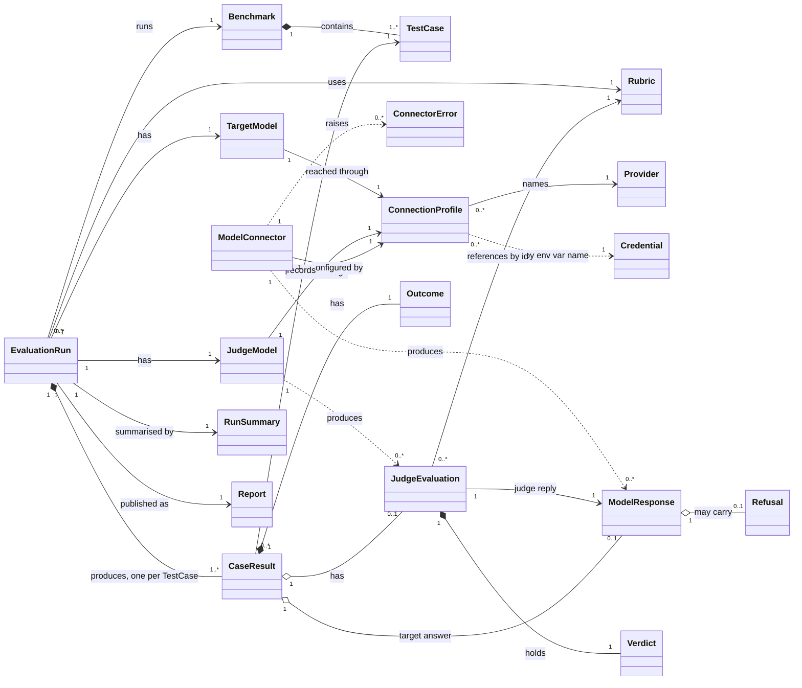

# Domain Ontology

The shared vocabulary of JudgeLab: one canonical name per concept, used the same way in conversation, docs, and code. The ontology describes the problem space; how each concept is modelled (bounded contexts, aggregates, behaviour) lives in the [domain model](../domain/).

- One file per concept, named after the canonical term in kebab-case (`test-case.md` for `TestCase`); copy [_template.md](_template.md).
- Every concept file must have a row in the glossary below (the docs check enforces this).
- Put per-concept diagrams in the concept file, limited to its immediate neighbours. The whole-system map belongs here.

## How these were derived

The concepts come from a noun/verb analysis of the use-case flows (UC-001 to UC-006) and their Gherkin scenarios. Nouns that the flows keep returning to, such as benchmark, case, answer, verdict, outcome and report, became concepts. Verbs that link them, such as "the system sends the question to the target", "the judge decides" and "the report records", became the relationships in the domain map. Where people or provider docs use other words for the same thing ("dataset", "system under test", "grader", "API key", "completion"), we picked one canonical term and listed the rest as aliases. Nouns that only describe mechanics (CLI, file path, progress line) were left out.

## Glossary

Read in this order: what we test, who we test with, how we reach the models, what comes back, how it is judged, and what the run produces.

| Term | Definition (one line) | Aliases | Status | Introduced in |
|---|---|---|---|---|
| [Benchmark](benchmark.md) | A named collection of test cases that is run as one evaluation. | dataset, benchmark dataset | Draft | v0.1 |
| [TestCase](test-case.md) | One question with the answer we expect. | case, sample, prompt | Draft | v0.1 |
| [TargetModel](target-model.md) | The model whose answers are being evaluated. | system under test, SUT, candidate model | Draft | v0.1 |
| [JudgeModel](judge-model.md) | The model that decides whether an answer is correct. | evaluator, grader, LLM-as-a-judge | Draft | v0.1 |
| [ConnectionProfile](connection-profile.md) | The configuration for reaching one model: provider, model id, optional base URL, the name of the env var holding the key, timeout, retries, options. | connection, model connection, profile | Draft | v0.1 |
| [Provider](provider.md) | The service that hosts a model (OpenAI-compatible, Anthropic, fake). | vendor, API | Draft | v0.1 |
| [Credential](credential.md) | The secret that authorises calls to a provider; JudgeLab only ever stores the NAME of the environment variable holding it. | API key, secret | Draft | v0.1 |
| [ModelConnector](model-connector.md) | Sends one prompt (with optional instructions) to a model and returns a ModelResponse or raises a ConnectorError. | connector, adapter, client | Draft | v0.1 |
| [ModelResponse](model-response.md) | What JudgeLab keeps from one model call: text or refusal, requested and served model, finish reason, truncated flag, token counts, request id, latency. | model call, completion, response | Draft | v0.1 |
| [Refusal](refusal.md) | A model's explicit decision not to answer; a real outcome, not an error. | declined answer | Draft | v0.1 |
| [ConnectorError](connector-error.md) | A model call failed, so we do not know what the model would have said. Kinds: auth, quota, rate limit, unavailable, request, response. | execution error, call failure | Draft | v0.1 |
| [Rubric](rubric.md) | Named instructions telling the judge what counts as an acceptable answer (v0.1: `semantic_correctness`). | grading instructions, criteria | Draft | v0.1 |
| [Verdict](verdict.md) | The judge's decision on one answer: PASS or FAIL. | grade, label | Draft | v0.1 |
| [JudgeEvaluation](judge-evaluation.md) | A validated verdict with its justification, the rubric id and the judge's ModelResponse. | judgement, evaluation | Draft | v0.1 |
| [Outcome](outcome.md) | The final state of one case: PASS, FAIL or ERROR (ERROR = no trustworthy verdict exists). | result status | Draft | v0.1 |
| [CaseResult](case-result.md) | Everything that happened to one test case: outcome, target response, judgement, error stage and message. | case outcome, result | Draft | v0.1 |
| [EvaluationRun](evaluation-run.md) | One execution of a benchmark against a target with a judge and a rubric, with its id and start/finish times. | run, evaluation | Draft | v0.1 |
| [RunSummary](run-summary.md) | Counts of passed/failed/errored cases, pass rate = passed/(passed+failed), coverage = evaluated/total. | summary, scores, metrics | Draft | v0.1 |
| [Report](report.md) | The JSON document (`report_version` "1") holding a run's metadata, summary and per-case evidence. | run report, results file | Draft | v0.1 |

Status values: Draft · Active · Deprecated

## Domain map

## Cross-concept invariants

- Every TestCase in an EvaluationRun ends with exactly one CaseResult, in benchmark order (AC-003-01, AC-006-01).
- An Outcome is PASS or FAIL only when a JudgeEvaluation exists, and then it equals that evaluation's Verdict (AC-006-01).
- A ConnectorError, an untrusted judge reply, or a truncated answer makes the Outcome ERROR, never FAIL (AC-004-03, AC-006-02, AC-006-03).
- A Refusal from the target is an answer, not an error: it goes to the JudgeModel like any other answer (AC-001-04, AC-006-04).
- The RunSummary's pass rate excludes ERROR cases; coverage shows how many cases reached a Verdict (AC-005-02, AC-005-03).
- No concept ever holds a Credential's value. ConnectionProfile holds only the variable's name, and the Report holds neither the value nor the name (AC-001-08, AC-005-06).
- The TargetModel and the JudgeModel each have their own ConnectionProfile, so either can change without touching the other or the Benchmark (AC-001-22, AC-006-11).
