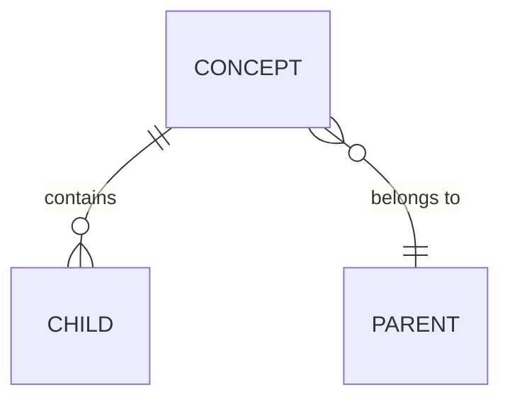
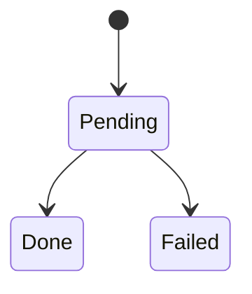

# <Concept>

| Field | Value |
|---|---|
| Status | Draft |
| Introduced in | v0.1 |
| Modelled in | <domain model(s) implementing it, e.g. `Evaluation:JudgeEvaluation`> |
| Aliases | |
| Related | Contains: `<Concept>` · Belongs to: `<Concept>` · Produces: `<Concept>` |

<!--
Status: Draft (still being discussed) · Active (safe to build on) · Deprecated (don't use; say what replaces it in "Not to be confused with").
Modelled in: the DDD model(s) in docs/domain/ that implement this concept (Context:Model). Code mapping lives there.
Aliases: other names people or providers use for the same thing (e.g. "golden answer" for expected answer). Pick one canonical term; list the rest here.
Related: name the relationship type, not just the neighbour (Contains, Belongs to, References, Produces, Evaluated by, Transitions to, …).
-->

## Definition

<!-- One or two sentences. What it is, and what it is for. -->

## Diagram

<!--
Optional: include only when it adds something a table can't.
- Structure: a concept with several relationships → erDiagram showing just its immediate neighbours (one hop) with cardinality.
- Lifecycle: a concept with statuses → stateDiagram-v2 showing allowed transitions.
Simple value objects don't need one. The whole-system map lives in README.md, not here.

-->

## Attributes

| Attribute | Type | Required | Description |
|---|---|---|---|
| | | | |

## Invariants

<!-- Rules that must always hold, written so a test can check them. -->

-

## Examples

<!-- One typical instance and one edge case, ideally as the JSON/YAML a user would actually write. -->

## Not to be confused with

<!-- **OtherConcept**: how it differs. -->

-
