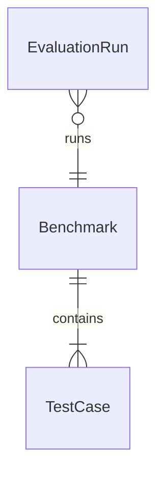

# Benchmark

| Field | Value |
|---|---|
| Status | Draft |
| Introduced in | v0.1 |
| Modelled in | `Benchmark:Benchmark` · `Benchmark:BenchmarkLoader` |
| Aliases | dataset, benchmark dataset |
| Related | Contains: `TestCase` (1..*) · Run by: `EvaluationRun` |

## Definition

A named collection of test cases that is run as one evaluation. The developer writes it as a JSON file, and JudgeLab refuses to use it until every case in it is valid.

## Diagram



## Attributes

| Attribute | Type | Required | Description |
|---|---|---|---|
| id | text | Yes | Stable identifier, e.g. `general-knowledge-v1`. Copied into the report. |
| name | text | Yes | Human-readable name, printed when a run starts. |
| cases | list of `TestCase` | Yes | The test cases, kept in file order. |

## Invariants

- `id` and `name` are non-empty text (AC-002-04).
- It has at least one case (AC-002-07).
- No two cases share an id; the error names the id and both positions (AC-002-05).
- The file has no fields other than `id`, `name` and `cases`, so typos are caught (AC-002-06).
- Cases keep the order they have in the file (AC-002-01).
- A file with problems is rejected as a whole, and every problem is reported at once (AC-002-08).

## Examples

A typical benchmark (from `benchmarks/sample.json`, shortened):

```json
{
  "id": "general-knowledge-v1",
  "name": "General knowledge (sample)",
  "cases": [
    { "id": "gk-001", "question": "What is the capital of France?", "expected_answer": "Paris" },
    { "id": "gk-002", "question": "What is the chemical symbol for gold?", "expected_answer": "Au" }
  ]
}
```

Edge case: this file is rejected with two problems, not one, because of the unknown field and the empty list.

```json
{ "id": "b1", "name": "Empty", "cases": [], "description": "typo-prone extra field" }
```

## Not to be confused with

- **EvaluationRun**: one execution of a benchmark. The same benchmark can be run many times, against different targets or judges.
- **Report**: the output of a run. The benchmark is the input.
