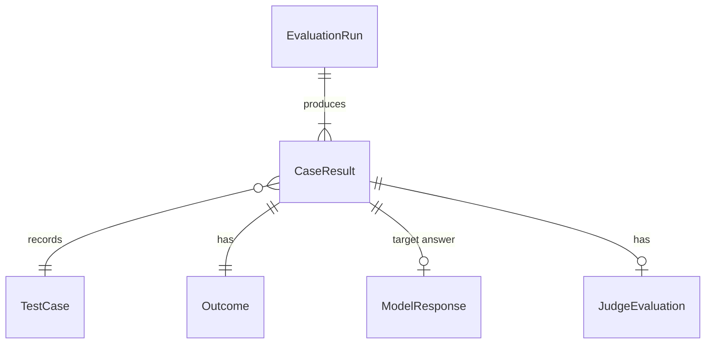

# CaseResult

| Field | Value |
|---|---|
| Status | Draft |
| Introduced in | v0.1 |
| Modelled in | `Evaluation:CaseResult` |
| Aliases | case outcome, result |
| Related | Belongs to: `EvaluationRun` · Records: `TestCase` (1) · Has: `Outcome` (1) · Has: `ModelResponse` (target, 0..1) · Has: `JudgeEvaluation` (0..1) |

## Definition

Everything that happened to one test case in a run: its outcome, the target's response, the judge's evaluation, and, for an ERROR, the stage that failed and why. It is the per-case evidence a reviewer reads.

## Diagram



## Attributes

| Attribute | Type | Required | Description |
|---|---|---|---|
| case | `TestCase` | Yes | The test case this result is for. Its id identifies the result. |
| outcome | `Outcome` (PASS, FAIL, ERROR) | Yes | The final state. |
| target | `ModelResponse` | No | The target's answer or refusal. Empty when the call failed or was not sent. |
| judgement | `JudgeEvaluation` | No | The judge's decision. Empty for every ERROR. |
| error_stage | enum (target, judge) | No | Where it went wrong. Set only for ERROR. |
| error | text | No | What went wrong, e.g. `ConnectorUnavailableError: HTTP 503`. Set only for ERROR. |

## Invariants

- There is exactly one case result per test case in a run, in benchmark order (AC-003-01, AC-006-01).
- PASS or FAIL has a judgement and no error; ERROR has no judgement and has an error stage and message (AC-006-01, AC-006-02, AC-006-03).
- An ERROR at the target stage has no judgement; it may still keep the target response, for example when the answer was truncated (AC-006-02).
- In the report it shows the question, expected answer, actual answer, refusal, outcome, verdict, justification, both calls, and the error (AC-005-04).

## Examples

```json
{
  "id": "gk-001",
  "question": "What is the capital of France?",
  "expected_answer": "Paris",
  "outcome": "PASS",
  "actual_answer": "Paris.",
  "refusal": null,
  "verdict": "PASS",
  "justification": "The answer names Paris.",
  "target_call": { "requested_model": "gpt-6.2-astra", "served_model": "gpt-6.2-astra", "finish_reason": "stop", "prompt_tokens": 14, "completion_tokens": 2, "request_id": "req_1", "latency_ms": 640.2 },
  "judge_call": { "requested_model": "claude-opus-5-5", "served_model": "claude-opus-5-5", "finish_reason": "end_turn", "prompt_tokens": 231, "completion_tokens": 24, "request_id": "req_2", "latency_ms": 1380.0 },
  "error": null
}
```

Edge case: a judge failure keeps the target's answer but has no verdict.

```json
{ "id": "gk-005", "outcome": "ERROR", "actual_answer": "Jupiter", "verdict": null, "judge_call": null,
  "error": { "stage": "judge", "message": "judge reply is not valid JSON" } }
```

## Not to be confused with

- **TestCase**: the input. The case result is what happened to it in one run.
- **Outcome**: one field of the case result.
- **RunSummary**: counts across all case results; it holds no per-case detail.
