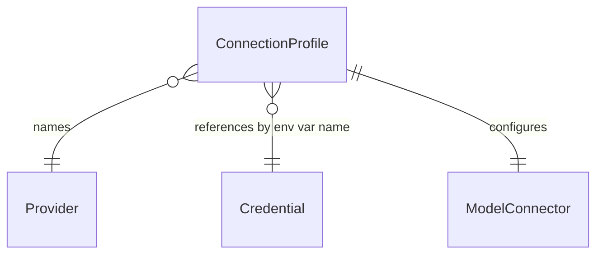

# ConnectionProfile

| Field | Value |
|---|---|
| Status | Draft |
| Introduced in | v0.1 |
| Modelled in | `Model Access:ConnectionProfile` |
| Aliases | connection, model connection, profile |
| Related | Names: `Provider` (1) · References: `Credential` (1, by env var name) · Configures: `ModelConnector` · Reaches: `TargetModel` or `JudgeModel` |

## Definition

The configuration for reaching one model: provider, model id, optional base URL, the name of the env var holding the key, timeout, retries and provider-specific options. It is plain data and never holds a secret.

## Diagram



## Attributes

| Attribute | Type | Required | Description |
|---|---|---|---|
| name | text | Yes | The role it fills: `target` or `judge`. Used in error messages. |
| provider | enum (`openai_compatible`, `anthropic`) | Yes | Which kind of connector to create. |
| model | text | Yes | The model id to request, e.g. `gpt-6.2-astra`. |
| api_key_env | text | Yes | The NAME of the environment variable that holds the key, e.g. `OPENAI_API_KEY`. |
| base_url | text | No | The provider's API address. When not set, the connector uses the provider's default. |
| timeout_s | number | No | Seconds to wait for one call. Default 60. |
| max_retries | number | No | How many times to retry a failed call. Default 0. |
| options | map | No | Provider-specific settings passed to the connector, e.g. `max_tokens`. Default empty. |

## Invariants

- Defaults are no base URL, `timeout_s` 60, `max_retries` 0 and no options (AC-001-12).
- `provider`, `model` and `api_key_env` are present and non-empty; all missing ones are reported at once (AC-001-13).
- `api_key_env` looks like a variable name (`[A-Z_][A-Z0-9_]*`). A value that looks like a pasted key is rejected and never echoed (AC-001-14).
- `base_url` is a full URL using https; plain http is allowed only for localhost (AC-001-15).
- Unknown settings are rejected, and the error lists the allowed ones (AC-001-16).
- `timeout_s` is a number greater than 0; `max_retries` is a whole number, 0 or more (AC-001-17).
- `provider` must be a known provider; the error lists the known ones (AC-001-19, AC-001-20).
- Options the chosen connector does not support are rejected (AC-001-21).
- The target profile and the judge profile are independent (AC-001-22).

## Examples

```yaml
connections:
  judge:
    provider: anthropic
    model: claude-opus-5-5
    api_key_env: ANTHROPIC_API_KEY
    timeout_s: 300
    options:
      max_tokens: 16000
```

Edge case: a local OpenAI-compatible server over plain http is allowed, because it is localhost.

```yaml
connections:
  target:
    provider: openai_compatible
    model: llama-local
    api_key_env: LOCAL_LLM_KEY
    base_url: http://localhost:8000/v1
```

## Not to be confused with

- **Credential**: the secret itself. The profile holds only the variable's name.
- **ModelConnector**: the working object built from a profile. The profile is just its settings.
- **Provider**: one field of the profile, not the whole profile.
