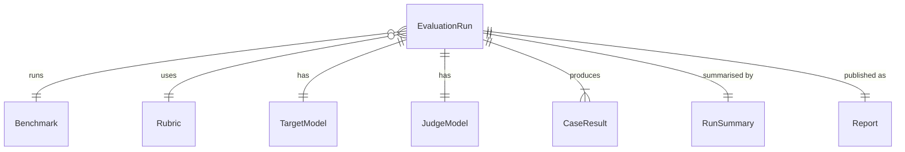
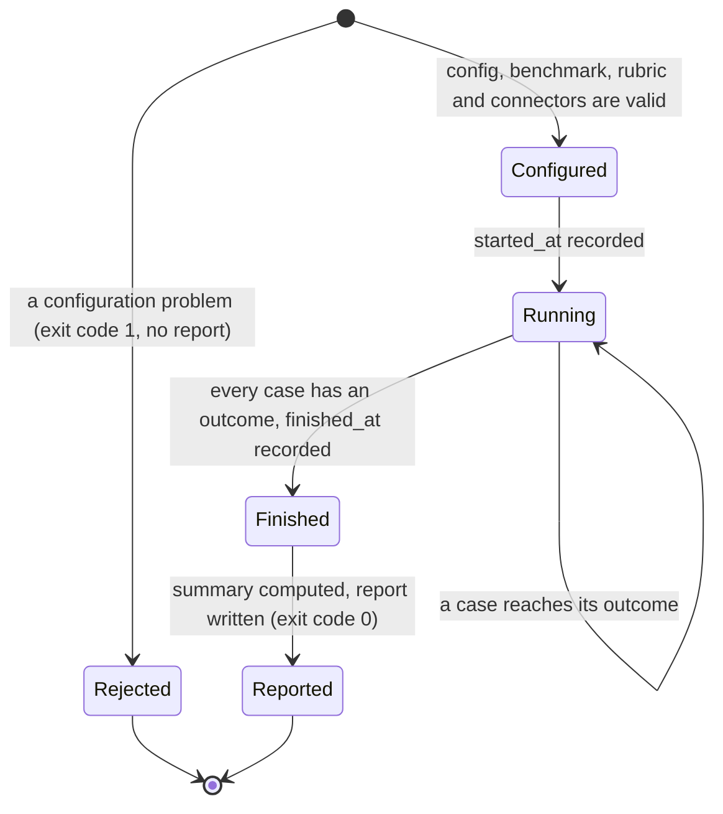

# EvaluationRun

| Field | Value |
|---|---|
| Status | Draft |
| Introduced in | v0.1 |
| Modelled in | `Evaluation:EvaluationRun` · `Reporting:RunInfo` |
| Aliases | run, evaluation |
| Related | Runs: `Benchmark` (1) · Uses: `Rubric` (1) · Has: `TargetModel` (1), `JudgeModel` (1) · Produces: `CaseResult` (1..*, one per `TestCase`) · Summarised by: `RunSummary` (1) · Published as: `Report` (1) |

## Definition

One execution of a benchmark against a target model, with a judge model and a rubric. It has its own id and its start and finish times, and it ends when every test case has an outcome.

## Diagram

Structure (one hop):



Lifecycle:



## Attributes

| Attribute | Type | Required | Description |
|---|---|---|---|
| id | text | Yes | A random unique id (32 hex characters). The first 8 go into the report's file name. |
| benchmark | `Benchmark` | Yes | What was run. |
| rubric_id | text | Yes | Which rubric the judge followed. |
| target | `TargetModel` | Yes | The model being evaluated. |
| judge | `JudgeModel` | Yes | The model doing the grading. |
| started_at | timestamp (UTC) | Yes | When the first case was sent. |
| finished_at | timestamp (UTC) | Yes | When the last case reached its outcome. |
| results | list of `CaseResult` | Yes | One per test case, in benchmark order. |

## Invariants

- A configuration problem stops the run before it starts: exit code 1, an `error:` line, and no report (AC-006-06).
- Every test case ends with exactly one case result, in order (AC-003-01, AC-006-01).
- After an auth or quota error from the target, remaining cases are not sent but still get an ERROR result (AC-003-03).
- A progress callback hears about every case (AC-003-04).
- One command runs the whole evaluation and writes exactly one report (AC-006-05).
- The config names everything a run needs; the output directory can be overridden on the command line (AC-006-07).
- Swapping target and judge needs only a config change (AC-006-11).

## Examples

What a user writes (`configs/evaluation.yaml`):

```yaml
connections:
  target: { provider: openai_compatible, model: gpt-6.2-astra, api_key_env: OPENAI_API_KEY }
  judge:  { provider: anthropic, model: claude-opus-5-5, api_key_env: ANTHROPIC_API_KEY }
benchmark:
  dataset: benchmarks/sample.json
  rubric: semantic_correctness
output:
  dir: reports
```

What the report records about the run:

```json
"run": {
  "id": "abc123ef99d04c6b8e1f2a3b4c5d6e7f",
  "started_at": "2026-11-27T09:30:00+00:00",
  "finished_at": "2026-11-27T09:30:41+00:00",
  "judgelab_version": "0.1.0"
}
```

## Not to be confused with

- **Benchmark**: the input. A run is one execution of it, with a particular target, judge and rubric.
- **JudgeEvaluation**: "evaluation" also names one judgement. A run contains many.
- **Report**: the published record of a run. The run is the activity; the report is its evidence.
- **Code note**: in v0.1 there is no single run object. The results come back as a list, and the id and times are kept in `RunInfo` for the report. See the Evaluation context's design notes.
