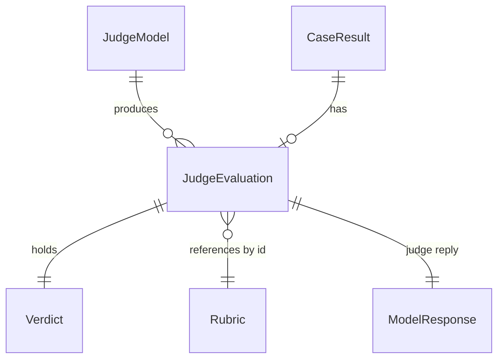

# JudgeEvaluation

| Field | Value |
|---|---|
| Status | Draft |
| Introduced in | v0.1 |
| Modelled in | `Evaluation:JudgeEvaluation` |
| Aliases | judgement, evaluation |
| Related | Produced by: `JudgeModel` · Holds: `Verdict` (1) · References: `Rubric` (by id) · Holds: `ModelResponse` (the judge's, 1) · Belongs to: `CaseResult` (0..1) |

## Definition

A validated verdict with its justification, the rubric id and the judge's ModelResponse. It is the evidence that a judge really looked at the answer and what it decided.

## Diagram



## Attributes

| Attribute | Type | Required | Description |
|---|---|---|---|
| verdict | `Verdict` (PASS, FAIL) | Yes | The judge's decision. |
| justification | text | Yes | The judge's reason, in one or two sentences. Never empty. |
| rubric_id | text | Yes | Which rubric the judge followed. |
| response | `ModelResponse` | Yes | The judge's own call: requested and served model, tokens, request id, latency. |

## Invariants

- It exists only when the judge replied with a supported verdict and a non-empty justification (AC-004-02).
- It never exists when the judge's reply was not JSON, was refused, was cut off, or the call failed (AC-004-03).
- It records the verdict, the justification, the rubric id, and both the requested and served judge model (AC-004-04).

## Examples

How it appears in a report case:

```json
{
  "verdict": "PASS",
  "justification": "The answer names Paris, which matches the expected answer.",
  "judge_call": {
    "requested_model": "claude-opus-5-5",
    "served_model": "claude-opus-5-5-20261101",
    "finish_reason": "end_turn",
    "prompt_tokens": 231,
    "completion_tokens": 28,
    "request_id": "req_01HZX",
    "latency_ms": 1420.7
  }
}
```

Edge case: when the judge replies "I think it's fine", there is no judgement. The report shows `"verdict": null`, `"judge_call": null` and an error at the `judge` stage.

## Not to be confused with

- **Verdict**: just PASS or FAIL. The judgement adds the reason and the evidence.
- **EvaluationRun**: "evaluation" is an alias for both. A judgement is about one answer; a run is the whole benchmark.
- **CaseResult**: the judgement is one part of a case result, which also holds the outcome and the target response.
