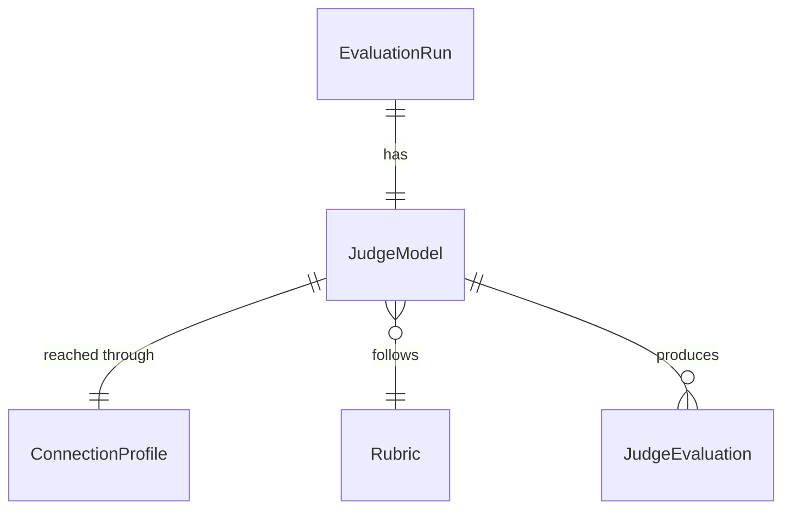

# JudgeModel

| Field | Value |
|---|---|
| Status | Draft |
| Introduced in | v0.1 |
| Modelled in | `Evaluation:Judge` · `Model Access:ModelConnector` (in the judge role) · `Reporting:RunInfo` |
| Aliases | evaluator, grader, LLM-as-a-judge |
| Related | Belongs to: `EvaluationRun` (1 per run) · Reached through: `ConnectionProfile` · Follows: `Rubric` · Produces: `JudgeEvaluation` |

## Definition

The model that decides whether an answer is correct. It reads the question, the expected answer and the target's actual answer, follows the rubric, and replies with a verdict and a justification.

## Diagram



## Attributes

| Attribute | Type | Required | Description |
|---|---|---|---|
| provider | text | Yes | Which provider hosts it, e.g. `anthropic`. From its connection profile. |
| model | text | Yes | The model id requested, e.g. `claude-opus-5-5`. |
| base_url | text | No | Where the provider's API lives, when not the default. |
| rubric | `Rubric` | Yes | The grading instructions it is given, plus the required reply format. |

## Invariants

- The judge sees the question, the expected answer and the actual answer, each in its own tag, with the rubric as instructions (AC-004-01).
- The rubric reaches every provider in that provider's own way (system message, `system` parameter, and so on) (AC-004-06).
- Only a reply with a supported verdict and a non-empty justification is accepted (AC-004-02).
- A reply that cannot be trusted (not JSON, refused, cut off, or the call failed) gives no verdict, and the case is ERROR (AC-004-03).
- Every judgement records which judge model produced it (AC-004-04).
- Switching the judge is a configuration change only (AC-004-05).

## Examples

```yaml
connections:
  judge:
    provider: anthropic
    model: claude-opus-5-5
    api_key_env: ANTHROPIC_API_KEY
    timeout_s: 300
    options:
      max_tokens: 16000
```

The reply the judge must give:

```json
{ "verdict": "PASS", "justification": "The answer names Paris, which matches the expected answer." }
```

## Not to be confused with

- **TargetModel**: produces the answers being graded. The judge only grades.
- **JudgeEvaluation**: one decision the judge made, not the judge itself.
- **Rubric**: what the judge is told to check. The judge is the model that applies it.
