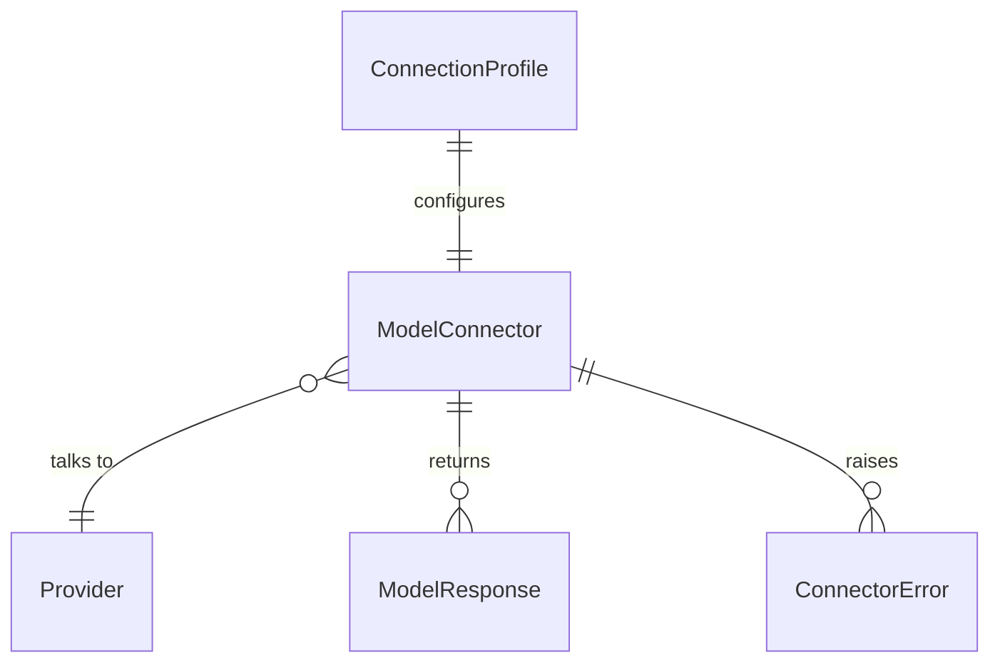

# ModelConnector

| Field | Value |
|---|---|
| Status | Draft |
| Introduced in | v0.1 |
| Modelled in | `Model Access:ModelConnector` · `Model Access:ConnectorRegistry` |
| Aliases | connector, adapter, client |
| Related | Configured by: `ConnectionProfile` (1) · Talks to: `Provider` · Uses: `Credential` · Produces: `ModelResponse` or `ConnectorError` |

## Definition

Sends one prompt (with optional instructions) to a model and returns a ModelResponse or raises a ConnectorError. Every provider has its own connector, and they all keep the same contract, so the rest of JudgeLab does not care which provider is behind it.

## Diagram



## Attributes

| Attribute | Type | Required | Description |
|---|---|---|---|
| provider | text | Yes | The provider it talks to, e.g. `anthropic`. Fixed per kind of connector. |
| model | text | Yes | The model id it requests. Must not be empty. |
| base_url | text | No | The API address it calls; the provider default when not set. |
| timeout_s | number | No | From the profile. |
| max_retries | number | No | From the profile. |

The one operation is `generate(prompt, instructions?)`.

## Invariants

- Each call returns a response with either text or a refusal set, or raises a `ConnectorError`. No other failure escapes (AC-001-09).
- Instructions are sent in the provider's own way; without instructions only the user's message is sent (AC-004-06).
- A request is not retried unless `max_retries` says so (AC-001-07).
- Its settings come only from its profile, never from provider environment variables (AC-001-02).
- Secrets never appear in its `repr`, its responses or its errors (AC-001-08).
- The fake connector answers from a script and records every prompt and instruction it receives (AC-001-10).

## Examples

What a user sees when a run starts (the connector's identity, no secrets):

```text
  target: openai_compatible gpt-6.2-astra
  judge:  anthropic claude-opus-5-5 (rubric semantic_correctness)
```

Edge case: the fake connector, given a prompt it has no scripted reply for, raises a request error so a test fails loudly.

## Not to be confused with

- **Provider**: the outside service. The connector is JudgeLab's side of the conversation.
- **ConnectionProfile**: the settings a connector is built from.
- **TargetModel / JudgeModel**: roles. The same kind of connector can serve either role.
