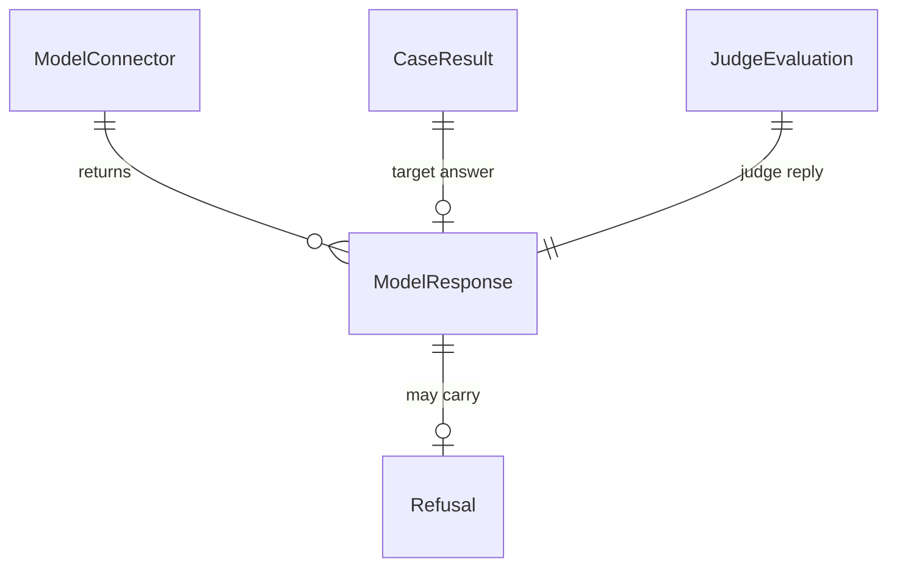

# ModelResponse

| Field | Value |
|---|---|
| Status | Draft |
| Introduced in | v0.1 |
| Modelled in | `Model Access:ModelResponse` · `Evaluation:TargetResult` |
| Aliases | model call, completion, response |
| Related | Produced by: `ModelConnector` · May carry: `Refusal` (0..1) · Belongs to: `CaseResult` (target answer, 0..1) or `JudgeEvaluation` (judge reply, 1) |

## Definition

What JudgeLab keeps from one model call: the text or the refusal, the requested and served model, the finish reason, the truncated flag, token counts, the request id and the latency. It is JudgeLab's own description of a call, the same for every provider.

## Diagram



## Attributes

| Attribute | Type | Required | Description |
|---|---|---|---|
| text | text | One of text/refusal | The model's answer. Empty when the model refused. |
| refusal | text | One of text/refusal | The model's refusal message. Empty when the model answered. |
| requested_model | text | Yes | The model id JudgeLab asked for. |
| served_model | text | Yes | The model id the provider says actually answered. It can differ from the requested one. |
| finish_reason | text | Yes | The provider's own value, e.g. `stop` or `end_turn`. |
| truncated | yes/no | Yes | True when the answer was cut off by a length limit. |
| prompt_tokens | number | No | Input tokens, when the provider reports usage. |
| completion_tokens | number | No | Output tokens, when the provider reports usage. |
| request_id | text | No | The provider's id for the call, for tracing and support tickets. |
| latency_ms | number | Yes | How long the call took, in milliseconds. |

## Invariants

- Exactly one of `text` and `refusal` is set (AC-001-03, AC-001-04, AC-001-09).
- A reply with neither text nor refusal is not a response at all; it is a response error (AC-001-05).
- Both the requested and the served model are kept (AC-001-03).
- When the provider reports no usage, both token counts are empty (AC-001-03).
- `truncated` is true exactly when the provider says the length limit was hit, for every provider (AC-001-11).
- A truncated target answer is never judged; the case is ERROR (AC-006-02).

## Examples

How one call appears in the report (`target_call` or `judge_call`):

```json
"target_call": {
  "requested_model": "gpt-6.2-astra",
  "served_model": "gpt-6.2-astra-2026-10-01",
  "finish_reason": "stop",
  "prompt_tokens": 14,
  "completion_tokens": 3,
  "request_id": "req_8f2c1a",
  "latency_ms": 812.4
}
```

The answer itself appears beside it as `"actual_answer": "Paris"` and `"refusal": null`.

Edge case: a refusal has `"actual_answer": null`, `"refusal": "I can't help with that."` and a finish reason such as `refusal`.

## Not to be confused with

- **ConnectorError**: a call that failed. A model response always means the model really replied.
- **JudgeEvaluation**: the judge's parsed decision. The judge's raw reply is a model response kept inside it.
- **CaseResult**: holds the target's response, plus everything else that happened to the case.
