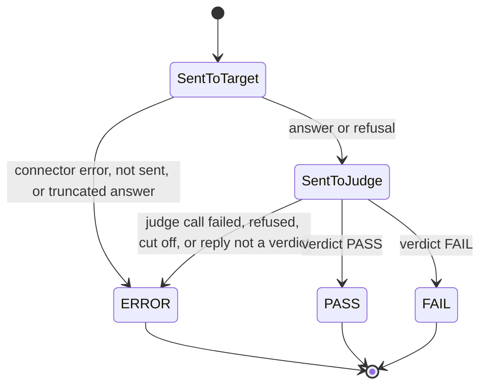

# Outcome

| Field | Value |
|---|---|
| Status | Draft |
| Introduced in | v0.1 |
| Modelled in | `Evaluation:Outcome` |
| Aliases | result status |
| Related | Belongs to: `CaseResult` (exactly 1) · Comes from: `Verdict` (PASS, FAIL) or `ConnectorError` and untrusted replies (ERROR) · Counted by: `RunSummary` |

## Definition

The final state of one case: PASS, FAIL or ERROR. ERROR means no trustworthy verdict exists, so we do not know whether the answer was right.

## Diagram

How one case reaches its outcome:



## Attributes

| Attribute | Type | Required | Description |
|---|---|---|---|
| value | enum (PASS, FAIL, ERROR) | Yes | PASS: the judge says the answer is correct. FAIL: the judge says it is wrong. ERROR: something failed before a verdict existed. |

## Invariants

- PASS or FAIL only when a judgement exists, and then equal to its verdict (AC-006-01).
- A target connector error or a truncated target answer gives ERROR at the target stage, and the case is never judged (AC-006-02).
- A judge failure gives ERROR at the judge stage, never FAIL (AC-004-03, AC-006-03).
- ERROR cases are counted in `errors`, never as failures (AC-005-02).
- Once set, it does not change.

## Examples

Progress lines the CLI prints, one per case:

```text
[1/5] gk-001: PASS
[2/5] gk-002: ERROR  (target: ConnectorUnavailableError: HTTP 503)
[3/5] gk-003: FAIL
```

## Not to be confused with

- **Verdict**: only PASS or FAIL, and only from the judge. Outcome adds ERROR for the cases where no verdict exists.
- **FAIL vs ERROR**: FAIL says "the model got it wrong". ERROR says "we could not find out". Treating an ERROR as a FAIL would blame the model for an outage.
- **CaseResult**: the whole record. The outcome is one field of it.
