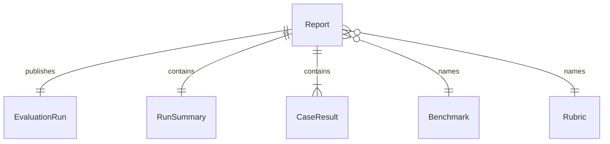

# Report

| Field | Value |
|---|---|
| Status | Draft |
| Introduced in | v0.1 |
| Modelled in | `Reporting:Report` |
| Aliases | run report, results file |
| Related | Publishes: `EvaluationRun` (1) · Contains: `RunSummary` (1), `CaseResult` (1..*) · Names: `Benchmark`, `Rubric`, `TargetModel`, `JudgeModel` |

## Definition

The JSON document (`report_version` "1") that holds a run's metadata, its summary and the evidence for every case. It is what a reviewer reads to check the verdicts, and it never contains a secret.

## Diagram



## Attributes

| Attribute | Type | Required | Description |
|---|---|---|---|
| report_version | text | Yes | The format version, `"1"` in v0.1. |
| run | object | Yes | `id`, `started_at`, `finished_at` (ISO timestamps) and `judgelab_version`. |
| benchmark | object | Yes | `id`, `name` and the number of `cases`. |
| rubric | text | Yes | The rubric id. |
| connections | object | Yes | `target` and `judge`, each with `provider`, `model` and `base_url` only. |
| summary | object | Yes | The run summary: total, passed, failed, errors, evaluated, pass_rate, coverage. |
| cases | list | Yes | One entry per case result, with its full evidence. |

## Invariants

- It records what was run, with what, and when (AC-005-05).
- Each case carries its full evidence: question, expected answer, actual answer, refusal, outcome, verdict, justification, target call, judge call and error (AC-005-04).
- It never contains a key, nor the name of the variable holding it (AC-005-06).
- It is written as UTF-8 JSON to a file named `run-<started_at as YYYYMMDDTHHMMSSZ>-<first 8 of run id>.json`; the directory is created if needed (AC-005-07).
- Exactly one report is written per run, and none when the configuration is invalid (AC-006-05, AC-006-06).

## Examples

`reports/run-20261127T093000Z-abc123ef.json`, shortened:

```json
{
  "report_version": "1",
  "run": { "id": "abc123ef99d04c6b8e1f2a3b4c5d6e7f", "started_at": "2026-11-27T09:30:00+00:00", "finished_at": "2026-11-27T09:30:41+00:00", "judgelab_version": "0.1.0" },
  "benchmark": { "id": "general-knowledge-v1", "name": "General knowledge (sample)", "cases": 5 },
  "rubric": "semantic_correctness",
  "connections": {
    "target": { "provider": "openai_compatible", "model": "gpt-6.2-astra", "base_url": "https://api.openai.com/v1" },
    "judge": { "provider": "anthropic", "model": "claude-opus-5-5", "base_url": "https://api.anthropic.com" }
  },
  "summary": { "total": 5, "passed": 4, "failed": 0, "errors": 1, "evaluated": 4, "pass_rate": 1.0, "coverage": 0.8 },
  "cases": [ { "id": "gk-001", "outcome": "PASS", "...": "..." } ]
}
```

## Not to be confused with

- **RunSummary**: only the counts. The report also holds every case's evidence.
- **EvaluationRun**: the activity. The report is the record it leaves behind.
- **CLI output**: the progress lines and totals printed to the terminal are for the developer watching; the report is the durable evidence.
