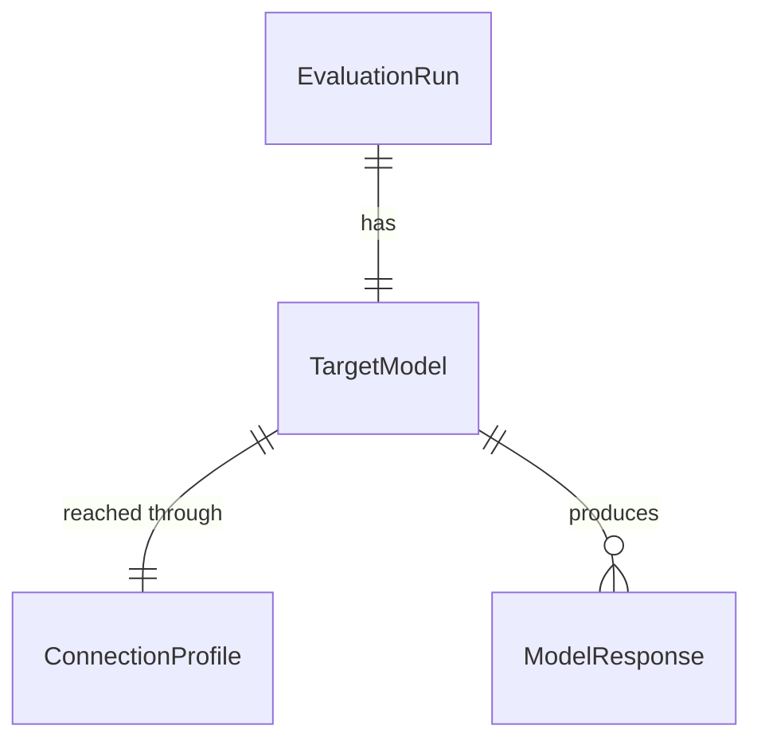

# TargetModel

| Field | Value |
|---|---|
| Status | Draft |
| Introduced in | v0.1 |
| Modelled in | `Model Access:ModelConnector` (in the target role) · `Reporting:RunInfo` |
| Aliases | system under test, SUT, candidate model |
| Related | Belongs to: `EvaluationRun` (1 per run) · Reached through: `ConnectionProfile` · Answers: `TestCase` · Produces: `ModelResponse` or `ConnectorError` |

## Definition

The model whose answers are being evaluated. JudgeLab sends it each test case's question and keeps what it says, so that the judge can grade it.

## Diagram



## Attributes

| Attribute | Type | Required | Description |
|---|---|---|---|
| provider | text | Yes | Which provider hosts it, e.g. `openai_compatible`. From its connection profile. |
| model | text | Yes | The model id requested, e.g. `gpt-6.2-astra`. |
| base_url | text | No | Where the provider's API lives, when not the default. |

## Invariants

- A run has exactly one target model, configured under `connections.target` (AC-006-07).
- Each question is sent once, in benchmark order, with no instructions (AC-003-01).
- After an auth or quota error from the target, the remaining cases are not sent (AC-003-03).
- Changing the target is a configuration change only (AC-001-22, AC-006-11).

## Examples

```yaml
connections:
  target:
    provider: openai_compatible
    model: gpt-6.2-astra
    api_key_env: OPENAI_API_KEY
    timeout_s: 60
```

In the report it appears without any key or variable name:

```json
"connections": { "target": { "provider": "openai_compatible", "model": "gpt-6.2-astra", "base_url": "https://api.openai.com/v1" } }
```

## Not to be confused with

- **JudgeModel**: grades answers; the target produces them. They can be the same provider, or even the same model id, but they are separate roles with separate profiles.
- **ConnectionProfile**: the configuration used to reach the target, not the model itself.
- **ModelConnector**: the piece of JudgeLab that talks to the target. The target is the remote model.
