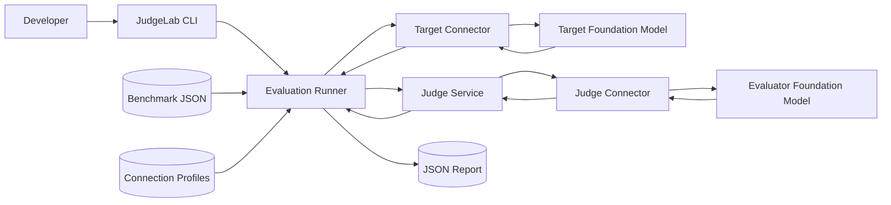
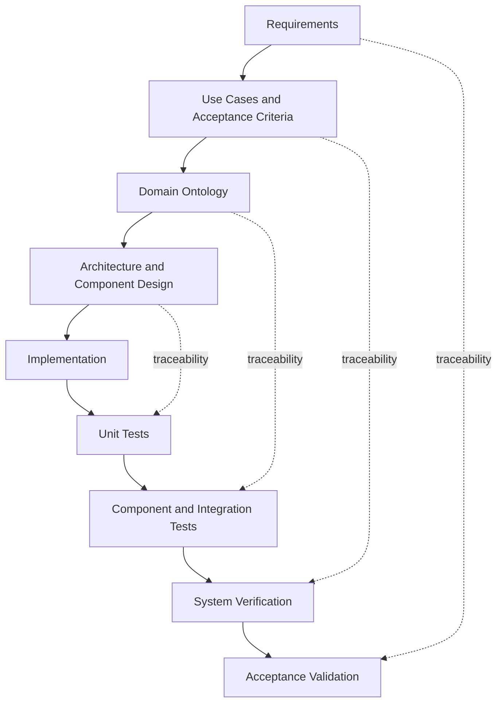
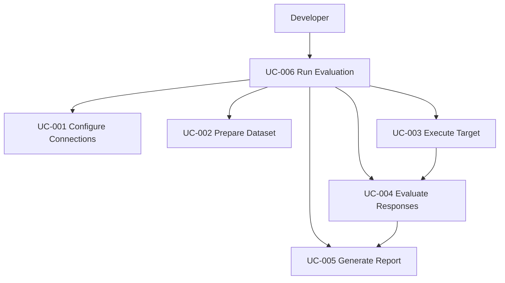
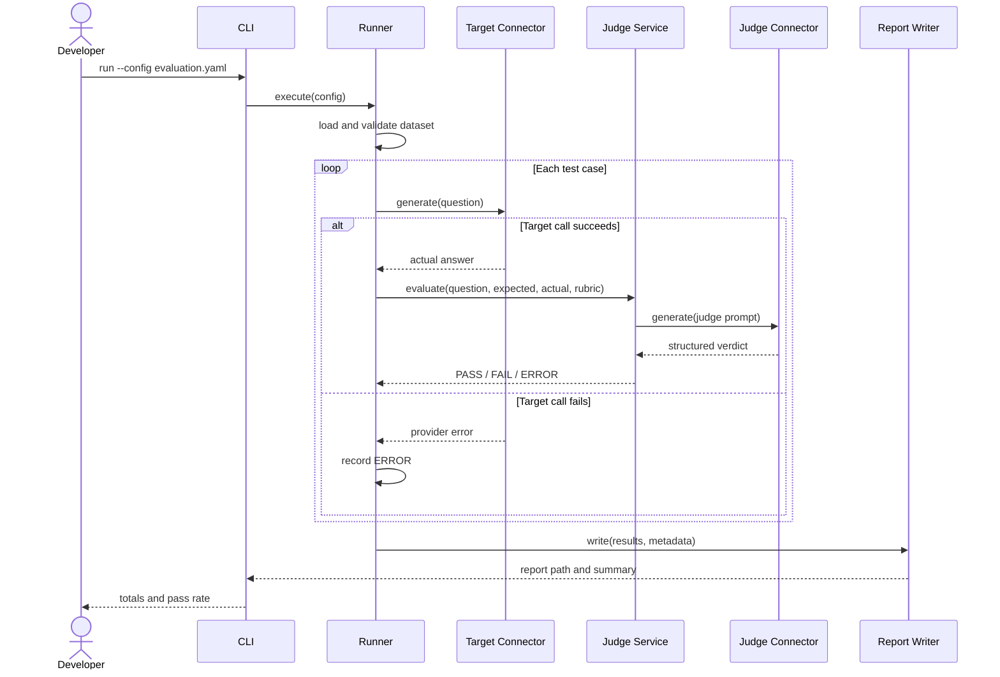
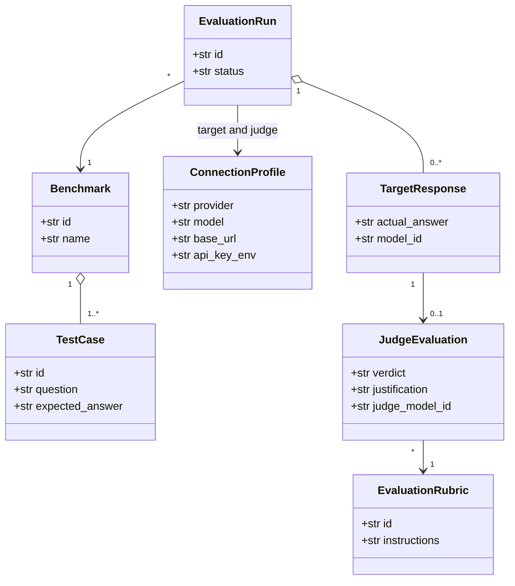
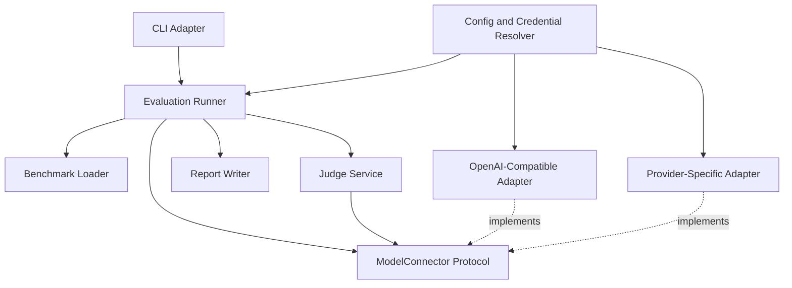
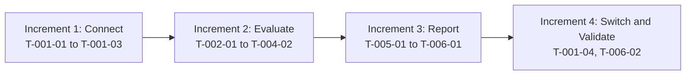
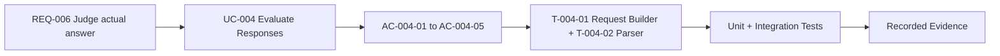

# JudgeLab v0.1 — Minimum Complete LLM Evaluation

**Status:** Proposed baseline  
**Architecture:** Python, CLI-first modular monolith  
**Method:** Lightweight V-cycle; incremental implementation by use case  
**Primary outcome:** Run a question-and-reference-answer benchmark against a configurable target foundation model, evaluate each answer with a separately configurable LLM judge, and produce a reviewable JSON report.

## 1. Scope and success criteria

**In scope:** JSON datasets, independently configurable target/judge connection profiles, API key references and optional base URLs, model inference, rubric-based PASS/FAIL judgment with justification, explicit execution errors, CLI, JSON reports, fake-connector tests, and one live end-to-end run.

**Out of scope:** web UI, plugin discovery, distributed execution, persistent database, red teaming, guardrails, statistical judge calibration, and advanced scheduling.



### Release acceptance

- Run a dataset of at least five cases from the CLI.
- Switch the target and judge independently via configuration.
- Use API keys from environment variables; never persist secrets in reports.
- Record question, expected answer, actual answer, rubric identifier, verdict, justification, and model identities.
- Distinguish `PASS`, `FAIL`, and `ERROR` (including failed inference and malformed judge output).
- Produce totals for passed, failed, errors, and successfully evaluated cases.
- Calculate `pass_rate = passed / (passed + failed)` when the denominator is nonzero; report the error count and coverage separately. Never silently treat errors as failures or exclude them without disclosure.
- Pass unit and fake-connector integration tests and manually inspect one live run.

## 2. V-cycle development process

Plan the whole V-cycle before implementation, but execute it incrementally for each use case.



Every task records: requirement IDs, acceptance criteria, design choices, code changes, test evidence, AI assistance level, DSA/GoF learning, and retrospective notes.

## 3. Requirements baseline

| ID | Requirement | Priority |
|---|---|---|
| REQ-001 | Load benchmark cases with question and expected answer | Must |
| REQ-002 | Validate records, including required fields and unique IDs | Must |
| REQ-003 | Configure target and judge independently | Must |
| REQ-004 | Support provider, model ID, optional base URL, and API-key environment reference | Must |
| REQ-005 | Obtain actual answers from the target model | Must |
| REQ-006 | Judge actual answers against question, reference, and rubric | Must |
| REQ-007 | Parse and validate verdict and justification | Must |
| REQ-008 | Distinguish execution/parse errors from negative verdicts | Must |
| REQ-009 | Calculate transparent aggregate metrics and error coverage | Must |
| REQ-010 | Persist per-case evidence and execution metadata as JSON | Must |
| REQ-011 | Expose end-to-end execution through a CLI | Must |
| REQ-012 | Support deterministic tests with fake connectors | Must |
| REQ-013 | Keep secrets out of logs, errors, and reports | Must |

## 4. Use-case model

| ID | Use case | Outcome |
|---|---|---|
| UC-001 | Configure model connections | Valid target and judge profiles |
| UC-002 | Prepare benchmark dataset | Validated test cases |
| UC-003 | Execute target model | Captured actual answers |
| UC-004 | Evaluate responses | Structured judge verdicts |
| UC-005 | Generate report | JSON evidence and summary |
| UC-006 | Run complete evaluation | Orchestrated CLI workflow |



### UC-004: Evaluate responses

**Preconditions:** Valid test case, target response, rubric, and judge connector.  
**Trigger:** A target response is available.  
**Main flow:** Assemble judge request → invoke evaluator → parse structured output → validate verdict → record result.  
**Alternative flows:** Invalid judge output, authentication failure, timeout, provider error.  
**Postcondition:** A validated judge evaluation or an explicit error record exists.

**Acceptance criteria** (as first planned; the maintained version, written as Gherkin scenarios, is [UC-004.feature](../../usecases/UC-004-evaluate-responses/UC-004.feature)):

- AC-004-01: Include question, expected answer, actual answer, and rubric in the judge request.
- AC-004-02: Accept only supported verdict values and a nonempty justification.
- AC-004-03: Invalid output becomes `ERROR`, never `FAIL`.
- AC-004-04: Record evaluator provider/model identity.
- AC-004-05: Switching the judge profile does not change benchmark data or the use-case logic.



## 5. Domain ontology

| Concept | Meaning |
|---|---|
| Benchmark | Named collection of test cases |
| TestCase | Question and expected answer |
| ConnectionProfile | Provider/model/endpoint configuration and credential reference |
| ModelConnector | Interface for invoking an inference API |
| TargetResponse | Actual answer from system under test |
| EvaluationRubric | Instructions defining acceptable answers |
| JudgeEvaluation | Verdict, justification, judge identity, and error if any |
| EvaluationRun | A single execution with configuration and timestamps |
| EvaluationReport | Aggregate metrics and case-level evidence |



## 6. Architecture and interfaces



Start with a single OpenAI-compatible connector and a fake connector for tests. Add a second provider-specific adapter only when it demonstrates a real protocol difference. Keep connection profiles separate from connector implementations.

**Proposed configuration (JudgeLab-specific, not a Moonshot schema):**

```yaml
connections:
  target:
    provider: openai_compatible
    model: target-model
    base_url: https://target.example.com/v1
    api_key_env: TARGET_API_KEY
  judge:
    provider: openai_compatible
    model: judge-model
    base_url: https://judge.example.com/v1
    api_key_env: JUDGE_API_KEY
benchmark:
  dataset: benchmarks/sample.json
  rubric: semantic_correctness
```

For v0.1, only run trusted local configuration; do not expose arbitrary URL submission to untrusted users. Validate schemes and restrict destinations if remote configuration is introduced later.

## 7. Work breakdown structure

| Task | UC | Deliverable | Verification |
|---|---|---|---|
| T-001-01 | UC-001 | Connection profile model | Config validation tests |
| T-001-02 | UC-001 | Credential resolution | Missing key and secret-redaction tests |
| T-001-03 | UC-001 | First live model connector | Fake HTTP + live smoke test |
| T-001-04 | UC-001 | Independent model switching | Switch-profile integration test |
| T-002-01 | UC-002 | JSON dataset loader | Valid/malformed file tests |
| T-002-02 | UC-002 | Test-case validation | Missing field/duplicate ID tests |
| T-003-01 | UC-003 | Target inference | Captured response test |
| T-004-01 | UC-004 | Judge request builder | Rubric/reference propagation tests |
| T-004-02 | UC-004 | Verdict parser | PASS/FAIL/invalid response tests |
| T-005-01 | UC-005 | Aggregate calculations | Pass/fail/error/zero denominator tests |
| T-005-02 | UC-005 | JSON report writer | Schema and metadata tests |
| T-006-01 | UC-006 | CLI and orchestration | End-to-end fake connector test |
| T-006-02 | UC-006 | Live end-to-end benchmark | Five-case report and manual review |
| T-001-05 | UC-001 | Anthropic (Claude) connector | Fake HTTP + contract tests + live smoke test |

### Incremental delivery



**Estimate:** 9–15 focused implementation sessions, plus DSA repetition and documentation. This is a planning estimate, not a deadline.

## 8. Verification and validation

| Level | Verification question | Evidence |
|---|---|---|
| Unit | Do validation and parsing functions behave correctly? | pytest results |
| Component | Does the connector obey its contract? | Fake HTTP tests |
| Integration | Can the runner coordinate fake target/judge connectors? | End-to-end fake run |
| System | Can the CLI produce a complete report? | CLI transcript and report |
| Acceptance | Are the results useful and interpretable? | Human review of five-case benchmark |

### Initial traceability matrix

| Requirement(s) | Use case(s) | Task(s) | Verification |
|---|---|---|---|
| REQ-001, REQ-002 | UC-002 | T-002-01, T-002-02 | Dataset tests |
| REQ-003, REQ-004, REQ-013 | UC-001 | T-001-01 to T-001-04 | Config, connector, secret tests |
| REQ-005 | UC-003 | T-003-01 | Target response test |
| REQ-006, REQ-007 | UC-004 | T-004-01, T-004-02 | Judge contract tests |
| REQ-008 | UC-004, UC-006 | T-004-02, T-006-01 | Error-path tests |
| REQ-009, REQ-010 | UC-005 | T-005-01, T-005-02 | Report tests |
| REQ-011, REQ-012 | UC-006 | T-006-01, T-006-02 | CLI and system tests |



## 9. DSA and GoF learning ledger

| Tasks | Concept | Practice |
|---|---|---|
| T-001-01 | Dictionaries, key lookup | Frequency counting and Two Sum |
| T-001-03 to T-001-04 | Adapter, Python Protocol, dependency inversion | Compare two connector implementations |
| T-002-01 to T-002-02 | Lists, sets, iteration | Contains Duplicate and array traversal |
| T-004-01 to T-004-02 | Parsing and state modeling | Edge cases and malformed inputs |
| T-005-01 | Aggregation and complexity | Single-pass counting |
| T-006-01 | Test doubles and dependency inversion | Replace real connectors with fakes |

**Learning loop:** Learn → Implement → Apply → Solve an unfamiliar exercise → Review → Reimplement.

**Review cadence:** Day 1, 3, 7, 14, 30 (adjust based on recall). Record date, problem, elapsed time, independent/hinted solution, mistakes, and next review date. For GoF patterns, document the original design, refactored design, trade-offs, and reasons to reject the pattern when unnecessary.

## 10. Release documentation and execution log

```text
judgelab/
├── src/judgelab/
├── tests/
├── benchmarks/
├── configs/
├── learning/
│   ├── dsa/
│   ├── patterns/
│   └── reviews/
└── docs/releases/v0.1/
    ├── README.md
    ├── 01-requirements.md
    ├── 02-usecases.md
    ├── 03-ontology.md
    ├── 04-analysis-design.md
    ├── 05-verification-plan.md
    ├── 06-traceability.md
    ├── 07-release-report.md
    ├── usecases/
    │   ├── UC-001-connections.md
    │   ├── UC-002-benchmarks.md
    │   ├── UC-003-target-execution.md
    │   ├── UC-004-judge-evaluation.md
    │   ├── UC-005-reporting.md
    │   └── UC-006-run-evaluation.md
    └── tasks/
        ├── T-001-01-connection-profile.md
        ├── T-001-02-credential-resolution.md
        └── ...
```

**Minimal task log:** Task ID, owner, start/end date, requirements/AC, design decision, implementation notes, tests and evidence, DSA/GoF concepts, AI assistance level, lessons learned, next review.

## 11. Release gates

1. **Requirements baseline:** Scope, IDs, and acceptance criteria reviewed.
2. **Design baseline:** Use cases, ontology, interfaces, and key trade-offs documented.
3. **Implementation:** All must-have capabilities work through the CLI.
4. **Verification:** Unit, component, integration, and system tests pass.
5. **Validation:** One real benchmark executed and results manually reviewed.
6. **Learning review:** Independent coding, DSA, GoF, and assistance records updated.

## 12. First hands-on session

**T-001-01 — Connection Profile**

1. Review REQ-003, REQ-004, and REQ-013.
2. Define valid/invalid provider, model, base URL, and credential-reference inputs.
3. Write acceptance and unit tests before implementation.
4. Implement the profile independently in Python.
5. Record test evidence, complexity notes, and assistance level.

**Next:** T-001-02 credential resolution, then T-001-03 the first real foundation-model request.
