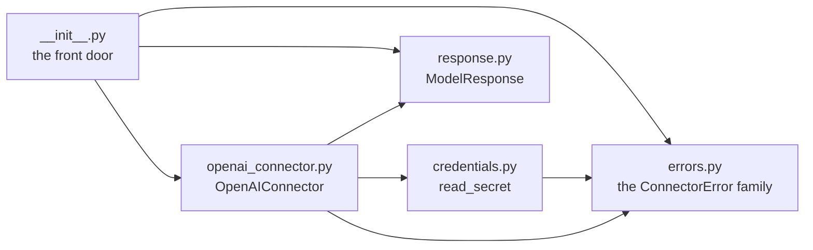
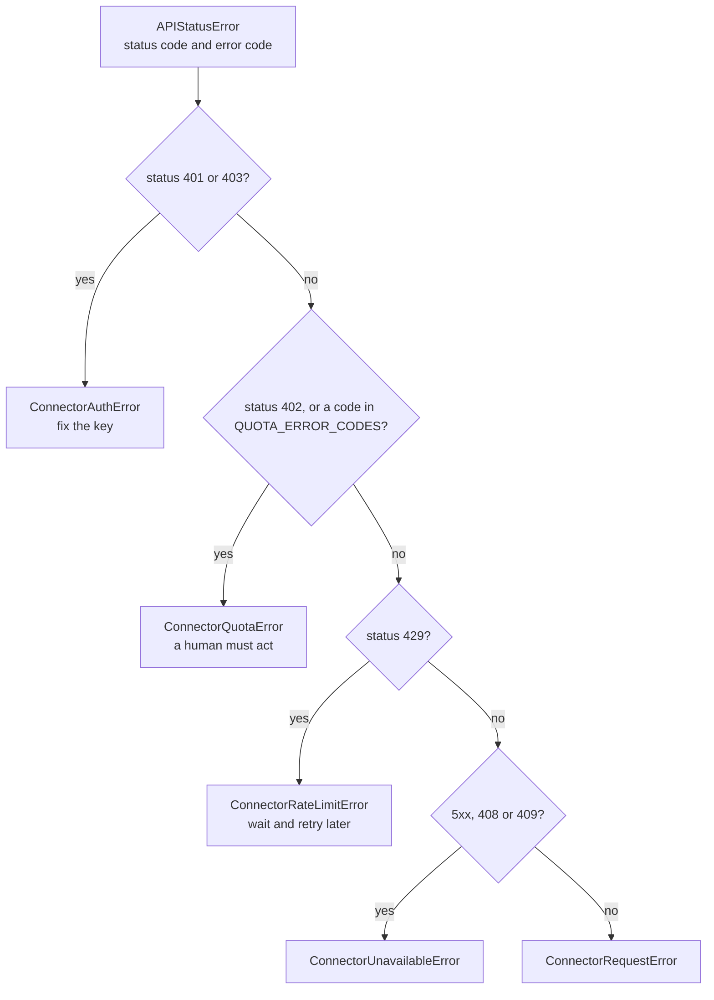
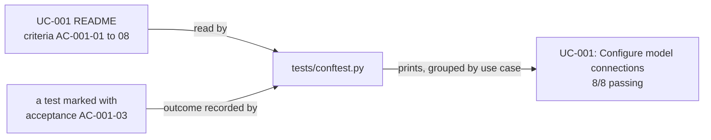

# Codealong 2: The Connector, Properly Built

In the first codealong you built a working OpenAI connector in a notebook. Notebooks are great for exploring, but they are not a good home for code that the rest of a project depends on: nothing imports from them, nothing tests them automatically, and a cell you forgot to re-run can make you believe something that is no longer true. In this codealong you are going to move the connector into the `judgelab.connectors` package, cover it with pytest tests that run in under a second without touching the network, and fix a real problem with error handling that we found after chapter 1 was written.

By the end you will have a `judgelab.connectors` package with five small modules, a test suite of 29 tests, and a pytest plugin that prints, after every run, a table showing which of the use case's acceptance criteria pass. That table is going to follow you for the rest of the project.

> **AI-Assist level:** this is a guided codealong, so record this work as **AI-Assist L4**.

## 2.1 Before You Start

Every unit of work in JudgeLab lives on its own short-lived branch (the rules are in [CONTRIBUTING.md](../../CONTRIBUTING.md)). This one implements task T-001-03, the first live model connector, and belongs to phase 1 of the roadmap. Starting from an up-to-date `main`, create the branch:

```bash
$ git switch main && git pull --ff-only && git switch -c feat/p1-openai-connector-T-001-03
```

Before going further, it's worth knowing where this task sits in the project's documents, because you are going to edit some of them in the next section. JudgeLab's docs describe the work in three layers:

- A **use case** is a goal a user has. This chapter belongs to **UC-001 Configure model connections**: a developer wants JudgeLab to talk to the target and judge models they choose. Each use case is a folder, here `docs/usecases/UC-001-configure-model-connections/`, and its `README.md` holds the flows of the use case, its acceptance criteria and a list of its slices.
- The **acceptance criteria** describe the use case's observable behaviour, one checkable sentence each. They are defined in the use case's README, and nowhere else.
- A **task** is the work that delivers a *slice* of the use case: a thin, end-to-end piece that makes some of its criteria pass. T-001-03 is one slice of UC-001, and its task file lives in the same folder as the use case. Task IDs are numbered within their use case, like the criteria: T-001-03 is task 3 of UC-001.

UC-001 has other slices (connection profiles, credentials, switching models) that you will build in chapter 5. T-001-03 is the slice that gets one real connector working end to end, and it is delivered over two chapters: this one and the next.

The notebook from chapter 1 is a useful reference to have open next to you, because a lot of what you are going to type is that code, cleaned up. Where something changes, I will tell you why.

As before, I strongly recommend that you type the code yourself. There is a lot more of it in this chapter, but the tests in particular are worth typing, because writing them is how you learn to write the next ones.

## 2.2 Requirements First

Before writing any code, let's write down what "done" means. JudgeLab follows a V-model style of working: a requirement comes first, then a test that checks it, and only then the code that makes the test pass. Here the requirements are acceptance criteria, and they belong to the use case, not to the task, because they describe what UC-001 does for its user, whichever slice happens to deliver them.

Open [docs/usecases/UC-001-configure-model-connections/README.md](../../docs/usecases/UC-001-configure-model-connections/README.md). Under `## Acceptance criteria` there is only a comment showing the format. Add these eight criteria below the comment:

_docs/usecases/UC-001-configure-model-connections/README.md_: The first eight acceptance criteria

```markdown
## Acceptance criteria

<!-- Observable behaviour, one line each: - [ ] **AC-UUU-NN**: ... (UUU = this use case's number). Tests are marked with these IDs. -->
- [ ] **AC-001-01**: A missing, empty or whitespace-only API-key variable raises an auth error that names the variable and contains no secret.
- [ ] **AC-001-02**: A connector is configured only from its arguments: provider environment variables such as `OPENAI_API_KEY`, `OPENAI_BASE_URL`, `ANTHROPIC_API_KEY`, `ANTHROPIC_AUTH_TOKEN` and `ANTHROPIC_BASE_URL` have no effect.
- [ ] **AC-001-03**: A successful reply returns the answer text, the requested and served model, the finish reason, token counts and the request id.
- [ ] **AC-001-04**: A refusal is returned as a response, not raised as an error.
- [ ] **AC-001-05**: A reply that cannot be trusted (wrong type, no choices, or no answer and no refusal) raises a response error.
- [ ] **AC-001-06**: Provider failures map to JudgeLab errors: bad credentials to auth; out of credit or over a spend limit to quota; too many requests to rate limit; timeouts, connection failures and server errors to unavailable; other rejected requests to request.
- [ ] **AC-001-07**: No request is retried unless retries are configured.
- [ ] **AC-001-08**: The API key never appears in a connector's repr or in any error message.
```

Most of these are the lessons of chapter 1, written as sentences that can be checked. AC-001-06 contains something new, "out of credit or over a spend limit to quota", which you are going to learn about in section 2.8.

Notice that the criteria talk about "a connector" and "provider failures", not about OpenAI and HTTP status codes. That is because they belong to the use case, and UC-001 will have more than one connector: the Claude connector of chapter 4 will be held to the same sentences, which is why AC-001-02 already names the Anthropic variables. How a particular provider signals "out of credit" is a detail for that provider's connector and its tests.

Each criterion has an ID in bold, such as `**AC-001-01**:`, made of the use case number and a criterion number within it. You don't have to work out the next free number yourself; the docs script prints it:

```bash
$ python3 .claude/skills/vbench-docs/scripts/docids.py next AC --usecase UC-001
AC-001-01
```

This exact format matters, because later in this chapter you are going to write a small pytest plugin that reads these lines out of the use case files and reports on them. The IDs also give every test a precise thing to point at: instead of a vague "tests the connector", a test will say "I verify AC-001-06".

The task file says which of these criteria its slice delivers. Open [docs/usecases/UC-001-configure-model-connections/T-001-03-first-live-model-connector.md](../../docs/usecases/UC-001-configure-model-connections/T-001-03-first-live-model-connector.md). Under `## Objective` there is nothing yet, and under `## Delivers` there is a comment and an empty bullet. Fill in the objective, and replace the comment and the bullet with the IDs of the eight criteria:

_docs/usecases/UC-001-configure-model-connections/T-001-03-first-live-model-connector.md_: Objective and delivered criteria

```markdown
## Objective

Send one prompt to an OpenAI-compatible Chat Completions endpoint and return the answer, the model identity and the call metadata in JudgeLab's own types, turning every failure into a JudgeLab connector error.

## Delivers

- AC-001-01
- AC-001-02
- AC-001-03
- AC-001-04
- AC-001-05
- AC-001-06
- AC-001-07
- AC-001-08
```

The task file lists only the IDs. The sentences themselves stay in the use case README, so there is exactly one place where each criterion is worded, and no second copy to drift out of date.

Finally, go back to the use case README and find the `## Slices` table at the bottom. It has one row per task, and the "Delivers" column of T-001-03's row is empty. Fill it with the same list, so that someone reading the use case can see at a glance which slice delivers which criteria:

_docs/usecases/UC-001-configure-model-connections/README.md_: T-001-03's row in the Slices table

```markdown
| [T-001-03](T-001-03-first-live-model-connector.md) | First live model connector | AC-001-01, AC-001-02, AC-001-03, AC-001-04, AC-001-05, AC-001-06, AC-001-07, AC-001-08 | Todo |
```

There is one more link to make. The release plan lists JudgeLab's requirements, and each one has its own file in `docs/requirements/`. A requirement says *what is needed*, for example REQ-013, "Keep secrets out of logs, errors, and reports". The use case's criteria say *how we'll know* it is met. Each requirement file has a `## Verified by` section that connects the two, listing the IDs of the criteria that prove it. Only the IDs, for the same reason the task file lists only IDs: the text of a criterion lives in one place, its use case.

Two requirements are proven by the criteria you just wrote. REQ-005, "Obtain actual answers from the target model", is verified by the criteria about replies, refusals, failures and retries. Open [docs/requirements/REQ-005.md](../../docs/requirements/REQ-005.md) and replace the empty bullet under `## Verified by` with their IDs:

_docs/requirements/REQ-005.md_: The criteria that verify REQ-005

```markdown
## Verified by

<!-- IDs of the use-case acceptance criteria (AC-UUU-NN) that prove this requirement; their text lives in the use case. -->

- AC-001-03
- AC-001-04
- AC-001-05
- AC-001-06
- AC-001-07
```

REQ-013 is verified by the three criteria about keys. Do the same in [docs/requirements/REQ-013.md](../../docs/requirements/REQ-013.md):

_docs/requirements/REQ-013.md_: The criteria that verify REQ-013

```markdown
## Verified by

<!-- IDs of the use-case acceptance criteria (AC-UUU-NN) that prove this requirement; their text lives in the use case. -->

- AC-001-01
- AC-001-02
- AC-001-08
```

A requirement can be verified by criteria from more than one use case. Keeping secrets out of reports, for example, is something UC-005 and UC-006 will have to prove as well, so REQ-013's list is going to grow in later chapters.

## 2.3 One Module, One Job

In the notebook, everything lived in a couple of cells. In the package, I'm going to split the code into five modules, so that each file has exactly one job:

```text
src/judgelab/connectors/
    __init__.py            the package's public names
    response.py            ModelResponse, the result of one call
    errors.py              the ConnectorError family
    credentials.py         read_secret(), the only place a secret is read
    openai_connector.py    OpenAIConnector and its error translation
```

This is how the modules of the package depend on each other:



Why bother? Think of who is going to import these. The evaluation runner, which you will write in a later chapter, needs `ModelResponse` and the errors, but has no business knowing that OpenAI exists. The Claude connector of chapter 4 needs the same response, errors and credentials, but none of the OpenAI code. When each concept lives in its own module, every consumer imports exactly what it needs, and a change to the OpenAI module can't accidentally break something that never imported it.

The `__init__.py` file is the front door. It re-exports the public names, so that the rest of JudgeLab writes `from judgelab.connectors import ModelResponse` and doesn't need to know which module a name lives in. If I ever move a class to a different file, only `__init__.py` changes.

Create the `src/judgelab/connectors` directory now. You are going to fill it in the order of dependencies, starting with the modules that don't import anything from JudgeLab.

## 2.4 The Response

The `ModelResponse` class is exactly the one from the notebook, with docstrings added.

_src/judgelab/connectors/response.py_: The result of one model call

```python
"""The result of one model call, in JudgeLab's own terms."""

from dataclasses import dataclass


@dataclass(frozen=True)
class ModelResponse:
    """What JudgeLab keeps from one model call.

    Either `text` or `refusal` is set. A refusal is a real model outcome
    (the judge decides whether refusing was right), not an error.
    """

    text: str | None
    refusal: str | None
    requested_model: str
    served_model: str
    finish_reason: str
    prompt_tokens: int | None
    completion_tokens: int | None
    request_id: str | None
    latency_ms: float
```

The docstring writes down a promise that, in the notebook, only existed in your head: either `text` or `refusal` is set. Code that receives a `ModelResponse` can rely on that, because the connector refuses to build one otherwise (you saw this in section 1.6 of the first codealong). The note about the judge is a hint of things to come: in chapter 8 an LLM judge will look at refusals and decide whether refusing was the right call.

## 2.5 The Error Family, Now With Quota

Next come the errors. The family from chapter 1 is still here, plus one new member, `ConnectorQuotaError`.

_src/judgelab/connectors/errors.py_: The connector errors

```python
"""Connector errors: a call failed, so we don't know what the model did (ERROR)."""


class ConnectorError(Exception):
    """Base class for every connector failure.

    Messages carry the status code, the provider's short error code and the
    request id, but never the API key or the provider's free-text message,
    which can echo part of the key.
    """

    def __init__(
        self, message: str, *, status_code: int | None = None, request_id: str | None = None
    ) -> None:
        super().__init__(message)
        self.status_code = status_code
        self.request_id = request_id


class ConnectorAuthError(ConnectorError):
    """Missing, invalid or unauthorised credentials. Fix the configuration."""


class ConnectorQuotaError(ConnectorError):
    """Out of credit or over a spend limit. Every call will fail until a human acts."""


class ConnectorRateLimitError(ConnectorError):
    """Too many requests. Retrying later may help."""


class ConnectorUnavailableError(ConnectorError):
    """Timeout, connection failure or server error. Retrying may help."""


class ConnectorRequestError(ConnectorError):
    """The provider rejected the request itself, e.g. an unknown model."""


class ConnectorResponseError(ConnectorError):
    """The provider replied, but not with something we can trust as an answer."""
```

In the notebook, the subclasses were one-liners with `...` as their body. Here each one has a docstring instead (a docstring is a valid class body on its own, so no `...` is needed). Read the docstrings as a group and you will notice that each one answers the question "what should the caller do about it?". An auth error means fix the configuration. A rate limit or an unavailable server means retrying may help. A request error means the request itself is wrong, so retrying the same thing will fail the same way.

The new `ConnectorQuotaError` is the one that says "every call will fail until a human acts". Running out of credit is not the same thing as sending requests too fast, and section 2.8 shows why that difference turned out to matter.

The module docstring also says something about what an error *means* for an evaluation: when a call fails, we don't know what the model did. That is a different outcome from the model answering badly, and JudgeLab will keep the two apart when it scores results.

## 2.6 Reading Secrets in One Place

In the notebook, the connector's constructor called `os.environ.get()` itself. In the package, I'm going to move that into its own small function, so that there is exactly one place in JudgeLab where a secret is read.

_src/judgelab/connectors/credentials.py_: Reading a secret

```python
"""Credential resolution: the only place JudgeLab reads a secret."""

import os

from judgelab.connectors.errors import ConnectorAuthError


def read_secret(env_name: str) -> str:
    """Return the value of the environment variable named `env_name`.

    Errors name the variable, never a value.
    """
    value = os.environ.get(env_name, "").strip()
    if not value:
        raise ConnectorAuthError(f"environment variable {env_name} is not set")
    return value
```

Having a single function for this has two benefits. First, there is only one place to audit when you want to know how secrets are handled. If a code review ever finds `os.environ` being read somewhere else in connection with a key, something is wrong. Second, the Claude connector of chapter 4 will use the same function and get the same behaviour for free.

The `.strip()` call fixes a subtle problem. A key that was pasted into a `.env` file with a trailing space, or a variable that is set to only spaces, would otherwise be sent to the provider as-is, and you would get a confusing 401 from the server. With `.strip()`, a blank variable is treated exactly like a missing one, and the stray whitespace around a real key is removed.

As in chapter 1, the error message names the variable and never shows a value. You can try the function from a Python shell started with `uv run python`:

```python
>>> import os
>>> from judgelab.connectors.credentials import read_secret
>>> os.environ['MY_KEY'] = '  sk-abc  \n'
>>> read_secret('MY_KEY')
'sk-abc'
>>> read_secret('NOPE_NOT_SET')
ConnectorAuthError: environment variable NOPE_NOT_SET is not set
```

Credential handling is its own slice of UC-001, task T-001-02, and you are going to give it formal acceptance criteria in chapter 5. The function is born here because the connector needs it now.

## 2.7 The OpenAI Connector

Now you are ready for the connector itself. This is the biggest file in this chapter, but most of it should look familiar.

_src/judgelab/connectors/openai_connector.py_: The OpenAI connector

```python
"""A connector for OpenAI-compatible Chat Completions endpoints.

References:
* SDK defaults, retries, timeouts, errors, request IDs:
  https://github.com/openai/openai-python
* Request and response shape:
  https://developers.openai.com/api/reference/resources/chat
* Error codes, including billing errors sent as HTTP 429:
  https://developers.openai.com/api/docs/guides/error-codes
"""

import time

import openai
from openai import OpenAI
from openai.types.chat import ChatCompletion

from judgelab.connectors.credentials import read_secret
from judgelab.connectors.errors import (
    ConnectorAuthError,
    ConnectorError,
    ConnectorQuotaError,
    ConnectorRateLimitError,
    ConnectorRequestError,
    ConnectorResponseError,
    ConnectorUnavailableError,
)
from judgelab.connectors.response import ModelResponse

OPENAI_DEFAULT_BASE_URL = "https://api.openai.com/v1"

# HTTP 429 responses that mean "out of credit or over a limit", not "slow down".
QUOTA_ERROR_CODES = {
    "insufficient_quota",
    "credit_balance_exhausted",
    "organization_spend_limit_exceeded",
    "project_spend_limit_exceeded",
    "organization_usage_limit_exceeded",
}


class OpenAIConnector:
    """Sends one prompt to an OpenAI-compatible Chat Completions endpoint."""

    def __init__(
        self,
        *,
        model: str,
        api_key_env: str,
        base_url: str | None = None,
        timeout_s: float = 60.0,
        max_retries: int = 0,
        http_client=None,
    ) -> None:
        self.model = model
        self.base_url = base_url or OPENAI_DEFAULT_BASE_URL
        self._client = OpenAI(
            api_key=read_secret(api_key_env),
            base_url=self.base_url,
            timeout=timeout_s,
            max_retries=max_retries,
            http_client=http_client,
        )

    def __repr__(self) -> str:
        return f"OpenAIConnector(model={self.model!r}, base_url={self.base_url!r})"

    def generate(self, prompt: str) -> ModelResponse:
        messages = [{"role": "user", "content": prompt}]

        start = time.perf_counter()
        try:
            completion = self._client.chat.completions.create(model=self.model, messages=messages)
        except openai.APIError as e:
            raise translate_error(e) from e
        latency_ms = (time.perf_counter() - start) * 1000

        if not isinstance(completion, ChatCompletion):
            raise ConnectorResponseError(
                f"expected a chat completion, got {type(completion).__name__}"
            )
        request_id = completion._request_id
        if not completion.choices:
            raise ConnectorResponseError("response has no choices", request_id=request_id)
        choice = completion.choices[0]
        if choice.message.content is None and choice.message.refusal is None:
            raise ConnectorResponseError(
                "response has neither content nor refusal", request_id=request_id
            )

        usage = completion.usage
        return ModelResponse(
            text=choice.message.content,
            refusal=choice.message.refusal,
            requested_model=self.model,
            served_model=completion.model,
            finish_reason=choice.finish_reason,
            prompt_tokens=usage.prompt_tokens if usage else None,
            completion_tokens=usage.completion_tokens if usage else None,
            request_id=request_id,
            latency_ms=latency_ms,
        )


def translate_error(e: openai.APIError) -> ConnectorError:
    """Map the SDK's exception family onto JudgeLab's."""
    if isinstance(e, openai.APIConnectionError):  # includes APITimeoutError
        kind = "timed out" if isinstance(e, openai.APITimeoutError) else "connection failed"
        return ConnectorUnavailableError(f"request {kind}")
    if isinstance(e, openai.APIStatusError):
        status, request_id, code = e.status_code, e.request_id, e.code
        detail = f"HTTP {status}" + (f" ({code})" if code else "")
        kwargs = {"status_code": status, "request_id": request_id}
        if status in (401, 403):
            return ConnectorAuthError(detail, **kwargs)
        if status == 402 or code in QUOTA_ERROR_CODES:
            return ConnectorQuotaError(detail, **kwargs)
        if status == 429:
            return ConnectorRateLimitError(detail, **kwargs)
        if status >= 500 or status in (408, 409):
            return ConnectorUnavailableError(detail, **kwargs)
        return ConnectorRequestError(detail, **kwargs)
    return ConnectorResponseError(f"unexpected SDK error: {type(e).__name__}")
```

The module docstring lists the documents this code is based on. When somebody (including future you) wonders why the connector does something unusual, these links are where the answer is.

Let me go through what changed compared to the notebook version, because each change has a reason.

**The constructor.** The `api_key_env` argument no longer has a default. In chapter 1 it defaulted to `"OPENAI_API_KEY"`, which was convenient, but it was also a hidden piece of configuration: a connector pointed at some other OpenAI-compatible server would quietly pick up your OpenAI key unless you remembered to override it. Now the caller always says which variable holds the key. That is also what AC-001-02 asks for: the connector is configured from its arguments and nothing else. The key is read with `read_secret()` and handed straight to the SDK, so it is still never stored on `self`. The default timeout went up from 30 to 60 seconds, a more forgiving value for the longer answers that evaluations ask for. The `max_retries=0` default stays exactly where it was.

**The `try` block.** In the notebook, you replaced the `create()` call with a `try`/`except` version in section 1.7. Here it is in its final place. Notice that the `try` wraps only the call to the SDK and nothing else. If the `try` covered the whole method, a bug in our own code that happened to raise an `openai` exception would be misreported as a provider failure.

**The reply checks.** The three checks from section 1.6 are the same, with one small tidy-up: the request id is read once into a `request_id` variable, and the first choice is stored in `choice` once and used both by the content check and by the `ModelResponse` constructor. In the notebook version, the code read `completion.choices[0]` in two different places.

**Error translation.** The `translate_error()` function looks a lot like the notebook version, except for the `QUOTA_ERROR_CODES` set and a new check that uses it. The `kwargs` dictionary just saves repeating `status_code=status, request_id=request_id` in six places; the `**kwargs` syntax unpacks it into keyword arguments. The quota check deserves a section of its own.

## 2.8 The 429 That Isn't a Rate Limit

In chapter 1, the error translation treated every HTTP 429 response as a rate limit. That is what 429 means in the HTTP standard ("Too Many Requests"), and a rate limit is the kind of error where waiting a little and trying again is the right response.

After chapter 1 was written, a closer read of OpenAI's [error-code guide](https://developers.openai.com/api/docs/guides/error-codes) turned up a surprise: out-of-credit and spend-limit errors are sent as HTTP 429, with a short error code that tells them apart from a real rate limit. The codes JudgeLab knows about are `credit_balance_exhausted`, `insufficient_quota`, `organization_spend_limit_exceeded`, `project_spend_limit_exceeded` and `organization_usage_limit_exceeded`. The guide is very clear about what you should do with them:

> Retrying billing, spend, or quota errors won't restore API access.

Think about what would happen if JudgeLab reported these as a `ConnectorRateLimitError`. Anything that reacts to a rate limit by waiting and retrying would wait and retry forever, burning time on an evaluation run that cannot possibly succeed, until a human tops up the account. A quota problem is much closer to an auth problem: stop, and tell a person.

So the status code alone is not enough. The function now checks the error code *first*, and only falls back to the status code when the code doesn't say anything special. That is why the order of the `if` statements matters:

1. 401 and 403 are auth errors.
2. A status of 402 ("Payment Required"), or any status with a billing code, is a quota error. Some OpenAI-compatible servers use 402 for this, so it is treated as quota too.
3. Any *other* 429 is a rate limit.
4. 5xx, 408 and 409 mean the server is unavailable.
5. Everything else in the 4xx range is a request error.

If you swapped steps 2 and 3, a `429 (insufficient_quota)` would be caught by the rate-limit check and the quota check would never see it.

One rule from chapter 1 is still in force, and the `ConnectorError` docstring now writes it down: the message keeps the status and the short error code, such as `HTTP 429 (insufficient_quota)`, but never the provider's free-text message. When you send a bad key, OpenAI's 401 message echoes the start of the key back to you, and an error message is exactly the kind of text that ends up in log files and reports. The short code is enough to tell what went wrong.

The order of the checks is what makes this work. Each question is only asked if the one before it said no:



## 2.9 The Package's Front Door

To finish the package, let's write the `__init__.py` file that re-exports the public names.

_src/judgelab/connectors/\_\_init\_\_.py_: Public names of the package

```python
"""Connectors: adapters that let JudgeLab call foundation models."""

from judgelab.connectors.errors import (
    ConnectorAuthError,
    ConnectorError,
    ConnectorQuotaError,
    ConnectorRateLimitError,
    ConnectorRequestError,
    ConnectorResponseError,
    ConnectorUnavailableError,
)
from judgelab.connectors.openai_connector import OpenAIConnector
from judgelab.connectors.response import ModelResponse

__all__ = [
    "ConnectorAuthError",
    "ConnectorError",
    "ConnectorQuotaError",
    "ConnectorRateLimitError",
    "ConnectorRequestError",
    "ConnectorResponseError",
    "ConnectorUnavailableError",
    "ModelResponse",
    "OpenAIConnector",
]
```

The `__all__` list is the official answer to "what is public in this package?". It controls what `from judgelab.connectors import *` brings in, and it tells Ruff that these imports are there on purpose, so it won't flag them as unused. Notice that `read_secret()` and `translate_error()` are not exported. They are helpers that the connector uses internally, and keeping them off the front door means nobody outside the package starts depending on them.

A quick check that the package imports correctly:

```bash
$ uv run python -c "from judgelab.connectors import OpenAIConnector; print(OpenAIConnector)"
<class 'judgelab.connectors.openai_connector.OpenAIConnector'>
```

## 2.10 Seeing Your Progress

You now have eight acceptance criteria and some code, but nothing that connects them. Pytest will tell you how many tests passed, but "29 passed" doesn't tell you whether AC-001-07 is covered at all. I'd like pytest to finish every run with a table like this, grouped by use case:

```text
UC-001: Configure model connections  (3/8 passing)
  PASS        AC-001-01  A missing, empty or whitespace-only API-key variable raises 
  not tested  AC-001-02  A connector is configured only from its arguments: provider 
```

Here is how a criterion written in a use case ends up as a line in pytest's output:



Pytest can be extended with plugins, and the simplest way to write one is a file named `conftest.py`. Pytest loads it automatically before collecting tests, and any functions in it that have special names, called *hooks*, are called by pytest at specific moments of a run. Create `tests/conftest.py`:

_tests/conftest.py_: The acceptance-criteria progress plugin

```python
"""Acceptance-criteria progress for the whole test suite.

Mark a test with the use-case acceptance criteria it verifies:

    @pytest.mark.acceptance("AC-001-01")
    def test_something(): ...

After every run, pytest prints every criterion defined in the use cases
(docs/usecases/*/README.md, written as **AC-001-01**: ...), grouped by use
case, with its status in that run.
"""

import re
from collections import defaultdict
from pathlib import Path

import pytest

USECASES_DIR = Path(__file__).resolve().parents[1] / "docs" / "usecases"
CRITERION = re.compile(r"\*\*(AC-\d{3}-\d{2,})\*\*:?\s*(.*)")
RESULTS = pytest.StashKey[dict]()


def pytest_configure(config):
    config.addinivalue_line(
        "markers", "acceptance(*ids): use-case acceptance criteria verified by this test"
    )
    config.stash[RESULTS] = defaultdict(list)


@pytest.hookimpl(wrapper=True)
def pytest_runtest_makereport(item, call):
    report = yield
    marker = item.get_closest_marker("acceptance")
    if marker and (report.when == "call" or report.outcome != "passed"):
        for criterion in marker.args:
            item.config.stash[RESULTS][criterion].append(report.outcome)
    return report


def defined_criteria() -> dict[str, dict[str, str]]:
    """{use case heading: {criterion id: description}}, in use-case order."""
    usecases = {}
    for readme in sorted(USECASES_DIR.glob("UC-*/README.md")):
        lines = readme.read_text(encoding="utf-8").splitlines()
        heading = lines[0].removeprefix("# ").strip() if lines else readme.parent.name
        criteria = {}
        for line in lines:
            match = CRITERION.search(line)
            if match:
                criteria[match.group(1)] = match.group(2).strip()
        usecases[heading] = criteria
    return usecases


def status_of(outcomes: list[str]) -> str:
    if not outcomes:
        return "not tested"
    if "failed" in outcomes:
        return "FAIL"
    if all(outcome == "passed" for outcome in outcomes):
        return "PASS"
    return "skipped"


def pytest_terminal_summary(terminalreporter, config):
    results = config.stash[RESULTS]
    usecases = defined_criteria()
    known = {criterion for criteria in usecases.values() for criterion in criteria}
    undefined = sorted(set(results) - known)
    if not known and not undefined:
        return
    counts = defaultdict(int)
    write = terminalreporter.write_line
    terminalreporter.write_sep("=", "acceptance criteria")
    for heading, criteria in usecases.items():
        if not criteria:
            continue
        statuses = {criterion: status_of(results.get(criterion, [])) for criterion in criteria}
        passing = sum(status == "PASS" for status in statuses.values())
        write(f"{heading}  ({passing}/{len(criteria)} passing)")
        for criterion, description in criteria.items():
            counts[statuses[criterion]] += 1
            write(f"  {statuses[criterion]:<11} {criterion}  {description[:60]}")
    for criterion in undefined:
        status = status_of(results[criterion])
        counts[status] += 1
        write(f"  {status:<11} {criterion}  (marked on a test but not defined in any use case)")
    write(
        " · ".join(
            f"{counts[s]} {s}" for s in ("PASS", "FAIL", "skipped", "not tested") if counts[s]
        )
    )
```

This is the most "framework-y" code in the chapter, so don't worry if it doesn't all make sense on the first read. You don't need to master pytest's plugin system to use this file. Here are the five ideas it is built on.

**A custom marker.** A marker is a label you attach to a test with a decorator, such as `@pytest.mark.acceptance("AC-001-01")`. Pytest has a few built-in markers, like `parametrize`, and you can invent your own. The `pytest_configure()` hook runs once at the start, and the `addinivalue_line()` call registers the `acceptance` marker, so that pytest knows it exists and doesn't warn about an unknown marker.

**Somewhere to keep the results.** The plugin needs to remember each test's outcome until the end of the run. You could use a global variable, but pytest offers a cleaner place: `config.stash`, a dictionary-like store attached to the run's configuration. Instead of string keys, it uses typed keys created with `pytest.StashKey`, which is what the `RESULTS` constant is. In `pytest_configure()` the plugin puts an empty `defaultdict(list)` in the stash, which will map each criterion ID to the list of outcomes of the tests that verify it.

**A hook wrapper that watches each result.** Pytest runs each test in three phases, `setup`, `call` and `teardown`, and after each phase it calls `pytest_runtest_makereport()` to build a report saying how that phase went. The `@pytest.hookimpl(wrapper=True)` decorator turns this hook into a *wrapper* around pytest's own implementation. Everything before the `yield` runs first, then pytest builds the report, and the `yield` expression hands that report back to you. The plugin then looks for an `acceptance` marker on the test (`item` is the test), and if it finds one, appends the outcome to the list of each criterion named in the marker. Finally it returns the report unchanged, because a wrapper must pass the result on.

The condition `report.when == "call" or report.outcome != "passed"` decides which phases count. The `call` phase is the test itself, so it always counts. A setup or teardown phase that passed is not interesting, but one that failed or skipped is, because a test whose fixture crashed never got to verify anything.

**Reading the criteria from the use cases.** The `defined_criteria()` function opens the `README.md` of every `UC-*` folder under `docs/usecases/`. It takes the use case's name from the first line of the file (the `# UC-001: Configure model connections` heading, with the `# ` removed), and runs the `CRITERION` regular expression on every line. The expression looks for an ID like `**AC-001-01**`, captures it as group 1, and captures the rest of the line, the description, as group 2. The result is a dictionary of dictionaries: for each use case heading, its criteria in the order they are written in the file. This is why the bold ID format from section 2.2 matters, and why task files only list IDs: if a task file repeated a criterion's sentence, it would not be read here, but it could drift away from the real one.

**Printing the table.** At the very end of a run, pytest calls `pytest_terminal_summary()`. For each use case that has criteria, it works out a status for every criterion with `status_of()`:

- **not tested**: no test with this criterion ran.
- **FAIL**: at least one of its tests failed.
- **PASS**: all of its tests passed.
- **skipped**: none failed, but not all of them passed.

It then prints the use case heading with a count, such as `(8/8 passing)`, followed by one indented line per criterion. Because the criteria come straight from the README in file order, the table lists them in the order you wrote them, with no sorting needed.

The `known` and `undefined` sets catch mistakes in the other direction. A criterion that a test mentions but no use case defines is collected in `undefined` and printed at the end with `(marked on a test but not defined in any use case)`, which catches typos in marker IDs.

You don't have any tests yet, but you can already run pytest and see the plugin at work:

```bash
$ uv run pytest -q
============================= acceptance criteria ==============================
UC-001: Configure model connections  (0/8 passing)
  not tested  AC-001-01  A missing, empty or whitespace-only API-key variable raises 
  not tested  AC-001-02  A connector is configured only from its arguments: provider 
  not tested  AC-001-03  A successful reply returns the answer text, the requested an
  not tested  AC-001-04  A refusal is returned as a response, not raised as an error.
  not tested  AC-001-05  A reply that cannot be trusted (wrong type, no choices, or n
  not tested  AC-001-06  Provider failures map to JudgeLab errors: bad credentials to
  not tested  AC-001-07  No request is retried unless retries are configured.
  not tested  AC-001-08  The API key never appears in a connector's repr or in any er
UC-004: Evaluate responses  (0/5 passing)
  not tested  AC-004-01  Include question, expected answer, actual answer, and rubric
  not tested  AC-004-02  Accept only supported verdict values and a nonempty justific
  not tested  AC-004-03  Invalid output becomes `ERROR`, never `FAIL`.
  not tested  AC-004-04  Record evaluator provider/model identity.
  not tested  AC-004-05  Switching the judge profile does not change benchmark data o
13 not tested
no tests ran in 0.01s
```

Eight criteria of UC-001, all of them "not tested". The descriptions are cut at 60 characters to keep the table narrow, but the IDs are what matter. This is your to-do list, and the rest of the chapter is about turning it into eight PASS lines.

And what is UC-004 doing there? When you planned v0.1, you wrote five criteria for "Evaluate responses" straight into that use case, and the plugin reads every use case, so they show up too. Use cases with no criteria yet, like UC-002 and UC-003, are left out. Think of the UC-004 lines as a preview of what's ahead: they will stay "not tested" until you build the judge in chapter 8, and they are a useful reminder that the table covers the whole project, not just the chapter you are on.

## 2.11 The Test Helpers

All the connector tests go in one file, `tests/connectors/test_openai_connector.py`. Create the `tests/connectors` directory, and start the file with the imports and a few helpers that every test will use.

_tests/connectors/test_openai_connector.py_: Imports and helpers

```python
"""OpenAIConnector tests against a fake HTTP server (httpx2.MockTransport).

The real `openai` SDK runs unchanged; only the network is replaced.
"""

import json

import httpx2
import pytest

from judgelab.connectors import (
    ConnectorAuthError,
    ConnectorQuotaError,
    ConnectorRateLimitError,
    ConnectorRequestError,
    ConnectorResponseError,
    ConnectorUnavailableError,
    ModelResponse,
    OpenAIConnector,
)

KEY_ENV = "JUDGELAB_TEST_OPENAI_KEY"
SECRET = "sk-test-SECRET-VALUE-1234"


def completion(content="Paris", *, refusal=None, finish="stop", choices=True, usage=True):
    message = {"role": "assistant", "content": content, "refusal": refusal}
    body = {
        "id": "chatcmpl-1",
        "object": "chat.completion",
        "created": 0,
        "model": "served-model-v2",
        "choices": [{"index": 0, "finish_reason": finish, "message": message}] if choices else [],
    }
    if usage:
        body["usage"] = {"prompt_tokens": 12, "completion_tokens": 1, "total_tokens": 13}
    return body


def server(status=200, *, body=None, text=None, raises=None, seen=None):
    """A fake OpenAI server. Records each request in `seen` if given."""

    def handler(request):
        if seen is not None:
            seen.append(request)
        if raises:
            raise raises(request)
        headers = {"x-request-id": "req_1"}
        if text is not None:
            return httpx2.Response(status, text=text, headers=headers)
        return httpx2.Response(status, json=body, headers=headers)

    return httpx2.Client(transport=httpx2.MockTransport(handler))


def error_body(code=None):
    return {"error": {"message": f"Incorrect key: {SECRET[:7]}****", "type": "x", "code": code}}


@pytest.fixture
def connect(monkeypatch):
    monkeypatch.setenv(KEY_ENV, SECRET)

    def make(client, **kwargs):
        return OpenAIConnector(
            model="asked-model",
            api_key_env=KEY_ENV,
            base_url="http://stub.local/v1",
            http_client=client,
            **kwargs,
        )

    return make
```

If you did section 1.8 of the first codealong, the `server()` helper will look familiar: it is the `fake_server()` cell, grown up. It builds an `httpx2.Client` with a `MockTransport`, so that when the OpenAI SDK sends a request, instead of going out to the network, it ends up in the `handler()` function. The real SDK runs every line of its own code, including parsing the reply and raising its exceptions, and only the network is fake. That is what makes these tests trustworthy: if a future version of the SDK changes how it handles a 429, these tests will notice.

The helper has a few options. It can answer with a JSON `body` or with raw `text` (for the HTML gateway page), it can `raise` a network exception instead of answering, and if you pass it a list as `seen`, it appends every request it receives to that list. That last option lets a test look at exactly what the connector sent: the URL, the headers and the body.

The `completion()` helper builds the JSON body of a successful Chat Completions reply. Its keyword arguments let each test bend one thing: no choices, no usage, a refusal instead of content, a different finish reason. Notice that the served model, `served-model-v2`, is different from the model the tests ask for, `asked-model`. That way a test can tell whether the connector reports the right one in each field.

The `error_body()` helper builds an error reply, and its message is modelled on the real OpenAI 401 message, including the first seven characters of the key. If any of our error messages ever included the provider's text, the key fragment would leak, and the test in section 2.15 would catch it.

Finally, `connect` is a *fixture*. A test asks for a fixture by naming it as an argument, and pytest calls the fixture function and passes its return value in. This one uses another fixture, `monkeypatch`, which is built into pytest. The `monkeypatch.setenv()` call sets an environment variable for the duration of one test and automatically restores the old value when the test ends, so tests can't leak settings into each other. The fixture then returns a function, `make()`, rather than a connector. This is a common pattern called a *factory fixture*: each test still chooses its own fake server, and the fixture fills in everything else.

## 2.12 Testing Construction

Below the helpers, add the tests for creating a connector. They cover AC-001-01, AC-001-02 and part of AC-001-08.

_tests/connectors/test_openai_connector.py_: Construction tests

```python
# --- construction ---------------------------------------------------------------


@pytest.mark.acceptance("AC-001-01", "AC-001-08")
@pytest.mark.parametrize("value", [None, "", "   "])
def test_missing_key_names_the_variable(monkeypatch, value):
    if value is None:
        monkeypatch.delenv("NOT_SET_ANYWHERE", raising=False)
    else:
        monkeypatch.setenv("NOT_SET_ANYWHERE", value)
    with pytest.raises(ConnectorAuthError, match="NOT_SET_ANYWHERE is not set"):
        OpenAIConnector(model="m", api_key_env="NOT_SET_ANYWHERE")


@pytest.mark.acceptance("AC-001-02")
def test_environment_defaults_have_no_effect(connect, monkeypatch):
    monkeypatch.setenv("OPENAI_BASE_URL", "http://somewhere-else.example/v1")
    monkeypatch.setenv("OPENAI_API_KEY", "sk-wrong-key-from-env")
    seen = []
    connect(server(body=completion(), seen=seen)).generate("hi")
    assert str(seen[0].url) == "http://stub.local/v1/chat/completions"
    assert seen[0].headers["authorization"] == f"Bearer {SECRET}"


@pytest.mark.acceptance("AC-001-02")
def test_default_base_url_is_openai(monkeypatch):
    monkeypatch.setenv(KEY_ENV, SECRET)
    monkeypatch.setenv("OPENAI_BASE_URL", "http://somewhere-else.example/v1")
    connector = OpenAIConnector(model="m", api_key_env=KEY_ENV)
    assert connector.base_url == "https://api.openai.com/v1"


@pytest.mark.acceptance("AC-001-08")
def test_repr_shows_model_and_url_only(connect):
    connector = connect(server(body=completion()))
    assert (
        repr(connector) == "OpenAIConnector(model='asked-model', base_url='http://stub.local/v1')"
    )
```

Here you meet the `acceptance` marker for the first time. The first test is marked with two criteria, because it checks both that the auth error names the variable (AC-001-01) and, implicitly, that it shows no secret (AC-001-08).

That first test also uses `@pytest.mark.parametrize`, which runs the same test once for each value in a list. Here the three values are the three ways a key can be missing: the variable doesn't exist at all (`None`), it is empty, or it contains only spaces. One test function, three test runs. The `pytest.raises()` context manager checks that the code inside the `with` block raises the given exception, and its `match` argument is a regular expression that must appear in the error message.

The second test is the proof of AC-001-02. It sets `OPENAI_BASE_URL` and `OPENAI_API_KEY` to wrong values, which the SDK would happily pick up if the connector let it, then sends a request and inspects it through `seen`. The request must go to the URL the connector was given and carry the key from `KEY_ENV`, not the one from the environment. The third test covers the default case, with no `base_url` argument at all. It never sends a request, so it doesn't need a fake server.

## 2.13 Testing Successful Replies

Next, the tests for replies that should come back as a `ModelResponse`, covering AC-001-03 and AC-001-04. Add them below the construction tests.

_tests/connectors/test_openai_connector.py_: Successful replies

```python
# --- successful replies --------------------------------------------------------------


@pytest.mark.acceptance("AC-001-03")
def test_returns_answer_and_metadata(connect):
    response = connect(server(body=completion())).generate("Capital of France?")
    assert response == ModelResponse(
        text="Paris",
        refusal=None,
        requested_model="asked-model",
        served_model="served-model-v2",
        finish_reason="stop",
        prompt_tokens=12,
        completion_tokens=1,
        request_id="req_1",
        latency_ms=response.latency_ms,
    )
    assert response.latency_ms >= 0


@pytest.mark.acceptance("AC-001-03")
def test_sends_one_user_message(connect):
    seen = []
    connect(server(body=completion(), seen=seen)).generate("hello")
    assert json.loads(seen[0].content) == {
        "model": "asked-model",
        "messages": [{"role": "user", "content": "hello"}],
    }


@pytest.mark.acceptance("AC-001-03")
def test_missing_usage_gives_unknown_token_counts(connect):
    response = connect(server(body=completion(usage=False))).generate("hi")
    assert (response.prompt_tokens, response.completion_tokens) == (None, None)


@pytest.mark.acceptance("AC-001-03")
def test_truncated_answer_keeps_its_finish_reason(connect):
    response = connect(server(body=completion("Par", finish="length"))).generate("hi")
    assert (response.text, response.finish_reason) == ("Par", "length")


@pytest.mark.acceptance("AC-001-04")
def test_refusal_is_a_response(connect):
    body = completion(None, refusal="I can't help with that.", finish="content_filter")
    response = connect(server(body=body)).generate("hi")
    assert (response.text, response.refusal) == (None, "I can't help with that.")
```

The first test compares the whole response against a complete `ModelResponse` in one assertion. Dataclasses compare field by field, so this checks all nine fields at once, and if one is wrong pytest shows you exactly which. The only field we can't predict is the latency, so there is a small trick: the expected object borrows `latency_ms` from the actual response, and a second assertion checks that it is not negative.

The second test checks the other direction: not what the connector returns, but what it sends. The request body, `seen[0].content`, is the raw JSON bytes, and `json.loads()` turns it into a dictionary to compare against.

The truncated-answer test may look odd, since nothing went wrong. That's the point. An answer cut off by the token limit has `finish_reason="length"`, and the connector must pass that on faithfully, because a judge looking at "Par" needs to know the model didn't finish its sentence.

## 2.14 Testing Replies We Can't Trust

Now the replies from section 1.6 of the first codealong, which must raise a `ConnectorResponseError` (AC-001-05).

_tests/connectors/test_openai_connector.py_: Untrustworthy replies

```python
# --- replies we can't trust ------------------------------------------------------------


@pytest.mark.acceptance("AC-001-05")
@pytest.mark.parametrize(
    "client_args, message",
    [
        ({"text": "<html>gateway</html>"}, "expected a chat completion"),
        ({"body": completion(choices=False)}, "no choices"),
        ({"body": completion(None, finish="tool_calls")}, "neither content nor refusal"),
    ],
    ids=["not-json", "no-choices", "no-content"],
)
def test_untrustworthy_replies_raise(connect, client_args, message):
    with pytest.raises(ConnectorResponseError, match=message):
        connect(server(**client_args)).generate("hi")
```

This time `parametrize` takes two names, `"client_args, message"`, and each entry in the list is a pair of values. Each pair is a row in a little table: what the server sends back, and what the error message must say. The `**client_args` syntax unpacks the dictionary into keyword arguments for `server()`.

The `ids` argument gives each row a readable name. Without it, pytest would make up names from the values, which for dictionaries are not pretty. With it, a failure is reported as `test_untrustworthy_replies_raise[no-choices]`, and you know immediately which case broke.

## 2.15 Testing Failures

The last group of tests covers failures: AC-001-06, AC-001-07 and the rest of AC-001-08. Add them at the end of the file.

_tests/connectors/test_openai_connector.py_: Failures

```python
# --- failures --------------------------------------------------------------------------


@pytest.mark.acceptance("AC-001-06")
@pytest.mark.parametrize(
    "status, code, expected",
    [
        (401, "invalid_api_key", ConnectorAuthError),
        (403, None, ConnectorAuthError),
        (402, None, ConnectorQuotaError),
        (429, "credit_balance_exhausted", ConnectorQuotaError),
        (429, "project_spend_limit_exceeded", ConnectorQuotaError),
        (429, None, ConnectorRateLimitError),
        (429, "slow_down", ConnectorRateLimitError),
        (500, None, ConnectorUnavailableError),
        (503, "server_is_overloaded", ConnectorUnavailableError),
        (400, None, ConnectorRequestError),
        (404, "model_not_found", ConnectorRequestError),
    ],
)
def test_http_errors_are_translated(connect, status, code, expected):
    with pytest.raises(expected) as caught:
        connect(server(status, body=error_body(code))).generate("hi")
    assert caught.value.status_code == status
    assert caught.value.request_id == "req_1"


@pytest.mark.acceptance("AC-001-06")
@pytest.mark.parametrize(
    "exception, message",
    [(httpx2.ReadTimeout, "timed out"), (httpx2.ConnectError, "connection failed")],
)
def test_network_failures_are_unavailable(connect, exception, message):
    client = server(raises=lambda request: exception("boom", request=request))
    with pytest.raises(ConnectorUnavailableError, match=message):
        connect(client).generate("hi")


@pytest.mark.acceptance("AC-001-07")
def test_no_hidden_retries(connect):
    seen = []
    with pytest.raises(ConnectorUnavailableError):
        connect(server(500, body=error_body(), seen=seen)).generate("hi")
    assert len(seen) == 1


@pytest.mark.acceptance("AC-001-08")
def test_errors_never_contain_the_key(connect):
    with pytest.raises(ConnectorAuthError) as caught:
        connect(server(401, body=error_body("invalid_api_key"))).generate("hi")
    assert SECRET[:7] not in str(caught.value)
    assert "invalid_api_key" in str(caught.value)
```

The first test is a *table-driven* test, and it is my favourite kind. Each row reads like a line of the specification: "a 429 with `credit_balance_exhausted` is a quota error", "a 429 with no code is a rate limit". The rows for 429 are the important ones from section 2.8: two billing codes that must become quota errors, and two other 429s (one with no code and one with a made-up `slow_down` code) that must stay rate limits. If someone later reorders the `if` statements in `translate_error()`, this table catches it. When a new error case turns up, adding it is one more line in the table.

The `pytest.raises(expected) as caught` form gives you access to the exception that was raised, as `caught.value`, so the test can also check that the status code and request id made it through. When there are no `ids`, pytest builds the names from the values, and for simple values like these the result is quite readable: `test_http_errors_are_translated[429-credit_balance_exhausted-ConnectorQuotaError]`.

The network-failure test uses the `raises` option of `server()`. The `handler()` function raises an `httpx2` exception instead of answering, the same way a real network problem would surface inside the SDK.

The retry test is the automated version of the "Do you see how fast that was?" moment from section 1.8. A 500 is exactly the kind of error the SDK would retry by default, so the test sends one and counts the requests that reached the server. One request means no hidden retries.

And the last test is AC-001-08's sharpest check. The fake server's 401 message contains the first seven characters of `SECRET`, just like the real OpenAI message does. The error message must not contain them, but it must still contain the short code `invalid_api_key`, so it remains useful.

## 2.16 Running the Tests

That was a lot of typing. Let's see if it all works:

```bash
$ uv run pytest -q
.............................                                            [100%]
============================= acceptance criteria ==============================
UC-001: Configure model connections  (8/8 passing)
  PASS        AC-001-01  A missing, empty or whitespace-only API-key variable raises 
  PASS        AC-001-02  A connector is configured only from its arguments: provider 
  PASS        AC-001-03  A successful reply returns the answer text, the requested an
  PASS        AC-001-04  A refusal is returned as a response, not raised as an error.
  PASS        AC-001-05  A reply that cannot be trusted (wrong type, no choices, or n
  PASS        AC-001-06  Provider failures map to JudgeLab errors: bad credentials to
  PASS        AC-001-07  No request is retried unless retries are configured.
  PASS        AC-001-08  The API key never appears in a connector's repr or in any er
UC-004: Evaluate responses  (0/5 passing)
  not tested  AC-004-01  Include question, expected answer, actual answer, and rubric
  not tested  AC-004-02  Accept only supported verdict values and a nonempty justific
  not tested  AC-004-03  Invalid output becomes `ERROR`, never `FAIL`.
  not tested  AC-004-04  Record evaluator provider/model identity.
  not tested  AC-004-05  Switching the judge profile does not change benchmark data o
8 PASS · 5 not tested
29 passed in 0.95s
```

Your time will be different, but it should be well under a second, for 29 tests that each run the real OpenAI SDK. That is the payoff of faking only the network. You can run this suite every time you save a file and never wait for it, and it costs nothing.

Where did 29 come from, when you only wrote 15 test functions? Parametrization. The missing-key test runs three times, the untrustworthy-reply test three times, the HTTP error table eleven times and the network-failure test twice. Run `uv run pytest -v` to see every one of them listed with its ID.

The table becomes even more useful when you run only part of the suite. The `-k` option selects tests whose names contain an expression, so this runs only the missing-key tests and the error table:

```bash
$ uv run pytest -q -k "missing_key or http_errors"
..............                                                           [100%]
============================= acceptance criteria ==============================
UC-001: Configure model connections  (3/8 passing)
  PASS        AC-001-01  A missing, empty or whitespace-only API-key variable raises 
  not tested  AC-001-02  A connector is configured only from its arguments: provider 
  not tested  AC-001-03  A successful reply returns the answer text, the requested an
  not tested  AC-001-04  A refusal is returned as a response, not raised as an error.
  not tested  AC-001-05  A reply that cannot be trusted (wrong type, no choices, or n
  PASS        AC-001-06  Provider failures map to JudgeLab errors: bad credentials to
  not tested  AC-001-07  No request is retried unless retries are configured.
  PASS        AC-001-08  The API key never appears in a connector's repr or in any er
UC-004: Evaluate responses  (0/5 passing)
  not tested  AC-004-01  Include question, expected answer, actual answer, and rubric
  not tested  AC-004-02  Accept only supported verdict values and a nonempty justific
  not tested  AC-004-03  Invalid output becomes `ERROR`, never `FAIL`.
  not tested  AC-004-04  Record evaluator provider/model identity.
  not tested  AC-004-05  Switching the judge profile does not change benchmark data o
3 PASS · 10 not tested
14 passed, 15 deselected in 0.19s
```

The table tells you honestly which requirements this particular run did and did not check, which a plain "14 passed" never would. The count on the use case line, `(3/8 passing)`, sums it up.

If you'd like to see the table do its job, break something on purpose. In `translate_error()`, swap the quota check and the rate-limit check (the two `if` statements with their `return` lines), and run the tests again:

```text
UC-001: Configure model connections  (7/8 passing)
...
  FAIL        AC-001-06  Provider failures map to JudgeLab errors: bad credentials to
...
7 PASS · 1 FAIL · 5 not tested
=========================== short test summary info ============================
FAILED tests/connectors/test_openai_connector.py::test_http_errors_are_translated[429-credit_balance_exhausted-ConnectorQuotaError]
FAILED tests/connectors/test_openai_connector.py::test_http_errors_are_translated[429-project_spend_limit_exceeded-ConnectorQuotaError]
2 failed, 27 passed in 1.66s
```

Exactly the two billing rows fail, because they now get a `ConnectorRateLimitError`. Put the checks back in the right order before you continue.

## 2.17 Troubleshooting

- **`ModuleNotFoundError: No module named 'judgelab.connectors'`.** Check that the directory is `src/judgelab/connectors` (inside `src/judgelab`, next to the existing `__init__.py`), and that you are running pytest through `uv run`, which uses the project's environment where `judgelab` is installed.
- **No acceptance table at the end of the run.** Pytest only loads `conftest.py` from the test directories, so the file must be at `tests/conftest.py` exactly. If the table appears but every criterion is "not tested" even though the tests pass, check the spelling of the IDs in your markers: an ID that no use case defines shows up at the end of the table with `(marked on a test but not defined in any use case)`.
- **A criterion is missing from the table.** The line in the use case README doesn't match the pattern. The ID must be in bold, with two asterisks on each side, and the criterion number has two digits: `**AC-001-01**:`. Remember also that the plugin only reads `docs/usecases/UC-*/README.md`, so a criterion written in a task file is not picked up; task files only list IDs under `## Delivers`.
- **A whole use case is missing from the table.** That's expected for a use case with no criteria yet: the plugin skips it.
- **`PytestUnknownMarkWarning: Unknown pytest.mark.acceptance`.** The `pytest_configure()` hook did not run, which usually means a typo in its name. Hook names must be spelled exactly.
- **`TypeError: OpenAIConnector.__init__() missing 1 required keyword-only argument: 'api_key_env'`.** The argument no longer has a default (section 2.7). Pass it explicitly: `OpenAIConnector(model=..., api_key_env="OPENAI_API_KEY")`.
- **Saving a file removed an import you just typed.** As in chapter 1, Ruff's fix-on-save deletes imports that are not used yet. Write the code that uses it, then save.

## 2.18 Exercises

1. Add a row to the HTTP error table for a 429 with the code `insufficient_quota`, and another for a 408. Before running them, predict which error each one produces.
2. Write a test that proves the whitespace around a real key is stripped. Use the `connect` fixture, but before calling it, use `monkeypatch.setenv()` to set `KEY_ENV` to `f"  {SECRET}  "`. Send a request with a `seen` list and check the `authorization` header. Which criterion would you mark it with?
3. Mark one of your tests with `@pytest.mark.acceptance("AC-001-99")` and run the suite. What does the table say, and why is that useful?
4. Add `pytest.skip("not today")` as the first line of `test_no_hidden_retries` and run the tests. What status does AC-001-07 get? Remove the line afterwards.
5. Explain out loud, without looking, why `translate_error()` checks for billing codes before it checks for status 429.

## 2.19 Committing Your Work

When all eight criteria pass, the documents should say so. The criteria live in the use case, so that is where they are ticked: open the UC-001 `README.md` again and tick the eight checkboxes of AC-001-01 to AC-001-08 (`- [x]`). In the Slices table at the bottom, set the Status of T-001-03's row to `In progress`. T-001-03 isn't finished, as you will add two more criteria to its slice in the next chapter.

Then open `T-001-03-first-live-model-connector.md`, and in the table at the top set **Branch** to `feat/p1-openai-connector-T-001-03`, **Status** to `In progress` (the same value as its row in the Slices table), and **AI-Assist** to `L4`. Then check that the docs are still consistent. Among other things, the `check` command verifies that every criterion is defined exactly once, in its own use case, and that every ID a task's `## Delivers` list mentions really exists:

```bash
$ python3 .claude/skills/vbench-docs/scripts/docids.py check
34 IDs defined · 0 error(s) · 0 warning(s)
```

Now stage exactly the files of this chapter. Naming them, instead of using `git add .`, keeps unrelated changes (like an edited notebook) out of the commit:

```bash
$ git add docs/usecases/UC-001-configure-model-connections docs/requirements src/judgelab/connectors tests/conftest.py tests/connectors
$ git status
```

The commit follows the Conventional Commits format from [CONTRIBUTING.md](../../CONTRIBUTING.md), with the `connector` scope and an `AI-Assist` trailer. Here is a message you can use, or write your own in the same shape:

```text
feat(connector): add OpenAI connector package with tests

Move the notebook connector into judgelab.connectors, one job per
module, with tests against a fake HTTP server (the real SDK runs,
only the network is fake).

OpenAI sends billing and spend-limit errors as HTTP 429 with a code,
so the code is checked before the status: those become
ConnectorQuotaError instead of a retryable rate-limit error.

A conftest plugin prints the status of every use-case acceptance
criterion after each pytest run, grouped by use case.

AI-Assist: L4
```

Push the branch and open a pull request. The easiest way is to ask Claude Code to do it with the `vbench-pr` skill, which writes the title and body from your commits following the template in CONTRIBUTING.md. In the "How it was verified" section, paste the acceptance table from your last test run. Once you have reviewed your own diff and you're happy with it, squash-merge the PR and delete the branch.

## 2.20 Wrapping Up

Congratulations, the connector has a proper home! It lives in a package where each module has a single job, it reads its secret in exactly one place, it tells a quota problem apart from a rate limit, and it is covered by 29 tests that run the real SDK against a fake network in under a second. And every time you run pytest, the acceptance table tells you exactly which requirements are met.

Now that you have one working connector in real code, you can look at it and ask a new question: which parts of it are about OpenAI, and which parts would be true of *any* connector? In the next codealong you are going to answer that question, pull the general parts out into an abstract connector, and build a second connector, a fake one, that needs no network at all.
