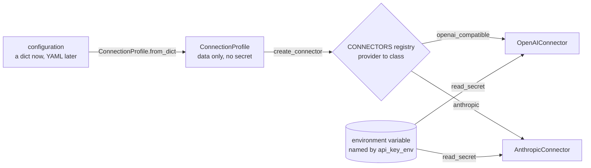

# Codealong 5: Connection Profiles and Switching Models

You now have two connectors, one for OpenAI-compatible endpoints and one for Claude, and both pass the same contract tests. But to use either of them, your code has to know which class to import and which arguments to pass. An evaluation needs two models, a target and a judge, and you want to swap either one without touching any code.

In this codealong you are going to separate the *description* of a connection from the *connector* that does the work. By the end you will have a `ConnectionProfile`, a small validated piece of data that says which provider, model, URL and key variable to use, and a registry with a `create_connector()` function that turns any profile into the right connector. Switching the judge from Claude to OpenAI will be a change to data, not to code.

> **AI-Assist level:** this is a guided codealong, so record this work as **AI-Assist L4**.

## 5.1 Before You Start

Start from an up-to-date `main`, with chapter 4 merged, and create the topic branch:

```bash
$ git switch main && git pull --ff-only && git switch -c feat/p1-connection-profiles-T001
```

No API keys are needed. Nothing in this chapter sends a request to a model. And, as always, I strongly recommend that you type the code yourself.

## 5.2 Data and Behaviour

Think about how you'd ask a friend to phone someone for you. You hand them a contact card with a name, a number, and maybe "ask for extension 42". The card is just data. It doesn't know how to make a call, and you can photocopy it, check it for mistakes or store it in a drawer. Your friend is the one who knows how to dial, wait, talk and hang up. If the card is wrong, you want to find out when you write it, not halfway through the call.

Here is the whole path from configuration to a working connector, which this chapter builds:



That's the split you're about to make:

- A **connection profile** is the contact card: which provider, which model, which base URL, which environment variable holds the key, plus a few limits. It's plain data, it's checked when it's created, and it **never holds a secret**, only the *name* of the variable where the secret lives.
- A **connector** is the friend who makes the call. It's behaviour, and it already exists.
- A **registry** sits between them. Given a profile, it picks the right connector class and creates it.

Project Moonshot makes the same split. Its connector endpoints are JSON files that describe a connection (the connector type, URI, model and parameters), and its connectors receive those settings through a `ConnectorEndpointArguments` object. One difference worth noticing is that Moonshot's endpoint files can carry the token itself. JudgeLab profiles deliberately can't, as you'll see in a moment.

Later, in chapter 10, these profiles will be read from a YAML file. For now you'll build them from Python dictionaries, which is exactly what a YAML parser gives you anyway.

## 5.3 The Acceptance Criteria

This chapter is still use case UC-001, *Configure model connections*. It finishes the three slices of it that are left: T001 (the connection profile), T002 (credential resolution, which you wrote back in chapter 2 but never gave its own slice), and T004 (independent model switching). All three task files already exist in [docs/usecases/UC-001-configure-model-connections/](../../docs/usecases/UC-001-configure-model-connections/), and they're already listed in its Slices table, in the release plan and in the traceability matrix. What they don't have yet is anything to deliver, so let's write the criteria first.

Profiles, credentials and switching are new behaviour that none of AC-001-01 to AC-001-11 describes. Running `python3 .claude/skills/vbench-docs/scripts/docids.py next AC --usecase UC-001` tells you that the next free id is `AC-001-12`. Open [docs/usecases/UC-001-configure-model-connections/README.md](../../docs/usecases/UC-001-configure-model-connections/README.md), and add these eleven criteria at the end of the "Acceptance criteria" list, right after AC-001-11:

_docs/usecases/UC-001-configure-model-connections/README.md_: The new criteria

```markdown
- [ ] **AC-001-12**: A connection is described by a validated profile built from configuration: provider, model, api_key_env, optional base_url, timeout_s, max_retries and options.
- [ ] **AC-001-13**: Missing or blank required profile settings are rejected, and the error lists every problem at once.
- [ ] **AC-001-14**: `api_key_env` must look like an environment variable name; the error never echoes the value, in case it is a pasted key.
- [ ] **AC-001-15**: `base_url` must be an https URL (plain http only for localhost).
- [ ] **AC-001-16**: Unknown profile settings (typos, or an `api_key` field) are rejected with the list of allowed settings.
- [ ] **AC-001-17**: `timeout_s` must be greater than 0 and `max_retries` a whole number of 0 or more.
- [ ] **AC-001-18**: The key is read from the environment variable the profile names, in one place only.
- [ ] **AC-001-19**: The connector is chosen by the profile's provider.
- [ ] **AC-001-20**: An unknown provider is rejected with the list of known providers.
- [ ] **AC-001-21**: Provider-specific options (like Claude's `max_tokens`) reach the connector; an option the connector does not accept is rejected clearly.
- [ ] **AC-001-22**: Target and judge connections are independent, and swapping providers or models needs only a configuration change.
```

Now decide which slice delivers which criteria. AC-001-12 to AC-001-17 are about the profile, so they belong to T001. AC-001-18 is about reading the key, so it belongs to T002. T002 also delivers a criterion you already have: AC-001-01 says that a missing, empty or whitespace-only key variable raises an auth error that names it, and `read_secret()` is the function that does exactly that. As you saw with Claude in the last chapter, there's no need to write that promise down a second time. AC-001-19 to AC-001-22 are about choosing and switching connectors, so they belong to T004.

T004 delivers one more criterion, and this one isn't in UC-001 at all. Open [docs/usecases/UC-004-evaluate-responses/README.md](../../docs/usecases/UC-004-evaluate-responses/README.md) and look at the last criterion, which came from your own v0.1 plan:

_docs/usecases/UC-004-evaluate-responses/README.md_: A criterion from another use case

```markdown
- [ ] **AC-004-05**: Switching the judge profile does not change benchmark data or the use-case logic.
```

Switching the judge is exactly what T004 makes possible, and the test you'll write for AC-001-22 swaps the judge's profile without touching anything else. So T004 delivers AC-004-05 as well. A slice belongs to one use case, but the evidence it produces can prove a criterion of another one, and the Delivers list says so.

Fill in the three Slices rows in the UC-001 README, which are empty in the "Delivers" column so far, so that they look like this:

_docs/usecases/UC-001-configure-model-connections/README.md_: The Slices rows for T001, T002 and T004

```markdown
| [T001](T001-connection-profile-model.md) | Connection profile model | AC-001-12, AC-001-13, AC-001-14, AC-001-15, AC-001-16, AC-001-17 | Todo |
| [T002](T002-credential-resolution.md) | Credential resolution | AC-001-01, AC-001-18 | Todo |
```

```markdown
| [T004](T004-independent-model-switching.md) | Independent model switching | AC-001-19, AC-001-20, AC-001-21, AC-001-22, AC-004-05 | Todo |
```

The T003 row sits between T002 and T004, which is why T004 is in its own block.

Then fill in each task file's Objective and `## Delivers` section, replacing the template's comment and empty `-`. In [docs/usecases/UC-001-configure-model-connections/T001-connection-profile-model.md](../../docs/usecases/UC-001-configure-model-connections/T001-connection-profile-model.md), the two sections should look like this:

_docs/usecases/UC-001-configure-model-connections/T001-connection-profile-model.md_: Objective and Delivers

```markdown
## Objective

Describe one model connection as validated data that never holds a secret.

## Delivers

- AC-001-12
- AC-001-13
- AC-001-14
- AC-001-15
- AC-001-16
- AC-001-17
```

Do the same in [docs/usecases/UC-001-configure-model-connections/T002-credential-resolution.md](../../docs/usecases/UC-001-configure-model-connections/T002-credential-resolution.md):

_docs/usecases/UC-001-configure-model-connections/T002-credential-resolution.md_: Objective and Delivers

```markdown
## Objective

Read a secret from the environment variable a profile names, in one place only.

## Delivers

- AC-001-01
- AC-001-18
```

And in [docs/usecases/UC-001-configure-model-connections/T004-independent-model-switching.md](../../docs/usecases/UC-001-configure-model-connections/T004-independent-model-switching.md):

_docs/usecases/UC-001-configure-model-connections/T004-independent-model-switching.md_: Objective and Delivers

```markdown
## Objective

Choose and configure the connector for target and judge from configuration alone.

## Delivers

- AC-001-19
- AC-001-20
- AC-001-21
- AC-001-22
- AC-004-05
```

All three tasks are already registered, so there is nothing else to add this time. Run `python3 .claude/skills/vbench-docs/scripts/docids.py check` to be sure, and it should report `0 error(s) · 0 warning(s)`.

Read AC-001-14 again, because it's an unusual requirement. It says that the error must *not* echo the value. You'll see why shortly.

## 5.4 The Connection Profile

The profile goes in a new module. Here's the first part, with the class and its validation.

_src/judgelab/connectors/profile.py_: The profile, part 1 of 2

```python
"""Connection profiles: which model to call, where, and which variable holds the key."""

import re
from collections.abc import Mapping
from dataclasses import dataclass, field
from urllib.parse import urlsplit

ENV_NAME = re.compile(r"[A-Z_][A-Z0-9_]*")
LOCAL_HOSTS = {"localhost", "127.0.0.1", "::1"}
FIELDS = {"provider", "model", "api_key_env", "base_url", "timeout_s", "max_retries", "options"}
REQUIRED = ("provider", "model", "api_key_env")


class ProfileError(ValueError):
    """A connection profile is invalid. The message lists every problem found."""


@dataclass(frozen=True)
class ConnectionProfile:
    """Configuration for one model connection. Data only: it never holds a secret."""

    name: str
    provider: str
    model: str
    api_key_env: str
    base_url: str | None = None
    timeout_s: float = 60.0
    max_retries: int = 0
    options: Mapping[str, object] = field(default_factory=dict)

    def __post_init__(self) -> None:
        problems = []
        for name in REQUIRED:
            value = getattr(self, name)
            if not isinstance(value, str) or not value.strip():
                problems.append(f"{name} must be a non-empty string")
        api_key_env = self.api_key_env
        if (
            isinstance(api_key_env, str)
            and api_key_env.strip()
            and not ENV_NAME.fullmatch(api_key_env)
        ):
            # Never echo the value: it may be a key pasted in by mistake.
            problems.append(
                "api_key_env must name an environment variable (like OPENAI_API_KEY), "
                "not contain a key"
            )
        if self.base_url is not None:
            problems.extend(_url_problems(self.base_url))
        if isinstance(self.timeout_s, bool) or not isinstance(self.timeout_s, int | float):
            problems.append("timeout_s must be a number")
        elif self.timeout_s <= 0:
            problems.append("timeout_s must be greater than 0")
        if isinstance(self.max_retries, bool) or not isinstance(self.max_retries, int):
            problems.append("max_retries must be a whole number")
        elif self.max_retries < 0:
            problems.append("max_retries must be 0 or more")
        if not isinstance(self.options, Mapping):
            problems.append("options must be a mapping")
        if problems:
            raise ProfileError(f"connection {self.name!r}: " + "; ".join(problems))
```

Let's go through this from the top.

`ConnectionProfile` is a frozen dataclass, like `ModelResponse`. A profile describes what an evaluation is going to call, and the report will record it, so it shouldn't change after it's been checked. The `name` field is the profile's role, such as `"target"` or `"judge"`, and every error message starts with it, so that when a configuration has two profiles, you know which one is wrong.

The fields mirror the connector constructors you've already written: `provider` picks the connector, and `model`, `api_key_env`, `base_url`, `timeout_s` and `max_retries` are passed through. The `options` field holds anything provider-specific, like Claude's `max_tokens`, so the profile doesn't need a field for every setting of every provider. Its default uses `field(default_factory=dict)`, because a plain `= {}` default would be a single dictionary shared by every profile. Python's dataclasses refuse to let you make that mistake.

A dataclass writes `__init__()` for you, and `__post_init__()` is a hook it calls right after. This is where the validation happens. The most important design choice here is that the method doesn't raise at the first problem. It collects every problem into a list, and raises one `ProfileError` at the end with all of them joined together. Imagine a configuration with three mistakes. If you only report the first one, the user fixes it, runs again, hits the second one, fixes it, runs again... Reporting everything at once lets them fix it all in one go.

`ProfileError` is a subclass of `ValueError`, and not of `ConnectorError`. A connector error means a call to a model failed. A profile error means the configuration is wrong, before any call is made, and the user has to fix it by editing their settings.

Now for the individual checks:

- **Required settings.** `provider`, `model` and `api_key_env` must be non-empty strings. The `.strip()` catches a value made only of spaces, which is easy to produce in a YAML file and impossible to see.
- **`api_key_env`.** It must match `ENV_NAME`, the usual shape of an environment variable name: capital letters, digits and underscores, not starting with a digit. The reason for this check is human. Sooner or later, someone is going to paste their actual key into the `api_key_env` setting instead of the name of the variable. Look carefully at the error message: it does *not* include the value. Normally a good error message shows the bad value, but here the bad value might be a real key, and an error message ends up in terminals, logs and bug reports. The comment in the code is there so that nobody "improves" this message later.
- **`base_url`.** This is checked by a helper you'll write in the next section. Whatever URL is in the profile is where the connector will send your API key and every prompt in your benchmark, so it has to be trustworthy.
- **`timeout_s` and `max_retries`.** These are checked for type first, then for range. Notice the `isinstance(..., bool)` checks. In Python, `bool` is a subclass of `int`, so `True` is an integer equal to 1, and `isinstance(True, int)` is `True`. Without the extra check, `max_retries: true` in a configuration file would quietly mean one retry. That's almost certainly a mistake, so it's rejected. The `int | float` inside `isinstance()` is the modern way to check against two types at once.
- **`options`.** It must be a mapping, because the registry is going to unpack it into keyword arguments.

## 5.5 Building a Profile from Configuration

You can create a profile by calling `ConnectionProfile(...)` directly, but configuration arrives as a dictionary, so let's add a class method that builds one from a dictionary, and the URL helper that the validation needs. Add `from_dict()` inside the class, below `__post_init__()`, and `_url_problems()` at the end of the module:

_src/judgelab/connectors/profile.py_: The profile, part 2 of 2

```python
    @classmethod
    def from_dict(cls, name: str, data: object) -> ConnectionProfile:
        """Build a profile from parsed configuration (e.g. one entry of a YAML file)."""
        if not isinstance(data, Mapping):
            raise ProfileError(f"connection {name!r}: must be a mapping of settings")
        unknown = sorted(set(data) - FIELDS)
        if unknown:
            raise ProfileError(
                f"connection {name!r}: unknown setting(s) {', '.join(unknown)}; "
                f"allowed: {', '.join(sorted(FIELDS))}"
            )
        missing = [key for key in REQUIRED if key not in data]
        if missing:
            raise ProfileError(f"connection {name!r}: missing {', '.join(missing)}")
        return cls(name=name, **data)


def _url_problems(url: object) -> list[str]:
    if not isinstance(url, str):
        return ["base_url must be a string"]
    parts = urlsplit(url)
    if not parts.hostname:
        return ["base_url must be a full URL like https://api.example.com/v1"]
    if parts.scheme == "https":
        return []
    if parts.scheme == "http" and parts.hostname in LOCAL_HOSTS:
        return []
    return ["base_url must use https (plain http is allowed only for localhost)"]
```

The `from_dict()` method does three checks before it calls the constructor.

First, the data must be a mapping. A YAML file can contain a list or a plain string where you expected a dictionary, and this turns that into a clear error.

Second, and most importantly, it rejects settings it doesn't know. The `set(data) - FIELDS` expression is the set difference, the keys in the data that aren't allowed fields. This catches two kinds of mistakes. One is typos: without this check, `modle: gpt-x` would be silently ignored, and you'd get a confusing "missing model" error, or worse, a default value you didn't intend. The other is an `api_key` setting. Someone who tries to put a key directly in the profile gets an error that lists the allowed settings, where they'll find `api_key_env`. There's a nice side effect too: `name` is not in `FIELDS`, so the data can't override the profile's name.

Third, it reports missing required settings by name. If these were left to the constructor, Python would raise a `TypeError` about missing arguments, which is correct but not very friendly.

Once the data has passed those checks, `cls(name=name, **data)` unpacks it into keyword arguments, and `__post_init__()` validates the values. Using `cls` instead of `ConnectionProfile` is the usual practice for class methods, as it means a subclass would get an instance of itself. And the `-> ConnectionProfile` annotation can refer to the class inside its own body because Python 3.14 evaluates annotations lazily.

The `_url_problems()` helper uses `urlsplit()` from the standard library to take the URL apart, instead of trying to match it with string operations. A URL without a hostname, like `api.openai.com/v1` with no scheme, is rejected as incomplete. An `https` URL is accepted. A plain `http` URL is accepted only when the host is the local machine, which is what you'd use with a model running on your own computer, such as a local Ollama server. Anything else is rejected, because a plain `http` URL to another machine would send your key and your prompts across the network unencrypted. It returns a list, even though it only ever finds one problem, so that `__post_init__()` can add its result to the other problems with `extend()`.

## 5.6 Trying Out Profiles

Let's see the profile at work. Start a Python shell with `uv run python`, and import what you need:

```python
>>> from judgelab.connectors.profile import ConnectionProfile
```

First, let's make the mistake that AC-001-14 is about, and paste a key where the variable name should go:

```python
>>> ConnectionProfile.from_dict("target", {"provider": "openai_compatible", "model": "gpt-x", "api_key_env": "sk-proj-abc123"})
ProfileError: connection 'target': api_key_env must name an environment variable (like OPENAI_API_KEY), not contain a key
```

The message tells you exactly what's wrong, and the pasted value appears nowhere in it. In your shell, you'll see a full traceback ending with this line.

Now a profile with three mistakes at once: an empty model, a plain `http` URL to a remote server, and a zero timeout:

```python
>>> ConnectionProfile.from_dict("target", {"provider": "openai_compatible", "model": "", "api_key_env": "OPENAI_API_KEY", "timeout_s": 0, "base_url": "http://api.example.com/v1"})
ProfileError: connection 'target': model must be a non-empty string; base_url must use https (plain http is allowed only for localhost); timeout_s must be greater than 0
```

All three problems, in one message. Finally, let's try putting the key in the profile directly:

```python
>>> ConnectionProfile.from_dict("judge", {"provider": "anthropic", "model": "claude-opus-5-5", "api_key": "sk-ant-xyz"})
ProfileError: connection 'judge': unknown setting(s) api_key; allowed: api_key_env, base_url, max_retries, model, options, provider, timeout_s
```

And here is a valid profile, so you can see the defaults that were filled in:

```python
>>> ConnectionProfile.from_dict("target", {"provider": "openai_compatible", "model": "gpt-x", "api_key_env": "OPENAI_API_KEY", "options": {"max_tokens": 512}})
ConnectionProfile(name='target', provider='openai_compatible', model='gpt-x', api_key_env='OPENAI_API_KEY', base_url=None, timeout_s=60.0, max_retries=0, options={'max_tokens': 512})
```

Keep this last profile in mind. It's valid as a profile, but `max_tokens` isn't something the OpenAI connector accepts. Whose job is it to catch that? You'll find out in the next section.

## 5.7 The Registry

The registry is the piece that turns a profile into a working connector. Create another new module:

_src/judgelab/connectors/registry.py_: The connector registry

```python
"""The registry: turns a ConnectionProfile into the right connector."""

from judgelab.connectors.anthropic_connector import AnthropicConnector
from judgelab.connectors.base import ModelConnector
from judgelab.connectors.openai_connector import OpenAIConnector
from judgelab.connectors.profile import ConnectionProfile, ProfileError

CONNECTORS: dict[str, type[ModelConnector]] = {
    OpenAIConnector.provider: OpenAIConnector,
    AnthropicConnector.provider: AnthropicConnector,
}


def create_connector(profile: ConnectionProfile) -> ModelConnector:
    """Create the connector named by `profile.provider`, configured from the profile."""
    try:
        connector_class = CONNECTORS[profile.provider]
    except KeyError:
        known = ", ".join(sorted(CONNECTORS))
        raise ProfileError(
            f"connection {profile.name!r}: unknown provider {profile.provider!r}; known: {known}"
        ) from None
    try:
        return connector_class(
            model=profile.model,
            api_key_env=profile.api_key_env,
            base_url=profile.base_url,
            timeout_s=profile.timeout_s,
            max_retries=profile.max_retries,
            **profile.options,
        )
    except TypeError as e:
        raise ProfileError(
            f"connection {profile.name!r}: unsupported option for {profile.provider}: {e}"
        ) from None
```

That's the whole registry. `CONNECTORS` is a dictionary that maps a provider name to a connector class. The type annotation, `dict[str, type[ModelConnector]]`, says that the values are classes (not instances) that implement the `ModelConnector` port.

Notice that the keys aren't typed out as strings. Each one comes from the class itself, through the `provider` class variable that you declared in `ModelConnector` back in chapter 3 and filled in on each connector. The name `"anthropic"` is written in exactly one place, the `AnthropicConnector` class, so the registry and the class can never disagree about it.

The `create_connector()` function does two things, and each one has its own error.

First, it looks up the class. If the provider isn't registered, the `KeyError` is turned into a `ProfileError` that lists the providers that *are* known, so the user can spot their typo right away. The `from None` at the end hides the original `KeyError` from the traceback, because it adds nothing that the new message doesn't already say.

Second, it creates the connector, passing the profile's common settings by name and unpacking `options` as extra keyword arguments. For a Claude profile with `options: {max_tokens: 512}`, that becomes `AnthropicConnector(..., max_tokens=512)`. If an option isn't accepted by the connector's constructor, Python raises a `TypeError`, and the registry turns that into a `ProfileError` that names the profile and the provider. That answers the question from the end of the last section: the profile can't know which options each provider accepts, but the connector's constructor can, so the check happens there. The profile stays simple, and there's no list of options to keep in sync.

Think about what it would take to add a third provider later. You'd write the connector class, add it to the contract tests, and add one line to `CONNECTORS`. Nothing in `create_connector()` or in `ConnectionProfile` would change. This is the open/closed principle at work: the registry is open to new providers, but closed to modification.

Before you can try it, the new names need to be exported. In [src/judgelab/connectors/\_\_init\_\_.py](../../src/judgelab/connectors/__init__.py), add these two imports between the `openai_connector` import and the `response` import:

_src/judgelab/connectors/\_\_init\_\_.py_: The new imports

```python
from judgelab.connectors.profile import ConnectionProfile, ProfileError
from judgelab.connectors.registry import CONNECTORS, create_connector
```

Then add the four new names to `__all__`. Ruff keeps this list sorted with constants first, so after the change it looks like this:

_src/judgelab/connectors/\_\_init\_\_.py_: The export list

```python
__all__ = [
    "CONNECTORS",
    "AnthropicConnector",
    "ConnectionProfile",
    "ConnectorAuthError",
    "ConnectorError",
    "ConnectorQuotaError",
    "ConnectorRateLimitError",
    "ConnectorRequestError",
    "ConnectorResponseError",
    "ConnectorUnavailableError",
    "FakeConnector",
    "ModelConnector",
    "ModelResponse",
    "OpenAIConnector",
    "ProfileError",
    "Refusal",
    "create_connector",
]
```

Now restart your Python shell so that it sees the new code, and try the registry:

```python
>>> from judgelab.connectors import ConnectionProfile, create_connector
>>> create_connector(ConnectionProfile.from_dict("target", {"provider": "gemini", "model": "g", "api_key_env": "OPENAI_API_KEY"}))
ProfileError: connection 'target': unknown provider 'gemini'; known: anthropic, openai_compatible
```

Here's the profile from the end of section 5.6, with an option the OpenAI connector doesn't accept:

```python
>>> p = ConnectionProfile.from_dict("target", {"provider": "openai_compatible", "model": "gpt-x", "api_key_env": "OPENAI_API_KEY", "options": {"max_tokens": 512}})
>>> create_connector(p)
ProfileError: connection 'target': unsupported option for openai_compatible: OpenAIConnector.__init__() got an unexpected keyword argument 'max_tokens'
```

For the next two commands, the key variables must be set, because the connectors read the key when they're created. Any value works, since no request is sent. Quit the shell, and start it again with `OPENAI_API_KEY=x ANTHROPIC_API_KEY=y uv run python`:

```python
>>> from judgelab.connectors import ConnectionProfile, create_connector
>>> create_connector(ConnectionProfile.from_dict("target", {"provider": "openai_compatible", "model": "gpt-6.2-astra", "api_key_env": "OPENAI_API_KEY"}))
OpenAIConnector(model='gpt-6.2-astra', base_url='https://api.openai.com/v1')
>>> j = create_connector(ConnectionProfile.from_dict("judge", {"provider": "anthropic", "model": "claude-opus-5-5", "api_key_env": "ANTHROPIC_API_KEY", "options": {"max_tokens": 2048}}))
>>> print(j, j.max_tokens)
AnthropicConnector(model='claude-opus-5-5', base_url='https://api.anthropic.com') 2048
```

Two profiles, two different connectors, and not a single `import` of a connector class. The `max_tokens` option went all the way through to the Claude connector.

## 5.8 Testing the Credentials Function

You wrote `read_secret()` in chapter 2, and it has been tested indirectly through the connectors ever since. Now that T002 is a slice with its own criteria to deliver, it gets its own small test file:

_tests/connectors/test_credentials.py_: Tests for `read_secret()`

```python
import pytest

from judgelab.connectors import ConnectorAuthError
from judgelab.connectors.credentials import read_secret


@pytest.mark.acceptance("AC-001-18")
def test_reads_the_named_variable(monkeypatch):
    monkeypatch.setenv("JUDGELAB_TEST_SECRET", "  s3cret  ")
    assert read_secret("JUDGELAB_TEST_SECRET") == "s3cret"


@pytest.mark.acceptance("AC-001-01")
@pytest.mark.parametrize("value", [None, "", "   "])
def test_missing_or_blank_names_the_variable(monkeypatch, value):
    if value is None:
        monkeypatch.delenv("JUDGELAB_TEST_SECRET", raising=False)
    else:
        monkeypatch.setenv("JUDGELAB_TEST_SECRET", value)
    with pytest.raises(
        ConnectorAuthError, match="^environment variable JUDGELAB_TEST_SECRET is not set$"
    ):
        read_secret("JUDGELAB_TEST_SECRET")
```

The first test sets the secret with spaces around it, which is a common result of copying a key from a web page, and checks that they're stripped. The second test runs three times, for a missing variable (`None` means "delete it"), an empty one and a whitespace-only one.

Look at the `match` pattern in the second test. The `^` and `$` anchors make it match the *entire* message, not just part of it. A plain `match="JUDGELAB_TEST_SECRET is not set"` would also pass for a message like `environment variable JUDGELAB_TEST_SECRET is not set (value was '   ')`. The anchors prove that the message contains nothing more than the variable name, which is how AC-001-01's "contains no secret" is checked.

## 5.9 Testing the Profile

Here are the profile tests:

_tests/connectors/test_profile.py_: Tests for `ConnectionProfile`

```python
import pytest

from judgelab.connectors import ConnectionProfile, ProfileError

VALID = {"provider": "openai_compatible", "model": "gpt-x", "api_key_env": "OPENAI_API_KEY"}


@pytest.mark.acceptance("AC-001-12")
def test_valid_profile_with_defaults():
    profile = ConnectionProfile.from_dict("target", VALID)
    assert profile == ConnectionProfile(
        name="target",
        provider="openai_compatible",
        model="gpt-x",
        api_key_env="OPENAI_API_KEY",
        base_url=None,
        timeout_s=60.0,
        max_retries=0,
        options={},
    )


@pytest.mark.acceptance("AC-001-12")
def test_valid_profile_with_every_setting():
    data = {
        **VALID,
        "base_url": "http://localhost:8000/v1",
        "timeout_s": 30,
        "max_retries": 2,
        "options": {"max_tokens": 512},
    }
    profile = ConnectionProfile.from_dict("judge", data)
    assert (profile.base_url, profile.timeout_s, profile.max_retries) == (
        "http://localhost:8000/v1",
        30,
        2,
    )
    assert profile.options == {"max_tokens": 512}


@pytest.mark.acceptance("AC-001-13")
def test_missing_settings_are_named():
    with pytest.raises(ProfileError, match="connection 'target': missing model, api_key_env"):
        ConnectionProfile.from_dict("target", {"provider": "openai_compatible"})


@pytest.mark.acceptance("AC-001-13")
def test_every_problem_is_reported_at_once():
    data = {"provider": " ", "model": "", "api_key_env": "OPENAI_API_KEY", "timeout_s": 0}
    with pytest.raises(ProfileError) as caught:
        ConnectionProfile.from_dict("target", data)
    message = str(caught.value)
    assert "provider must be a non-empty string" in message
    assert "model must be a non-empty string" in message
    assert "timeout_s must be greater than 0" in message


@pytest.mark.acceptance("AC-001-14")
def test_a_pasted_key_is_rejected_without_being_echoed():
    pasted = "sk-proj-THIS-IS-A-REAL-LOOKING-KEY"
    with pytest.raises(ProfileError, match="must name an environment variable") as caught:
        ConnectionProfile.from_dict("target", {**VALID, "api_key_env": pasted})
    assert pasted not in str(caught.value)


@pytest.mark.acceptance("AC-001-15")
@pytest.mark.parametrize(
    "url",
    ["https://api.openai.com/v1", "http://localhost:8000/v1", "http://127.0.0.1:11434/v1"],
)
def test_allowed_base_urls(url):
    assert ConnectionProfile.from_dict("target", {**VALID, "base_url": url}).base_url == url


@pytest.mark.acceptance("AC-001-15")
@pytest.mark.parametrize(
    "url, message",
    [
        ("http://api.example.com/v1", "must use https"),
        ("ftp://example.com", "must use https"),
        ("api.openai.com/v1", "must be a full URL"),
    ],
)
def test_rejected_base_urls(url, message):
    with pytest.raises(ProfileError, match=message):
        ConnectionProfile.from_dict("target", {**VALID, "base_url": url})


@pytest.mark.acceptance("AC-001-16")
@pytest.mark.parametrize("key", ["api_key", "modle"])
def test_unknown_settings_are_rejected(key):
    with pytest.raises(ProfileError, match=f"unknown setting\\(s\\) {key}; allowed:"):
        ConnectionProfile.from_dict("target", {**VALID, key: "x"})


@pytest.mark.acceptance("AC-001-17")
@pytest.mark.parametrize(
    "settings, message",
    [
        ({"timeout_s": -1}, "timeout_s must be greater than 0"),
        ({"timeout_s": "fast"}, "timeout_s must be a number"),
        ({"max_retries": -1}, "max_retries must be 0 or more"),
        ({"max_retries": 1.5}, "max_retries must be a whole number"),
        ({"max_retries": True}, "max_retries must be a whole number"),
    ],
)
def test_limits_are_checked(settings, message):
    with pytest.raises(ProfileError, match=message):
        ConnectionProfile.from_dict("target", {**VALID, **settings})
```

The `VALID` dictionary at the top holds the smallest valid profile, and most tests build on it with `{**VALID, ...}`. That expression copies `VALID` into a new dictionary and then overrides or adds keys, so each test changes exactly one thing and leaves `VALID` untouched for the next one. When a test fails, you know it's because of the one setting it changed.

`test_valid_profile_with_defaults()` compares the result with a complete `ConnectionProfile` built by hand. Dataclasses compare field by field, so this one assertion checks every default at once.

`test_every_problem_is_reported_at_once()` is the test for the "collect every problem" design. It feeds three mistakes in and checks that all three messages are in the error. If someone later changes `__post_init__()` to raise at the first problem, this test fails.

`test_a_pasted_key_is_rejected_without_being_echoed()` checks both halves of AC-001-14: the right error is raised, and the pasted value is not in it. Making the test's fake key look as realistic as possible is a small but deliberate touch.

The last test has a row with `True` for `max_retries`. That's the `bool` subtlety from section 5.4, now pinned down by a test.

One more detail: in `test_unknown_settings_are_rejected()`, the parentheses in `setting(s)` are escaped as `\\(s\\)`. The `match` argument is a regular expression, and in a regular expression, parentheses are special characters.

## 5.10 Testing the Registry

And here are the registry tests:

_tests/connectors/test_registry.py_: Tests for `create_connector()`

```python
import pytest

from judgelab.connectors import (
    AnthropicConnector,
    ConnectionProfile,
    OpenAIConnector,
    ProfileError,
    create_connector,
)


@pytest.fixture(autouse=True)
def keys(monkeypatch):
    monkeypatch.setenv("TEST_OPENAI_KEY", "sk-openai-test")
    monkeypatch.setenv("TEST_ANTHROPIC_KEY", "sk-ant-test")


OPENAI = {"provider": "openai_compatible", "model": "gpt-x", "api_key_env": "TEST_OPENAI_KEY"}
CLAUDE = {"provider": "anthropic", "model": "claude-opus-5-5", "api_key_env": "TEST_ANTHROPIC_KEY"}


def profile(name, data):
    return ConnectionProfile.from_dict(name, data)


@pytest.mark.acceptance("AC-001-19")
@pytest.mark.parametrize(
    "data, expected", [(OPENAI, OpenAIConnector), (CLAUDE, AnthropicConnector)]
)
def test_creates_the_registered_connector(data, expected):
    connector = create_connector(profile("target", data))
    assert type(connector) is expected
    assert connector.model == data["model"]


@pytest.mark.acceptance("AC-001-19")
def test_profile_settings_reach_the_connector():
    data = {**OPENAI, "base_url": "http://localhost:8000/v1"}
    connector = create_connector(profile("target", data))
    assert connector.base_url == "http://localhost:8000/v1"


@pytest.mark.acceptance("AC-001-20")
def test_unknown_provider_lists_known_ones():
    with pytest.raises(
        ProfileError, match="unknown provider 'gemini'; known: anthropic, openai_compatible"
    ):
        create_connector(profile("target", {**OPENAI, "provider": "gemini"}))


@pytest.mark.acceptance("AC-001-21")
def test_provider_options_reach_the_connector():
    connector = create_connector(profile("judge", {**CLAUDE, "options": {"max_tokens": 512}}))
    assert connector.max_tokens == 512


@pytest.mark.acceptance("AC-001-21")
def test_unsupported_option_is_rejected():
    with pytest.raises(ProfileError, match="unsupported option for openai_compatible"):
        create_connector(profile("target", {**OPENAI, "options": {"max_tokens": 512}}))


@pytest.mark.acceptance("AC-001-22", "AC-004-05")
def test_target_and_judge_switch_independently():
    target = create_connector(profile("target", OPENAI))
    judge = create_connector(profile("judge", CLAUDE))
    assert (type(target), type(judge)) == (OpenAIConnector, AnthropicConnector)

    swapped_target = create_connector(profile("target", CLAUDE))
    swapped_judge = create_connector(profile("judge", OPENAI))
    assert (type(swapped_target), type(swapped_judge)) == (AnthropicConnector, OpenAIConnector)
    assert target is not swapped_judge
```

The `keys` fixture is marked `autouse=True`, which means pytest applies it to every test in the file without each test having to ask for it. Every test here creates a real connector, and every connector reads its key when it's created, so every test needs the variables set. Using test-only variable names, instead of the real `OPENAI_API_KEY`, guarantees that the tests never pick up your actual keys.

The tests check the class with `type(connector) is expected` rather than `isinstance()`. `isinstance()` would also accept a subclass, and the registry promises the *exact* class that's registered.

`test_target_and_judge_switch_independently()` is the one I'd point to if someone asked what this chapter was for. It builds a target and a judge from two profiles, then swaps the provider data between them. The only thing that changes between the two halves of the test is the data passed to `profile()`. There's no `if provider == ...` anywhere, and no connector class is chosen by hand. That's AC-001-22: swapping providers or models is a configuration change and nothing else. Look at its marker, too. It carries two ids, `AC-001-22` and `AC-004-05`, from two different use cases. The judge's profile is swapped and nothing else changes, which is exactly what your UC-004 criterion promised, so one test is the evidence for both. A test proves behaviour, and a behaviour can matter to more than one use case.

## 5.11 Running the Tests

Run the whole suite:

```bash
$ uv run pytest
```

Here's the acceptance criteria table at the end of the output:

```text
============================= acceptance criteria ==============================
UC-001: Configure model connections  (22/22 passing)
  PASS        AC-001-01  A missing, empty or whitespace-only API-key variable raises 
  PASS        AC-001-02  A connector is configured only from its arguments: provider 
  PASS        AC-001-03  A successful reply returns the answer text, the requested an
  PASS        AC-001-04  A refusal is returned as a response, not raised as an error.
  PASS        AC-001-05  A reply that cannot be trusted (wrong type, no choices, or n
  PASS        AC-001-06  Provider failures map to JudgeLab errors: bad credentials to
  PASS        AC-001-07  No request is retried unless retries are configured.
  PASS        AC-001-08  The API key never appears in a connector's repr or in any er
  PASS        AC-001-09  Every connector implements the `ModelConnector` port and pas
  PASS        AC-001-10  A `FakeConnector` answers from a script (answers, refusals, 
  PASS        AC-001-11  Truncation is reported the same way for every provider: `tru
  PASS        AC-001-12  A connection is described by a validated profile built from 
  PASS        AC-001-13  Missing or blank required profile settings are rejected, and
  PASS        AC-001-14  `api_key_env` must look like an environment variable name; t
  PASS        AC-001-15  `base_url` must be an https URL (plain http only for localho
  PASS        AC-001-16  Unknown profile settings (typos, or an `api_key` field) are 
  PASS        AC-001-17  `timeout_s` must be greater than 0 and `max_retries` a whole
  PASS        AC-001-18  The key is read from the environment variable the profile na
  PASS        AC-001-19  The connector is chosen by the profile's provider.
  PASS        AC-001-20  An unknown provider is rejected with the list of known provi
  PASS        AC-001-21  Provider-specific options (like Claude's `max_tokens`) reach
  PASS        AC-001-22  Target and judge connections are independent, and swapping p
UC-004: Evaluate responses  (1/5 passing)
  not tested  AC-004-01  Include question, expected answer, actual answer, and rubric
  not tested  AC-004-02  Accept only supported verdict values and a nonempty justific
  not tested  AC-004-03  Invalid output becomes `ERROR`, never `FAIL`.
  not tested  AC-004-04  Record evaluator provider/model identity.
  PASS        AC-004-05  Switching the judge profile does not change benchmark data o
23 PASS · 4 not tested
93 passed in 2.38s
```

All 22 UC-001 criteria pass, delivered by five slices, and the whole connector layer of v0.1 is now covered. And for the first time, a UC-004 row passes too: AC-004-05, proved by the switching test, long before you write the judge itself.

## 5.12 Troubleshooting

- **`TypeError: ConnectionProfile.__init__() got an unexpected keyword argument ...`.** You're calling `ConnectionProfile(...)` directly with an unknown setting. Only `from_dict()` turns unknown settings into a friendly `ProfileError`. Use it for anything that comes from configuration.
- **`ImportError: cannot import name 'create_connector'`.** You haven't added the new imports to `connectors/__init__.py`, or your Python shell is still running the old code. Restart it.
- **`ConnectorAuthError: environment variable OPENAI_API_KEY is not set` when calling `create_connector()`.** The connector reads its key when it's created, even though nothing is sent. Set the variable to any value for local experiments, as in section 5.7.
- **The `True` row of `test_limits_are_checked` fails with `DID NOT RAISE`.** The profile accepted `max_retries=True`, which means you left out the `isinstance(..., bool)` part of the check. `True` is an `int` in Python.
- **`NameError: name '_url_problems' is not defined`.** You've typed part 1 of `profile.py` but not part 2 yet. The helper is defined at the bottom of the module.

## 5.13 Exercises

1. Create a Claude profile with `"options": {"max_tokens": "512"}`, a string instead of a number, and pass it to `create_connector()`. Read the message carefully. Is "unsupported option" an accurate description of what went wrong? How could you make the registry's error more precise without catching less?
2. `ConnectionProfile` is frozen, but its `options` is a regular dictionary. Try changing `profile.options["max_tokens"]` after the profile is created. What happens, and what could you use instead of a `dict` to make the options read-only too? (Hint: look up `types.MappingProxyType`.)
3. Try `http://[::1]:8000/v1` as a `base_url`. Is it accepted? Use `urlsplit()` in a shell to see what its `hostname` is.
4. Write a small `EchoConnector` class in a scratch file that implements `ModelConnector` and returns the prompt as its answer. Register it in a copy of `CONNECTORS` and create it from a profile. How many existing lines did you need to change?
5. Without looking at the code, explain why `api_key_env`'s error message doesn't show the bad value, when almost every other error message in JudgeLab tries to be as specific as possible.

## 5.14 Committing Your Work

When the tests pass, update the docs. Start with the criteria, which live in the use case READMEs. In `docs/usecases/UC-001-configure-model-connections/README.md`, tick AC-001-12 to AC-001-22 (change `- [ ]` to `- [x]`). AC-001-01 was already ticked, and it stays that way. In `docs/usecases/UC-004-evaluate-responses/README.md`, tick AC-004-05, the first UC-004 criterion to pass. Back in the UC-001 README, set the **Status** of the T001, T002 and T004 rows in the Slices table to `Done`.

Then, in the three task files in the UC-001 folder, `T001-connection-profile-model.md`, `T002-credential-resolution.md` and `T004-independent-model-switching.md`, set **Status** to `Done`, **Branch** to `` `feat/p1-connection-profiles-T001` ``, and **AI-Assist** to `L4`, and add any lessons learned. Then run `python3 .claude/skills/vbench-docs/scripts/docids.py check` one last time.

Review your changes with `git status` and `git diff`, then commit:

```bash
$ git add docs/usecases/UC-001-configure-model-connections docs/usecases/UC-004-evaluate-responses/README.md src tests
$ git commit
```

Here is the commit message I would write:

```text
feat(connector): add connection profiles and a connector registry

A ConnectionProfile describes one model connection as validated data:
provider, model, base URL and the name of the key variable, never the
key itself. Validation collects every problem before raising, never
echoes a pasted key, and only allows plain http for localhost.

create_connector() looks the provider up in CONNECTORS and passes
the profile's settings and options to the connector class, so target
and judge switch providers through configuration alone. Adding a
provider is one line in the registry (open/closed).

Also gives read_secret() its own T002 tests.

AI-Assist: L4
```

Then push the branch and use the `vbench-pr` skill to open the pull request, just like in the last chapter. It will run the tests, self-review the diff, and fill in the PR template for you, with `Highest level: L4` in the "AI assistance" section.

## 5.15 Wrapping Up

Congratulations, the connector layer of JudgeLab is complete! You can describe any connection as a profile, have it checked thoroughly before anything is sent, and turn it into the right connector with a single function call. The profile never holds a secret, it won't repeat a key you pasted by mistake, and it won't send your key to an unencrypted remote URL. Best of all, the target and the judge are now independent, and swapping either one is a change to data.

So far, the only prompt you've sent is "What is the capital of France?". In the next codealong you are going to give JudgeLab something real to evaluate: a benchmark dataset, loaded from a JSON file and validated with the same "report every problem at once" approach you used for profiles.
