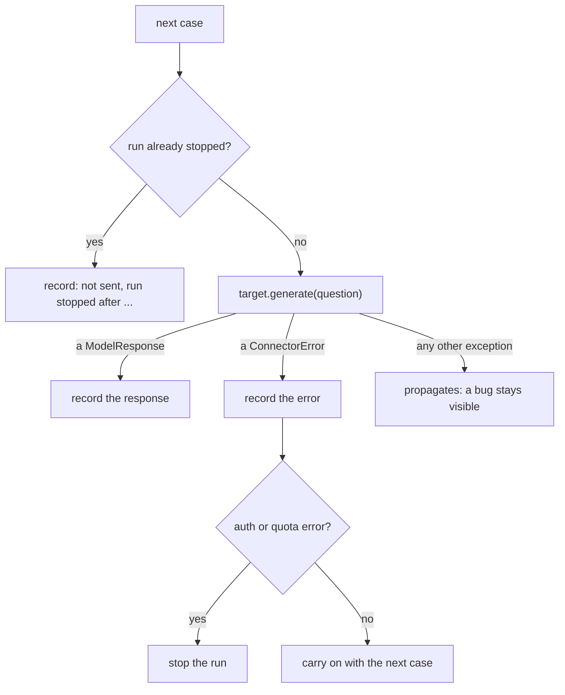

# Codealong 7: Running the Target Model

You now have connectors that can talk to models and benchmarks full of questions. In this codealong you are going to put the two together for the first time. By the end you will have a `run_target()` function that sends every question in a benchmark to the model being evaluated, one at a time and in order, and returns a record of what happened to each one: the model's response, or the error that got in the way.

The happy path of this function is only a handful of lines. Most of this chapter is about the unhappy one. When you send a hundred requests to a model, some of them are going to fail, and the interesting question is what to do next. Should the run stop? Should it continue? It depends on *why* the call failed, and you are going to teach the runner to tell the difference.

> **AI-Assist level:** this is a guided codealong, so record this work as **AI-Assist L4**.

## 7.1 Before You Start

Start from an up-to-date `main`, with the benchmark loader from chapter 6 merged, and create a branch for this task:

```bash
$ git switch main && git pull --ff-only
$ git switch -c feat/p1-target-runner-T007
```

This chapter covers the use case [UC-003 Execute target model](../../docs/usecases/UC-003-execute-target-model/README.md), which has a single slice, [T007](../../docs/usecases/UC-003-execute-target-model/T007-target-inference.md). That slice delivers all five of the use case's acceptance criteria, AC-003-01 to AC-003-05, which you are about to write. In the plan's vocabulary, the model you are evaluating is called the *target*, to tell it apart from the *judge* model that you will meet in the next chapter.

As always, I strongly recommend that you type the code yourself.

## 7.2 Writing the Acceptance Criteria First

UC-003 has no criteria yet, so the docs script will tell you to start at `01`:

```bash
$ python3 .claude/skills/vbench-docs/scripts/docids.py next AC --usecase UC-003
AC-003-01
```

Open `docs/usecases/UC-003-execute-target-model/README.md` and add the criteria under the comment in its Acceptance criteria section:

_docs/usecases/UC-003-execute-target-model/README.md_: The acceptance criteria

```markdown
- [ ] **AC-003-01**: Each case's question is sent to the target once, in order, and each result keeps its case and the model response.
- [ ] **AC-003-02**: A connector error on one case is recorded against that case and the run continues.
- [ ] **AC-003-03**: An auth or quota error stops the run: remaining cases are not sent and are recorded as not sent, naming the cause.
- [ ] **AC-003-04**: An optional progress callback is called after every case.
- [ ] **AC-003-05**: Exceptions that are not connector errors are not swallowed, so bugs stay visible.
```

Then open the T007 task file, fill in its Objective, and list all five criteria under `## Delivers`:

_docs/usecases/UC-003-execute-target-model/T007-target-inference.md_: Objective and Delivers

```markdown
## Objective

Send each benchmark question to the target model and capture what happened.

## Delivers

- AC-003-01
- AC-003-02
- AC-003-03
- AC-003-04
- AC-003-05
```

And repeat the list in T007's row of the Slices table, back in the use case README:

_docs/usecases/UC-003-execute-target-model/README.md_: The Slices table

```markdown
| Task | Slice | Delivers | Status |
|---|---|---|---|
| [T007](T007-target-inference.md) | Target inference | AC-003-01, AC-003-02, AC-003-03, AC-003-04, AC-003-05 | Todo |
```

Read through the five criteria before you continue. The first one is the obvious one, and the other four are all about failures and visibility. That ratio is about right for code that talks to the network.

## 7.3 Which Errors Should Stop a Run?

Before looking at the code, let's think about the decision at the center of this chapter.

This is what the runner decides for every case:



Imagine you are a waiter taking orders for a table of twelve, and the kitchen tells you they've run out of the fish. You note it down for that one guest and carry on with the next order. That is a failure that belongs to one case. Now imagine the kitchen tells you the gas has been cut off. You don't go around the table taking eleven more orders that can't possibly be cooked. You stop, and you tell everyone why.

The connector errors you built in the earlier chapters fall into these same two groups, and you already know them from the error-triage lesson:

- A `ConnectorRateLimitError` or a `ConnectorUnavailableError` (a 429, a 500, a timeout) is about *this* call. The provider was busy or had a hiccup, and the next call may well succeed. The right thing to do is to record the failure for this case and continue.
- A `ConnectorAuthError` (a bad or missing key) or a `ConnectorQuotaError` (no credit left, or a spend limit reached) is about *every* call. Nothing is going to fix itself until a human does something. If you keep going, you will get the same error for each remaining case, and with a 500-case benchmark, that is 500 pointless requests, 500 identical errors in the report, and possibly an angry email from the provider.

So the runner needs a list of errors that stop the run. When one of them happens, it stops sending requests, and records each remaining case as "not sent", with a note that says why. That way the results still have one entry per case, and anyone reading them can see exactly where the run stopped and what stopped it.

## 7.4 The Runner

Now let's write it. Create a new module called `runner.py` in the `judgelab` package:

_src/judgelab/runner.py_: The target runner

```python
"""Running a benchmark: send each case to the target model and collect the results."""

from collections.abc import Callable
from dataclasses import dataclass

from judgelab.benchmark import Benchmark, TestCase
from judgelab.connectors import (
    ConnectorAuthError,
    ConnectorError,
    ConnectorQuotaError,
    ModelConnector,
    ModelResponse,
)

# Errors that will repeat on every remaining call: stop instead of trying them all.
STOP_THE_RUN = (ConnectorAuthError, ConnectorQuotaError)


@dataclass(frozen=True)
class TargetResult:
    """What happened when one case was sent to the target model."""

    case: TestCase
    response: ModelResponse | None
    error: ConnectorError | None


def run_target(
    benchmark: Benchmark,
    target: ModelConnector,
    *,
    on_result: Callable[[TargetResult], None] | None = None,
) -> list[TargetResult]:
    """Send every case's question to `target`, in order, one call per case."""
    results: list[TargetResult] = []
    stopped_by: tuple[str, ConnectorError] | None = None

    for case in benchmark.cases:
        if stopped_by:
            failed_case, error = stopped_by
            note = f"not sent: run stopped after {type(error).__name__} on case {failed_case}"
            result = TargetResult(case, None, ConnectorError(note))
        else:
            try:
                result = TargetResult(case, target.generate(case.question), None)
            except ConnectorError as error:
                result = TargetResult(case, None, error)
                if isinstance(error, STOP_THE_RUN):
                    stopped_by = (case.id, error)
        results.append(result)
        if on_result:
            on_result(result)
    return results
```

Let's go through it, starting at the top.

`STOP_THE_RUN` is the decision from the previous section, written down as a tuple of exception classes. Putting it in a named constant at the top of the module, with a comment, means that the policy is visible in one place instead of being buried inside the loop. It is a tuple because that is what `isinstance()` accepts as its second argument when you want to check against several classes at once.

`TargetResult` records what happened to one case. It keeps the `case` itself, so that later stages (the judge, the report) have the question and the expected answer right there, without having to look them up by id. Then it has a `response` and an `error`, and exactly one of the two is set: a call either produced a response or it failed. A refusal from the model counts as a response, not an error, as you decided back in chapter 1.

Then comes `run_target()`. It takes the benchmark and the target connector, and notice the type of the `target` argument: `ModelConnector`, the port, not any particular connector. The runner has no idea whether it is talking to OpenAI, Claude, or the `FakeConnector`, and that is exactly what makes it testable without a network.

The loop goes through the cases in order and makes one call per case. There are no retries here. You configured the connectors so that they never retry behind your back, and the runner doesn't either: if a call fails, that failure is a fact worth recording.

The `stopped_by` variable remembers which case and which error stopped the run, and it starts out as `None`. As long as it is `None`, each case is sent to the target. When a call raises a `ConnectorError`, the error is recorded against that case, and if it is one of the `STOP_THE_RUN` errors, `stopped_by` is set. From then on, the `if stopped_by:` branch is taken for every remaining case, and instead of calling the model, the runner records a plain `ConnectorError` whose message says what happened, like `not sent: run stopped after ConnectorAuthError on case gk-002`.

Why not just `break` out of the loop? Because then the results would be shorter than the benchmark, and anyone reading them later would have to work out which cases are missing and why. With the "not sent" records, the results always have exactly one entry per case, in the same order as the benchmark. Those cases will show up as errors in the final report, which is the honest answer: we don't know how the model would have done on them.

### Catching only connector errors

Look carefully at the `except` clause. It catches `ConnectorError`, and nothing else. This is deliberate, and it is the subject of AC-003-05.

The connector port promises that any failure while talking to a model comes out as a `ConnectorError`. So if something else escapes from `generate()`, say a `ZeroDivisionError` or an `AttributeError`, then it isn't a problem with the model or the network. It's a bug in our code. If the runner caught all exceptions with `except Exception`, that bug would be quietly recorded as a failed case, the run would carry on, and you might never notice. Worse, the report would blame the target model for a mistake that is ours. By catching only the errors that it knows how to handle, the runner lets bugs crash the program, loudly, which is what you want from a bug.

### The progress callback

The last piece is the `on_result` argument. It is optional, and when you give it a function, the runner calls it with each `TargetResult`, right after it is recorded.

Why is this useful? A real benchmark run can take several minutes, and a program that sits there without printing anything looks exactly like a program that has hung. The runner could print progress messages itself, but then it would be deciding how progress looks, and that is not its job. A test wants no output at all, a command-line tool wants a line per case, and a web interface might want to update a progress bar. With a callback, the runner just announces "here's another result", and whoever is interested decides what to do with it. This is a very simple version of what is known as the Observer pattern. In chapter 10, the command-line interface is going to use this callback to print a line for each case.

The `*` before `on_result` makes it keyword-only, so a call reads `run_target(benchmark, target, on_result=show)`, which is clearer than a function passed as a third positional argument.

## 7.5 Trying It Out

Let's see the runner in action, using the `FakeConnector` so that no requests are sent anywhere. Start a session with `uv run python` and load the sample benchmark:

```python
>>> from judgelab.benchmark import load_benchmark
>>> from judgelab.connectors import FakeConnector, ConnectorRateLimitError, ConnectorAuthError
>>> from judgelab.runner import run_target
>>> b = load_benchmark("benchmarks/sample.json")
>>> def show(r):
...     print(r.case.id, r.response.text if r.response else f"{type(r.error).__name__}: {r.error}")
...
```

The `show()` function is going to be the progress callback. Now script a fake target that answers everything with "I think so", except the second question, which hits a rate limit:

```python
>>> target = FakeConnector(default="I think so", replies={"What is the chemical symbol for gold?": ConnectorRateLimitError("HTTP 429")})
>>> results = run_target(b, target, on_result=show)
gk-001 I think so
gk-002 ConnectorRateLimitError: HTTP 429
gk-003 I think so
gk-004 I think so
gk-005 I think so
>>> len(target.prompts)
5
```

The rate limit was recorded against `gk-002`, and the run carried on, so all five questions were sent. Now let's make the second question fail with an authentication error instead:

```python
>>> target = FakeConnector(default="I think so", replies={"What is the chemical symbol for gold?": ConnectorAuthError("HTTP 401 (invalid_api_key)")})
>>> results = run_target(b, target, on_result=show)
gk-001 I think so
gk-002 ConnectorAuthError: HTTP 401 (invalid_api_key)
gk-003 ConnectorError: not sent: run stopped after ConnectorAuthError on case gk-002
gk-004 ConnectorError: not sent: run stopped after ConnectorAuthError on case gk-002
gk-005 ConnectorError: not sent: run stopped after ConnectorAuthError on case gk-002
>>> len(target.prompts)
2
```

This time only two prompts reached the fake model. The other three cases were never sent, but they are still in the results, each explaining why. Finally, have a look at a complete result:

```python
>>> results[0]
TargetResult(case=TestCase(id='gk-001', question='What is the capital of France?', expected_answer='Paris'), response=ModelResponse(text='I think so', refusal=None, requested_model='fake-model', served_model='fake-model', finish_reason='stop', truncated=False, prompt_tokens=6, completion_tokens=3, request_id='fake-1', latency_ms=0.0), error=None)
```

Everything you will need to judge and report on this case is there: the question, the expected answer, the model's answer, and the details of the call.

## 7.6 The Tests

Now let's turn those experiments into tests. Create a new test module:

_tests/test_runner.py_: Tests for the target runner

```python
import pytest

from judgelab.benchmark import Benchmark, TestCase
from judgelab.connectors import (
    ConnectorAuthError,
    ConnectorQuotaError,
    ConnectorRateLimitError,
    ConnectorUnavailableError,
    FakeConnector,
)
from judgelab.runner import run_target

BENCH = Benchmark(
    id="b1",
    name="Bench",
    cases=(
        TestCase("c1", "Capital of France?", "Paris"),
        TestCase("c2", "2+2?", "4"),
        TestCase("c3", "Largest planet?", "Jupiter"),
    ),
)


@pytest.mark.acceptance("AC-003-01")
def test_each_question_is_sent_once_in_order():
    target = FakeConnector(
        replies={"Capital of France?": "Paris", "2+2?": "4", "Largest planet?": "Jupiter"}
    )
    results = run_target(BENCH, target)
    assert target.prompts == ["Capital of France?", "2+2?", "Largest planet?"]
    assert [r.case.id for r in results] == ["c1", "c2", "c3"]
    assert [r.response.text for r in results] == ["Paris", "4", "Jupiter"]
    assert all(r.error is None for r in results)


@pytest.mark.acceptance("AC-003-02")
@pytest.mark.parametrize(
    "error",
    [ConnectorUnavailableError("HTTP 500"), ConnectorRateLimitError("HTTP 429")],
)
def test_a_failed_case_is_recorded_and_the_run_continues(error):
    target = FakeConnector(
        replies={"Capital of France?": "Paris", "2+2?": error, "Largest planet?": "Jupiter"}
    )
    results = run_target(BENCH, target)
    assert results[1].response is None and results[1].error is error
    assert results[2].response.text == "Jupiter"
    assert len(target.prompts) == 3


@pytest.mark.acceptance("AC-003-03")
@pytest.mark.parametrize(
    "error",
    [ConnectorAuthError("HTTP 401"), ConnectorQuotaError("HTTP 429 (credit_balance_exhausted)")],
)
def test_auth_and_quota_errors_stop_the_run(error):
    target = FakeConnector(replies={"Capital of France?": "Paris", "2+2?": error})
    results = run_target(BENCH, target)
    assert target.prompts == ["Capital of France?", "2+2?"]  # c3 was never sent
    assert results[1].error is error
    skipped = results[2]
    assert skipped.response is None
    assert str(skipped.error) == f"not sent: run stopped after {type(error).__name__} on case c2"


@pytest.mark.acceptance("AC-003-04")
def test_progress_callback_sees_every_result():
    seen = []
    run_target(BENCH, FakeConnector(default="ok"), on_result=lambda r: seen.append(r.case.id))
    assert seen == ["c1", "c2", "c3"]


@pytest.mark.acceptance("AC-003-05")
def test_bugs_are_not_hidden():
    class Broken(FakeConnector):
        def generate(self, prompt):
            raise ZeroDivisionError("a bug, not a connector error")

    with pytest.raises(ZeroDivisionError):
        run_target(BENCH, Broken())
```

There is no network anywhere in these tests. Every one of them uses the `FakeConnector` from chapter 3, which answers from a script and records every prompt it receives. Because a scripted reply can be an exception to raise, you can produce any failure you want, on any case you want, which would be very hard to do reliably with a real provider.

The benchmark is built directly in the test module as a `Benchmark` object instead of being loaded from a file. These tests are about the runner, not the loader, so there is no reason to involve a file. Using short questions like `"2+2?"` also keeps the `replies` dictionaries readable.

The most useful assertions are the ones on `target.prompts`. In `test_each_question_is_sent_once_in_order`, comparing it with the full list of questions checks three things at once: every question was sent, each was sent exactly once, and they were sent in order. In `test_auth_and_quota_errors_stop_the_run`, the same check proves that `c3` was never sent, which is the whole point of stopping. Checking only the results would not be enough, because a buggy runner could send `c3` and then record it as "not sent" anyway.

Both failure tests are parametrized, so each one runs once for each kind of error. Notice also the use of `is` in `results[1].error is error`. That checks that the runner recorded the *same* exception object that the connector raised, not a new one with a similar message, so nothing about the original error (its status code, its request id) is lost.

The callback test passes a `lambda` that appends each case id to a list, and then checks the list. And `test_bugs_are_not_hidden` creates a subclass of `FakeConnector` whose `generate()` method has a "bug". The test passes only if the `ZeroDivisionError` comes all the way out of `run_target()`. If someone later changes the `except ConnectorError` clause into `except Exception`, this test will fail and explain why that's a bad idea.

Run the suite:

```bash
$ uv run pytest
```

The acceptance table now has a group for UC-003. That group, and the last two lines, should look like this:

```text
UC-003: Execute target model  (5/5 passing)
  PASS        AC-003-01  Each case's question is sent to the target once, in order, a
  PASS        AC-003-02  A connector error on one case is recorded against that case 
  PASS        AC-003-03  An auth or quota error stops the run: remaining cases are no
  PASS        AC-003-04  An optional progress callback is called after every case.
  PASS        AC-003-05  Exceptions that are not connector errors are not swallowed, 
...
36 PASS · 4 not tested
111 passed in 2.42s
```

## 7.7 Troubleshooting

- **`test_bugs_are_not_hidden` fails with `DID NOT RAISE`.** Your `except` clause catches more than `ConnectorError`. Check that it doesn't say `except Exception`.
- **`test_auth_and_quota_errors_stop_the_run` fails because `target.prompts` has three items.** The runner recorded the stop but kept sending. Check that the `if stopped_by:` test happens *before* the call to `generate()`, at the top of the loop.
- **The "not sent" message says the wrong case.** `stopped_by` must be set from `case.id` in the same iteration where the error happened, before the loop moves on.
- **`ImportError: cannot import name 'ConnectorQuotaError'`.** Import the connector names from the `judgelab.connectors` package, which re-exports them in its `__init__.py`, and check that `ConnectorQuotaError` is in that file's imports and `__all__` list.
- **`AttributeError: 'NoneType' object has no attribute 'text'` in your own code.** A failed case has `response=None`. Anything that reads results, like the `show()` callback in section 7.5, has to check `r.response` (or `r.error`) before using it.

## 7.8 Exercises

1. Write a test where the *first* case raises a `ConnectorAuthError`. How many prompts reach the target, and what do the three results look like?
2. What happens if a `ConnectorRequestError` is raised (for example, an unknown model name)? Should that stop the run too? Make an argument both ways, then check what the code does.
3. Write a progress callback that prints `[2/3] c2: ok` or `[2/3] c2: ERROR` for each case. You will need to know the total number of cases; where would that come from?
4. Explain to someone, in two sentences, why the runner records "not sent" results instead of simply stopping the loop.

## 7.9 Committing Your Work

Once the tests pass, update the [UC-003 README](../../docs/usecases/UC-003-execute-target-model/README.md): tick its five acceptance criteria and set the Status of T007's row in the Slices table to `Done`. Then, in [T007](../../docs/usecases/UC-003-execute-target-model/T007-target-inference.md), set Branch to `feat/p1-target-runner-T007`, Status to `Done` and AI-Assist to `L4`, and run the docs check:

```bash
$ python3 .claude/skills/vbench-docs/scripts/docids.py check
```

Then commit your work, following [CONTRIBUTING.md](../../CONTRIBUTING.md):

```bash
$ git add src/judgelab/runner.py tests/test_runner.py docs/usecases/UC-003-execute-target-model
$ git commit
```

```text
feat(benchmark): send each benchmark case to the target model

run_target() makes one call per case, in order, and records a
TargetResult with the response or the connector error. Auth and quota
errors would repeat on every remaining call, so they stop the run and
the remaining cases are recorded as not sent, naming the cause. Only
ConnectorError is caught, so bugs are not hidden. An on_result
callback (Observer) lets callers show progress.

AI-Assist: L4
```

Push the branch and open a pull request with the `vbench-pr` skill, reviewing the title and body before it is created.

## 7.10 Wrapping Up

Congratulations, you have run a benchmark against a model! It was a fake model, but `run_target()` doesn't know that, and it will work exactly the same way with OpenAI or Claude. Your runner sends every question exactly once, keeps going through the failures that affect one case, stops when it is clear that nothing else is going to work, and refuses to hide bugs.

What you have now is a list of answers. Is "I think so" a correct answer to "What is the capital of France?" Obviously not, but JudgeLab can't tell yet. In the next chapter you are going to build the piece that decides: the LLM judge.
