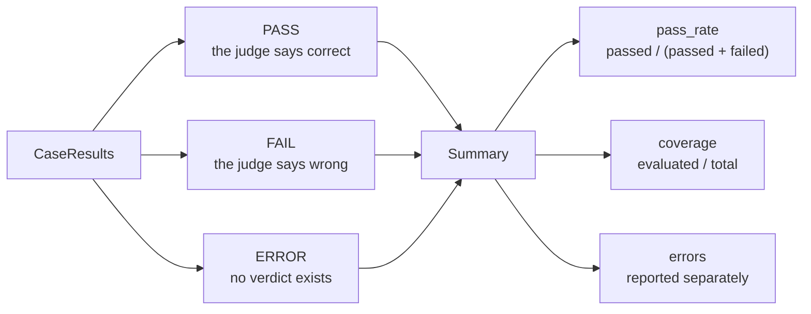
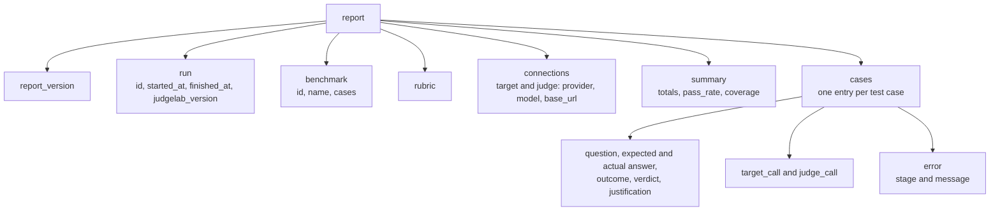

# Codealong 9: Scoring and the JSON Report

In this codealong you are going to turn a pile of verdicts into an evaluation result. By the end you will have an `Outcome` for every case (`PASS`, `FAIL` or `ERROR`), a `Summary` with a pass rate that can never be quietly inflated or deflated by errors, and a JSON report on disk that a reviewer can read months from now to see exactly what happened.

Up to now, the pieces of JudgeLab have each done one job well: the connectors talk to models, `run_target()` collects the target's answers, and the `Judge` turns one answer into a validated verdict. But nothing yet says what a run *concluded*, and nothing keeps a record. That is what this chapter is about, and it is also where the most important promise in your v0.1 plan gets kept: errors are reported next to the pass rate, and never counted as failures.

> **AI-Assist level:** this is a guided codealong, so record your work as **L4**.

## 9.1 Before You Start

You need the code from chapter 8: the `judge.py` module with `Judge`, `JudgeEvaluation`, `JudgeError`, `build_judge_prompt()` and `get_rubric()`. Run the tests to confirm that you are starting from a green suite:

```bash
$ uv run pytest -q
```

This chapter covers the use case [UC-005 Generate report](../../docs/usecases/UC-005-generate-report/README.md), whose goal in the v0.1 plan is "JSON evidence and summary". It has two slices, and you are going to build both: [T-005-01](../../docs/usecases/UC-005-generate-report/T-005-01-aggregate-calculations.md) (aggregate calculations, the scoring) and [T-005-02](../../docs/usecases/UC-005-generate-report/T-005-02-json-report-writer.md) (the JSON report writer). Between them, they deliver all seven of the use case's acceptance criteria, AC-005-01 to AC-005-07.

Notice what this use case does *not* include: running the target and the judge one after the other. That is orchestration, and it belongs to the next use case, UC-006 Run complete evaluation, which is the subject of chapter 10. In this chapter, the scoring and the report work on results that already exist, so you will build those results by hand.

Following [CONTRIBUTING.md](../../CONTRIBUTING.md), create a topic branch from an up-to-date `main`:

```bash
$ git switch main && git pull --ff-only && git switch -c feat/p1-scoring-report-T-005-01
```

As always, I strongly recommend that you type the code yourself.

## 9.2 Writing the Acceptance Criteria First

Before writing any code, let's decide what "done" means. The criteria go in the use case's README, and UC-005 has none yet, so the docs script tells you to start at `01`:

```bash
$ python3 .claude/skills/vbench-docs/scripts/docids.py next AC --usecase UC-005
AC-005-01
```

Open `docs/usecases/UC-005-generate-report/README.md` and add these seven lines under the comment in its Acceptance criteria section:

_docs/usecases/UC-005-generate-report/README.md_: The acceptance criteria

```markdown
- [ ] **AC-005-01**: Totals for passed, failed and errored cases are counted in a single pass over the results.
- [ ] **AC-005-02**: `pass_rate` is passed / (passed + failed): errors are never counted as failures, and the rate is `None` when nothing was evaluated.
- [ ] **AC-005-03**: `coverage` is the share of cases that reached a verdict, reported next to the pass rate.
- [ ] **AC-005-04**: Each case records its question, expected and actual answer, refusal, outcome, verdict and justification, both model calls (requested and served model, tokens, request id, latency) and any error with its stage.
- [ ] **AC-005-05**: The report records the run id, UTC start and finish times, JudgeLab version, benchmark, rubric, both connections (provider, model, base URL) and the summary.
- [ ] **AC-005-06**: The report never contains an API key or the name of the variable holding it.
- [ ] **AC-005-07**: Reports are written as UTF-8 JSON into an output directory (created if needed) with a unique, time-stamped file name.
```

The first three are about scoring, and the other four are about the report. Now say which slice delivers which. Open the task file for T-005-01, fill in its Objective, and replace the placeholder under `## Delivers` with the scoring criteria:

_docs/usecases/UC-005-generate-report/T-005-01-aggregate-calculations.md_: Objective and Delivers

```markdown
## Objective

Summarise a run's outcomes transparently, never hiding errors.

## Delivers

- AC-005-01
- AC-005-02
- AC-005-03
```

Then do the same in the task file for T-005-02, which delivers the report criteria:

_docs/usecases/UC-005-generate-report/T-005-02-json-report-writer.md_: Objective and Delivers

```markdown
## Objective

Persist every case's evidence and the run's metadata as a reviewable JSON report.

## Delivers

- AC-005-04
- AC-005-05
- AC-005-06
- AC-005-07
```

Finally, go back to the use case README and copy the same lists into the Delivers column of its Slices table:

_docs/usecases/UC-005-generate-report/README.md_: The Slices table

```markdown
| Task | Slice | Delivers | Status |
|---|---|---|---|
| [T-005-01](T-005-01-aggregate-calculations.md) | Aggregate calculations | AC-005-01, AC-005-02, AC-005-03 | Todo |
| [T-005-02](T-005-02-json-report-writer.md) | JSON report writer | AC-005-04, AC-005-05, AC-005-06, AC-005-07 | Todo |
```

The last step links the requirements to the criteria that prove them. Each requirement file has a `## Verified by` section, and three requirements are proven by this chapter's criteria: the scoring criteria verify REQ-009 (transparent aggregate metrics), three of the report criteria verify REQ-010 (per-case evidence and metadata as JSON), and AC-005-06 verifies REQ-013 (keeping secrets out of reports). Replace the `-` placeholder under `## Verified by` in `REQ-009.md` with the scoring criteria:

_docs/requirements/REQ-009.md_: Verified by

```markdown
- AC-005-01
- AC-005-02
- AC-005-03
```

Do the same in `REQ-010.md`:

_docs/requirements/REQ-010.md_: Verified by

```markdown
- AC-005-04
- AC-005-05
- AC-005-07
```

REQ-013 already lists the UC-001 criteria that keep the key out of connectors and their errors, so add AC-005-06 to the end of its list:

_docs/requirements/REQ-013.md_: Verified by

```markdown
- AC-001-01
- AC-001-02
- AC-001-08
- AC-001-14
- AC-005-06
```

If you run `uv run pytest` now, the progress table at the bottom has a new `UC-005: Generate report` group with all seven criteria marked `not tested`. Your job in this chapter is to turn them into `PASS`.

## 9.3 Three Outcomes

The judge only knows two words: `PASS` and `FAIL`. But a run has a third possibility, and it is the one that matters most for honest reporting: sometimes we simply don't know. The target timed out, or the judge replied with something that isn't JSON. Calling that a `FAIL` would blame the model for a problem with the plumbing, and dropping it silently would make the pass rate look better than the evidence supports. So the run needs its own vocabulary, with a separate word for "no verdict".

Here is how the three outcomes become the numbers in a summary:



Create a new module for this vocabulary and for the summary of a run.

_src/judgelab/scoring.py_: Outcomes and the summary of a run

```python
"""Outcomes and the summary of a run."""

from collections.abc import Iterable
from dataclasses import dataclass
from enum import StrEnum

from judgelab.benchmark import TestCase
from judgelab.connectors import ModelResponse
from judgelab.judge import JudgeEvaluation


class Outcome(StrEnum):
    PASS = "PASS"  # the judge says the answer is correct
    FAIL = "FAIL"  # the judge says the answer is wrong
    ERROR = "ERROR"  # we don't know: something failed before a verdict existed


@dataclass(frozen=True)
class CaseResult:
    """Everything that happened to one test case."""

    case: TestCase
    outcome: Outcome
    target: ModelResponse | None = None
    judgement: JudgeEvaluation | None = None
    error_stage: str | None = None  # "target" or "judge"
    error: str | None = None


@dataclass(frozen=True)
class Summary:
    total: int
    passed: int
    failed: int
    errors: int

    @property
    def evaluated(self) -> int:
        """Cases with a verdict. Errors are never counted as failures."""
        return self.passed + self.failed

    @property
    def pass_rate(self) -> float | None:
        """passed / (passed + failed), or None when nothing was evaluated."""
        return self.passed / self.evaluated if self.evaluated else None

    @property
    def coverage(self) -> float:
        """The share of cases that reached a verdict."""
        return self.evaluated / self.total if self.total else 0.0


def summarise(results: Iterable[CaseResult]) -> Summary:
    """Count outcomes in a single pass over the results."""
    counts = {outcome: 0 for outcome in Outcome}
    total = 0
    for result in results:
        counts[result.outcome] += 1
        total += 1
    return Summary(
        total=total,
        passed=counts[Outcome.PASS],
        failed=counts[Outcome.FAIL],
        errors=counts[Outcome.ERROR],
    )
```

Let's go through it one piece at a time.

`Outcome` is a `StrEnum`, the same kind of enum you used for `Verdict` in chapter 8. Its members are also real strings, so `Outcome.PASS == "PASS"` is true and an f-string prints `PASS` instead of `Outcome.PASS`. That will matter when the command line prints progress in the next chapter. You may wonder why I didn't just add `ERROR` to `Verdict`. The reason is that they belong to different parts of the system. `Verdict` is what the judge is allowed to say, and the judge must never be able to say `ERROR`. `Outcome` is what the *run* concluded about a case. Keeping them separate means a judge reply of `{"verdict": "ERROR"}` is still rejected by the parser, exactly as before.

`CaseResult` is the record of everything that happened to one case. Only `case` and `outcome` are required. The others default to `None` because not every case gets that far: a case whose target call failed has no target response and no judgement, only an `error` and the `error_stage` where it happened. The stage is there so a reviewer can tell at a glance whether the problem was the model under test or the judge.

`Summary` stores four numbers and *computes* the other three. This is the design choice I want you to notice most in this chapter. If `evaluated`, `pass_rate` and `coverage` were stored fields, someone could build a `Summary` where the pass rate disagrees with the counts, and nothing would catch it. As properties, they are derived from the counts every time you read them, so they can't disagree. There is one rule of thumb at work here: store facts, derive conclusions.

Look closely at the two divisions. `pass_rate` is `passed / evaluated`, where `evaluated` is `passed + failed`. Errors are not in the denominator, which is exactly what your [v0.1 plan](../../docs/releases/v0.1/README.md) asks for. And when nothing was evaluated, it returns `None` instead of dividing by zero. `None` means "there is no pass rate", which is the truth. Returning `0.0` would be a lie, because it would say the model failed everything when in fact we have no idea. `coverage`, on the other hand, returns `0.0` for an empty run, because "none of zero cases reached a verdict" really is zero coverage, and a reader needs to see the pass rate and the coverage side by side to judge how much to trust the rate.

Finally, `summarise()`. This is the "single-pass counting" entry from your DSA ledger (T-005-01). The function walks over the results exactly once, keeping a running count per outcome in a dictionary that starts with a zero for every member of `Outcome`. That makes it O(n) in time and O(1) in extra space, since there are always three counters no matter how many results there are. It also means the function works on *any* iterable, including a one-shot generator, and that's not a minor detail, as you are about to see.

## 9.4 Trying the Scoring

Let's play with this in a Python session. Start one with `uv run python` from the root of the project:

```python
>>> from judgelab.benchmark import TestCase
>>> from judgelab.scoring import CaseResult, Outcome, summarise
>>> case = TestCase("c1", "2+2?", "4")
>>> outcomes = [Outcome.PASS, Outcome.FAIL, Outcome.PASS, Outcome.ERROR]
>>> summary = summarise(CaseResult(case, o) for o in outcomes)
>>> summary
Summary(total=4, passed=2, failed=1, errors=1)
>>> summary.evaluated, summary.pass_rate, summary.coverage
(3, 0.6666666666666666, 0.75)
>>> nothing = summarise([CaseResult(case, Outcome.ERROR)])
>>> nothing.pass_rate, nothing.coverage
(None, 0.0)
```

Notice that the pass rate is two out of three, not two out of four. The error is visible in `errors` and in the 75% coverage, but it does not drag the pass rate down.

Now, here is why the single pass matters. Suppose you had written `summarise()` the "obvious" way, with one `sum()` per outcome. Watch what happens with a generator:

```python
>>> results = (CaseResult(case, o) for o in outcomes)
>>> sum(1 for r in results if r.outcome == Outcome.PASS)
2
>>> sum(1 for r in results if r.outcome == Outcome.FAIL)
0
```

The first pass consumed the generator, so the second pass saw nothing and reported zero failures. There was no error and no warning, only a wrong number. Counting everything in one loop makes this bug impossible.

## 9.5 The JSON Report

An evaluation that only exists in memory is gone when the process ends. Your plan asks for a report that records every case's evidence plus enough about the run to reproduce and trust it (REQ-010), and that never contains a secret (REQ-013). Let's write it.

The report has a fixed shape. This map of its sections is worth keeping in mind while you read the code:



_src/judgelab/report.py_: The JSON report

```python
"""The JSON report: per-case evidence plus the run's metadata and summary."""

import json
import uuid
from dataclasses import dataclass, field
from datetime import UTC, datetime
from importlib.metadata import version
from pathlib import Path

from judgelab.benchmark import Benchmark
from judgelab.connectors import ModelConnector, ModelResponse
from judgelab.scoring import CaseResult, Summary

REPORT_VERSION = "1"


@dataclass(frozen=True)
class RunInfo:
    """What was run, with what, and when."""

    benchmark: Benchmark
    rubric_id: str
    target: ModelConnector
    judge: ModelConnector
    started_at: datetime
    finished_at: datetime
    run_id: str = field(default_factory=lambda: uuid.uuid4().hex)


def build_report(run: RunInfo, results: list[CaseResult], summary: Summary) -> dict:
    """Everything a reviewer needs, as plain data. Never includes secrets."""
    return {
        "report_version": REPORT_VERSION,
        "run": {
            "id": run.run_id,
            "started_at": run.started_at.isoformat(),
            "finished_at": run.finished_at.isoformat(),
            "judgelab_version": version("judgelab"),
        },
        "benchmark": {
            "id": run.benchmark.id,
            "name": run.benchmark.name,
            "cases": len(run.benchmark.cases),
        },
        "rubric": run.rubric_id,
        "connections": {"target": _connection(run.target), "judge": _connection(run.judge)},
        "summary": {
            "total": summary.total,
            "passed": summary.passed,
            "failed": summary.failed,
            "errors": summary.errors,
            "evaluated": summary.evaluated,
            "pass_rate": summary.pass_rate,
            "coverage": summary.coverage,
        },
        "cases": [_case(result) for result in results],
    }


def write_report(report: dict, directory: str | Path) -> Path:
    """Write the report as UTF-8 JSON into `directory`, creating it if needed."""
    directory = Path(directory)
    directory.mkdir(parents=True, exist_ok=True)
    started = datetime.fromisoformat(report["run"]["started_at"])
    path = directory / f"run-{started:%Y%m%dT%H%M%SZ}-{report['run']['id'][:8]}.json"
    path.write_text(json.dumps(report, indent=2, ensure_ascii=False) + "\n", encoding="utf-8")
    return path


def utc_now() -> datetime:
    return datetime.now(UTC)


def _connection(connector: ModelConnector) -> dict:
    return {
        "provider": connector.provider,
        "model": connector.model,
        "base_url": connector.base_url,
    }


def _call(response: ModelResponse) -> dict:
    return {
        "requested_model": response.requested_model,
        "served_model": response.served_model,
        "finish_reason": response.finish_reason,
        "prompt_tokens": response.prompt_tokens,
        "completion_tokens": response.completion_tokens,
        "request_id": response.request_id,
        "latency_ms": round(response.latency_ms, 1),
    }


def _case(result: CaseResult) -> dict:
    target, judgement = result.target, result.judgement
    return {
        "id": result.case.id,
        "question": result.case.question,
        "expected_answer": result.case.expected_answer,
        "outcome": result.outcome.value,
        "actual_answer": target.text if target else None,
        "refusal": target.refusal if target else None,
        "verdict": judgement.verdict.value if judgement else None,
        "justification": judgement.justification if judgement else None,
        "target_call": _call(target) if target else None,
        "judge_call": _call(judgement.response) if judgement else None,
        "error": {"stage": result.error_stage, "message": result.error} if result.error else None,
    }
```

This module is split in two on purpose. `build_report()` turns the run into plain data, which means dictionaries, lists, strings, numbers and `None`, and `write_report()` puts that data on disk. Building the report doesn't touch the file system, so the tests can check its contents directly, and writing it doesn't know anything about evaluations.

`RunInfo` collects the facts about the run that aren't in the results: what was evaluated, with which rubric and connectors, and when. Look at how `run_id` gets its default. If I had written `run_id: str = uuid.uuid4().hex`, Python would have called `uuid4()` once, when the class was defined, and every run would get the same id. This is the same trap as the default argument that stored your API key in chapter 1. `field(default_factory=...)` tells the dataclass to call the function each time an instance is created instead.

`utc_now()` is a one-liner, but it's worth having. `datetime.now()` without an argument returns a "naive" datetime with no time zone attached, and when you read it back later you can't tell whether it was London time or Singapore time. `datetime.now(UTC)` returns an aware datetime, and its `isoformat()` ends in `+00:00`, so the report says exactly which moment it means. Everything in JudgeLab that records a time should call this function.

`judgelab_version` comes from `importlib.metadata.version("judgelab")`. That reads the version of the installed package, which `uv` took from the `version` field in your `pyproject.toml`. There's only one place where the version is written down, so the report and the package can't disagree. The `report_version` field is different: it versions the *shape* of the report, so that a script reading old reports in a year's time can tell which layout it is looking at.

Then there's `_connection()`, which is where REQ-013 is enforced. A connector is described by its provider, model and base URL, and nothing else. In particular, the `api_key_env` setting from the connection profile is not there, even though it is only a name. A report is evidence that you might attach to a review or share with someone outside your team, and the simplest way to be sure it says nothing about credentials is to never put credential information in it at all. The test you'll write in a moment proves this by building a report with a real `OpenAIConnector` and searching the written file for both the key and the variable name.

`_case()` flattens a `CaseResult` into the evidence for one case. Every key is always present, with `None` when a stage never happened. A reviewer, or a script, can then read `case["verdict"]` without first checking whether the key exists. Both model calls are recorded with `_call()`, including the served model and the request id, so if a verdict looks strange you can trace it back to the exact request on the provider's side. The latency is rounded to one decimal place, because sub-microsecond digits are noise.

Now look at `write_report()`. The `mkdir(parents=True, exist_ok=True)` call creates the directory and any missing parents, and does nothing if it already exists, so the caller never has to prepare the folder. The file name is built from the run's start time and the first eight characters of its id, like `run-20261127T093000Z-3f9c2a1b.json`. Starting with the timestamp means the files sort in chronological order in any file listing, and the id fragment means two runs that start in the same second still get different names, so one report never overwrites another. The `Z` in the name is a literal character, meaning "UTC", and it's only true because `started_at` comes from `utc_now()`.

Finally, the JSON itself is written with `indent=2` so that a human can read it, and with `ensure_ascii=False` so that a name like "Brontë" is stored as it is instead of as `ë`. Since the file can now contain non-ASCII characters, the encoding is given explicitly as UTF-8. Without it, Python would use your operating system's default encoding, which isn't UTF-8 on every machine.

## 9.6 Writing a Report

Let's see a report on disk. To build one, you need some results first, and since running the target and the judge together is next chapter's job, you are going to make them by hand here, using `FakeConnector`s so nothing leaves your computer. This uses the sample benchmark from chapter 6, so start `uv run python` from the root of the project:

```python
>>> from judgelab.benchmark import load_benchmark
>>> from judgelab.connectors import FakeConnector, Refusal
>>> from judgelab.judge import Judge, build_judge_prompt, get_rubric
>>> from judgelab.scoring import CaseResult, Outcome, summarise
>>> b = load_benchmark("benchmarks/sample.json")
>>> france, gold, novel, hexagon, planet = b.cases
>>> target = FakeConnector(model="target-model", replies={
...     france.question: "Paris",
...     novel.question: Refusal("I'd rather not say."),
...     hexagon.question: "6",
...     planet.question: "Jupiter",
... })
>>> PASS = '{"verdict": "PASS", "justification": "Correct."}'
>>> FAIL = '{"verdict": "FAIL", "justification": "The model refused to answer."}'
>>> refused = build_judge_prompt(novel, "[refused] I'd rather not say.")
>>> judge = Judge(FakeConnector(model="judge-model", default=PASS, replies={refused: FAIL}),
...               get_rubric("semantic_correctness"))
```

The fake target answers four of the five questions, and refuses the one about the novel. The fake judge passes everything, except a prompt where the actual answer is that refusal, marked with `[refused]`. Now a small helper that asks the target, shows the answer to the judge, and records the result:

```python
>>> def judged(case):
...     answer = target.generate(case.question)
...     actual = answer.text if answer.text is not None else f"[refused] {answer.refusal}"
...     judgement = judge.evaluate(case, actual)
...     return CaseResult(case, Outcome(judgement.verdict), answer, judgement)
...
>>> unavailable = CaseResult(gold, Outcome.ERROR, error_stage="target",
...                          error="ConnectorUnavailableError: HTTP 503")
>>> results = [judged(france), unavailable, judged(novel), judged(hexagon), judged(planet)]
>>> summary = summarise(results)
>>> summary
Summary(total=5, passed=3, failed=1, errors=1)
>>> summary.evaluated, summary.pass_rate, summary.coverage
(4, 0.75, 0.8)
```

`Outcome(judgement.verdict)` turns the judge's `Verdict` into the run's `Outcome`. It works because both enums are string-valued: `Verdict.FAIL` has the value `"FAIL"`, and `Outcome("FAIL")` looks that up. The gold question is the one case that never got an answer, so I wrote its `CaseResult` directly, as an `ERROR` at the target stage, the way a failed call will be recorded. The pass rate is three out of four evaluated, and the error shows up as 80% coverage instead of as a failure.

This helper is a rough sketch of what the next chapter's `evaluate()` will do properly, with the error handling and the stopping rules that a real run needs. For now, it's enough to give the report something to describe. Let's turn these results into a report:

```python
>>> from judgelab.report import RunInfo, build_report, utc_now, write_report
>>> now = utc_now()
>>> run = RunInfo(b, "semantic_correctness", target, judge.connector, now, now)
>>> report = build_report(run, results, summary)
>>> report["summary"]
{'total': 5, 'passed': 3, 'failed': 1, 'errors': 1, 'evaluated': 4, 'pass_rate': 0.75, 'coverage': 0.8}
>>> report["cases"][1]["error"]
{'stage': 'target', 'message': 'ConnectorUnavailableError: HTTP 503'}
>>> path = write_report(report, "reports")
>>> path.name
'run-20261126T233415Z-56408f98.json'
```

Your file name will have a different time and id, of course. Open the file in your editor. The top of it describes the run:

```json
{
  "report_version": "1",
  "run": {
    "id": "56408f9876024a61b0e012c7978ba864",
    "started_at": "2026-11-26T23:34:15.489548+00:00",
    "finished_at": "2026-11-26T23:34:15.489548+00:00",
    "judgelab_version": "0.1.0"
  },
  "benchmark": {
    "id": "general-knowledge-v1",
    "name": "General knowledge (sample)",
    "cases": 5
  },
  "rubric": "semantic_correctness",
  "connections": {
    "target": {
      "provider": "fake",
      "model": "target-model",
      "base_url": null
    },
    "judge": {
      "provider": "fake",
      "model": "judge-model",
      "base_url": null
    }
  },
  "summary": {
    "total": 5,
    "passed": 3,
    "failed": 1,
    "errors": 1,
    "evaluated": 4,
    "pass_rate": 0.75,
    "coverage": 0.8
  },
  "cases": [
```

And further down, the `cases` list has one entry per case. Here are the error and the refusal:

```json
    {
      "id": "gk-002",
      "question": "What is the chemical symbol for gold?",
      "expected_answer": "Au",
      "outcome": "ERROR",
      "actual_answer": null,
      "refusal": null,
      "verdict": null,
      "justification": null,
      "target_call": null,
      "judge_call": null,
      "error": {
        "stage": "target",
        "message": "ConnectorUnavailableError: HTTP 503"
      }
    },
    {
      "id": "gk-003",
      "question": "Who wrote the novel Pride and Prejudice?",
      "expected_answer": "Jane Austen",
      "outcome": "FAIL",
      "actual_answer": null,
      "refusal": "I'd rather not say.",
      "verdict": "FAIL",
      "justification": "The model refused to answer.",
      "target_call": {
        "requested_model": "target-model",
        "served_model": "target-model",
        "finish_reason": "refusal",
        "prompt_tokens": 7,
        "completion_tokens": 0,
        "request_id": "fake-2",
        "latency_ms": 0.0
      },
      "judge_call": {
        "requested_model": "judge-model",
        "served_model": "judge-model",
        "finish_reason": "stop",
        "prompt_tokens": 20,
        "completion_tokens": 8,
        "request_id": "fake-2",
        "latency_ms": 0.0
      },
      "error": null
    },
```

Imagine you are a reviewer who wasn't there when this ran. Can you tell what happened to `gk-003`? The target refused, the judge was shown the refusal and failed it, and you have the request ids of both calls if you need to dig deeper. That is what "reviewable" means. Both request ids are `fake-2` because each `FakeConnector` simply numbers its own calls, and neither of them was ever asked about `gk-002`.

When you are done exploring, delete the folder with `rm -r reports`. In the next chapter you are going to tell Git to ignore it, but for now you don't want it showing up in `git status`.

## 9.7 Tests

Time to prove all of this with tests. There are two new test files, one per module.

_tests/test_scoring.py_: Tests for outcomes and the summary

```python
import pytest

from judgelab.benchmark import TestCase
from judgelab.scoring import CaseResult, Outcome, Summary, summarise

CASE = TestCase("c", "Q?", "A")


def results(*outcomes):
    return [CaseResult(CASE, outcome) for outcome in outcomes]


@pytest.mark.acceptance("AC-005-01")
def test_counts_each_outcome():
    summary = summarise(results(Outcome.PASS, Outcome.FAIL, Outcome.PASS, Outcome.ERROR))
    assert summary == Summary(total=4, passed=2, failed=1, errors=1)


@pytest.mark.acceptance("AC-005-01")
def test_summarise_works_on_a_single_pass_iterator():
    summary = summarise(iter(results(Outcome.PASS, Outcome.ERROR)))
    assert (summary.total, summary.passed, summary.errors) == (2, 1, 1)


@pytest.mark.acceptance("AC-005-02")
def test_pass_rate_excludes_errors():
    summary = summarise(results(Outcome.PASS, Outcome.FAIL, Outcome.ERROR, Outcome.ERROR))
    assert summary.evaluated == 2
    assert summary.pass_rate == 0.5  # 1 / (1 + 1), not 1 / 4


@pytest.mark.acceptance("AC-005-02")
def test_pass_rate_is_none_when_nothing_was_evaluated():
    assert summarise(results(Outcome.ERROR, Outcome.ERROR)).pass_rate is None
    assert summarise([]).pass_rate is None


@pytest.mark.acceptance("AC-005-03")
def test_coverage_is_the_share_with_a_verdict():
    summary = summarise(results(Outcome.PASS, Outcome.FAIL, Outcome.FAIL, Outcome.ERROR))
    assert summary.coverage == 0.75
    assert summarise([]).coverage == 0.0
```

These are straightforward, but two of them deserve a comment. `test_summarise_works_on_a_single_pass_iterator` wraps the list in `iter()`, which turns it into an iterator that can only be read once, the same situation you saw in section 9.4. If someone "simplifies" `summarise()` into several passes later, this test fails. And `test_counts_each_outcome` compares against a whole `Summary` with `==`. Dataclasses compare field by field, and since the derived values are properties and not fields, the comparison checks just the four counts.

_tests/test_report.py_: Tests for the report

```python
import json
from datetime import UTC, datetime

import pytest

from judgelab.benchmark import Benchmark, TestCase
from judgelab.connectors import FakeConnector, OpenAIConnector
from judgelab.judge import SEMANTIC_CORRECTNESS, Judge
from judgelab.report import RunInfo, build_report, write_report
from judgelab.scoring import CaseResult, Outcome, summarise

BENCH = Benchmark(
    "b1",
    "Bench",
    (TestCase("c1", "Capital of France?", "Paris"), TestCase("c2", "2+2?", "4")),
)
SECRET = "sk-report-SECRET-9999"
START = datetime(2026, 11, 27, 9, 30, 0, tzinfo=UTC)
END = datetime(2026, 11, 27, 9, 30, 4, tzinfo=UTC)


@pytest.fixture
def report(monkeypatch):
    monkeypatch.setenv("REPORT_TEST_KEY", SECRET)
    first, second = BENCH.cases
    target = FakeConnector(model="target-model", default="Paris")
    judge = Judge(
        FakeConnector(
            model="judge-model", default='{"verdict": "PASS", "justification": "Correct."}'
        ),
        SEMANTIC_CORRECTNESS,
    )
    answer = target.generate(first.question)
    results = [
        CaseResult(first, Outcome.PASS, answer, judge.evaluate(first, answer.text)),
        CaseResult(
            second, Outcome.ERROR, error_stage="target", error="ConnectorUnavailableError: HTTP 503"
        ),
    ]
    # A real connector (holding the key) is also described, to prove no secret leaks.
    real_judge = OpenAIConnector(model="gpt-judge", api_key_env="REPORT_TEST_KEY")
    run = RunInfo(
        BENCH, "semantic_correctness", target, real_judge, START, END, run_id="abc123ef99"
    )
    return build_report(run, results, summarise(results))


@pytest.mark.acceptance("AC-005-04")
def test_cases_carry_their_evidence(report):
    passed, errored = report["cases"]
    assert passed["id"] == "c1" and passed["outcome"] == "PASS"
    assert (passed["question"], passed["expected_answer"], passed["actual_answer"]) == (
        "Capital of France?",
        "Paris",
        "Paris",
    )
    assert (passed["verdict"], passed["justification"]) == ("PASS", "Correct.")
    assert passed["target_call"]["served_model"] == "target-model"
    assert passed["judge_call"]["served_model"] == "judge-model"
    assert passed["error"] is None
    assert errored["outcome"] == "ERROR"
    assert errored["error"] == {
        "stage": "target",
        "message": "ConnectorUnavailableError: HTTP 503",
    }
    assert errored["verdict"] is None and errored["target_call"] is None


@pytest.mark.acceptance("AC-005-05")
def test_run_metadata_and_summary(report):
    assert report["report_version"] == "1"
    assert report["run"]["id"] == "abc123ef99"
    assert report["run"]["started_at"] == "2026-11-27T09:30:00+00:00"
    assert report["run"]["judgelab_version"] == "0.1.0"
    assert report["benchmark"] == {"id": "b1", "name": "Bench", "cases": 2}
    assert report["rubric"] == "semantic_correctness"
    assert report["connections"]["judge"] == {
        "provider": "openai_compatible",
        "model": "gpt-judge",
        "base_url": "https://api.openai.com/v1",
    }
    assert report["summary"] == {
        "total": 2,
        "passed": 1,
        "failed": 0,
        "errors": 1,
        "evaluated": 1,
        "pass_rate": 1.0,
        "coverage": 0.5,
    }


@pytest.mark.acceptance("AC-005-06")
def test_report_never_contains_a_secret(report, tmp_path):
    text = write_report(report, tmp_path).read_text(encoding="utf-8")
    assert SECRET not in text
    assert "REPORT_TEST_KEY" not in text


@pytest.mark.acceptance("AC-005-07")
def test_written_as_json_with_a_unique_name(report, tmp_path):
    path = write_report(report, tmp_path / "reports" / "nested")
    assert path.name == "run-20261127T093000Z-abc123ef.json"
    assert json.loads(path.read_text(encoding="utf-8")) == report
```

The `report` fixture builds one report that all four tests examine, which keeps each test short and focused on one criterion. There are three tricks in it.

The first is how the results are made. Just like the Python session in section 9.6, the fixture builds them by hand: the fake target answers the first case, the fake judge evaluates that answer with `judge.evaluate()`, and the two become a `PASS` result. The second case is written directly as an `ERROR` at the target stage, with the message a failed call would leave. Building the results this way keeps the test about the report and nothing else. If orchestration changes in the next chapter, these tests don't care.

The second is the fixed `START` and `END` times and the explicit `run_id="abc123ef99"`. Reports normally contain the current time and a random id, which would make the file name impossible to predict. Passing fixed values makes the test deterministic, so the AC-005-07 test can check the exact name `run-20261127T093000Z-abc123ef.json`.

The third is the secrets test. The fixture uses `monkeypatch.setenv()` to put a fake key in a variable with a distinctive name, then creates a real `OpenAIConnector` that reads it. No request is ever sent, but the connector really does hold the key inside its SDK client. The report describes that connector as the judge, gets written to disk, and the test searches the *written text* for both the key and the variable name. Testing the file, and not the dictionary, means that nothing added during serialisation can slip past. `monkeypatch` removes the variable again when the test ends, and `tmp_path` gives each test its own empty directory that pytest cleans up for you. The AC-005-07 test passes a directory two levels deep that doesn't exist yet, which is how it proves that `mkdir(parents=True)` works.

Finally, `json.loads(...) == report` proves the round trip: what you read back from the file is exactly the data you built.

## 9.8 Running the Tests

Run the whole suite:

```bash
$ uv run pytest
```

The acceptance-criteria table at the end should now show the whole of UC-005 passing. Here is the new group and the end of the output (the earlier groups are omitted):

```text
UC-005: Generate report  (7/7 passing)
  PASS        AC-005-01  Totals for passed, failed and errored cases are counted in a
  PASS        AC-005-02  `pass_rate` is passed / (passed + failed): errors are never 
  PASS        AC-005-03  `coverage` is the share of cases that reached a verdict, rep
  PASS        AC-005-04  Each case records its question, expected and actual answer, 
  PASS        AC-005-05  The report records the run id, UTC start and finish times, J
  PASS        AC-005-06  The report never contains an API key or the name of the vari
  PASS        AC-005-07  Reports are written as UTF-8 JSON into an output directory (
49 PASS
143 passed in 2.47s
```

Your timing will be different, but you should see 49 criteria passing across five use cases, and 143 tests.

## 9.9 Troubleshooting

- **`PackageNotFoundError: judgelab`** from `version("judgelab")`. The package isn't installed in the virtual environment, which can happen if you run Python from outside `uv`. Use `uv run pytest` and `uv run python`, which install the project before running anything.
- **`test_run_metadata_and_summary` fails on `judgelab_version`.** The test expects `0.1.0`. Check the `version` field in `pyproject.toml`.
- **`ImportError: cannot import name 'CaseResult' from partially initialized module`.** You have a circular import. `scoring.py` must not import from `report.py`. The dependencies only go one way: `report` imports `scoring`, and `scoring` imports `benchmark`, `connectors` and `judge`.
- **`ValueError: 'PASS' is not a valid Outcome`.** Check the spelling of the values in `Outcome`. They must be exactly the same strings as in `Verdict`, because `Outcome(judgement.verdict)` converts by value.
- **`fake connector has no reply for prompt`** in the Python session. The judge's scripted reply is keyed by the prompt, so the refusal must be formatted exactly as `[refused] <message>`, with one space.
- **`FileNotFoundError: benchmarks/sample.json`** in the Python session. Start `uv run python` from the root of the project, not from `src/` or `tests/`.

## 9.10 Exercises

1. Build a `Summary(total=0, passed=0, failed=0, errors=0)` and read its three properties. Explain out loud why the pass rate is `None` but the coverage is `0.0`.
2. In the Python session from section 9.6, build a report whose results are all `ERROR`. What do `pass_rate` and `coverage` look like in the JSON file, and why is `null` the honest value for one of them?
3. Write a test that proves a case with a refusal keeps the refusal message in the report, with `actual_answer` set to `null`.
4. The `judged()` helper in section 9.6 has no error handling at all. List the things that can go wrong when it calls the target and the judge, and decide, for each, what the case's outcome and error stage should be. Keep the list: you'll compare it with `evaluate()` in the next chapter.

## 9.11 Committing Your Work

Once all the tests pass, you can mark the work as done. In the [UC-005 README](../../docs/usecases/UC-005-generate-report/README.md), tick all seven acceptance criteria (`- [ ]` becomes `- [x]`) and set the Status of both rows in the Slices table to `Done`. In both [T-005-01](../../docs/usecases/UC-005-generate-report/T-005-01-aggregate-calculations.md) and [T-005-02](../../docs/usecases/UC-005-generate-report/T-005-02-json-report-writer.md), set **Status** to `Done`, fill in the **Branch** (`feat/p1-scoring-report-T-005-01`) and set **AI-Assist** to `L4`. Then check that the docs are still consistent:

```bash
$ python3 .claude/skills/vbench-docs/scripts/docids.py check
```

Then stage and commit, following the commit conventions in [CONTRIBUTING.md](../../CONTRIBUTING.md):

```bash
$ git add src/judgelab/scoring.py src/judgelab/report.py \
    tests/test_scoring.py tests/test_report.py \
    docs/usecases/UC-005-generate-report docs/requirements
$ git commit
```

Here is a message you can adapt:

```text
feat(report): score outcomes and write the JSON report

Adds PASS/FAIL/ERROR outcomes and a summary whose pass rate is
passed / (passed + failed), so errors are reported next to the rate
and never counted as failures. The report records every case's
evidence, the run's metadata and both connections without any
credential, in a UTF-8 JSON file with a unique, time-stamped name.

Concepts: single-pass counting (O(n), works on one-shot iterators);
derived values as properties so they can't disagree with the counts.

AI-Assist: L4
```

Then push the branch and ask Claude Code to open the pull request. The `vbench-pr` skill reads `CONTRIBUTING.md`, checks the branch, runs the readiness checklist and drafts the title and body for you to confirm. Under "How it was verified", paste the end of your `uv run pytest` output.

## 9.12 Wrapping Up

Congratulations, JudgeLab can now say what a run concluded and keep a record of it! Every case gets an outcome that says honestly whether a verdict exists, the summary keeps errors out of the pass rate while still reporting them as coverage, and the whole run is saved as a JSON report that a stranger could review and that never mentions your credentials. UC-005 is complete.

What's still missing is the part that produces the results: so far you have built them by hand. In the next codealong, [Evaluating a Benchmark from the Command Line](10-command-line.md), you are going to write `evaluate()`, which sends every case to the target and then to the judge and decides each outcome, including what happens when either model fails. Then you are going to put a proper command line in front of it, with a YAML configuration file that names the target, the judge and the benchmark, so that a full evaluation becomes a single command: `judgelab run --config configs/evaluation.yaml`.
