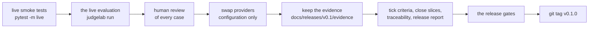

# Codealong 11: The First Live Evaluation and the v0.1 Release

This is the chapter where JudgeLab meets real models. In this codealong you are going to add a couple of live smoke tests that stay switched off unless you ask for them, run your first real evaluation of a target model judged by a different model, read the report the way a reviewer would, prove that the target and the judge can be swapped with nothing but configuration, and then release v0.1, with the evidence, the release report and the Git tag that go with it.

There's very little new code in this chapter, about forty lines. Most of the work is the kind that turns working code into a release: running it for real, looking hard at what it produced, and writing down what you found. That last part is easy to skip and, for an evaluation tool, it is the part that matters most. A benchmark result is only as good as the reasons you have to believe it.

> **AI-Assist level:** this is a guided codealong, so record your work as **L4**.

## 11.1 Before You Start

You need everything from chapter 10, with its pull request merged, and a green test suite. Start a new branch. This one is mostly about validation, so it's a `test/` branch:

```bash
$ git switch main && git pull --ff-only && git switch -c test/p1-live-validation-T013
```

This is the road from here to a tagged release:



This chapter finishes [UC-006 Run complete evaluation](../../docs/usecases/UC-006-run-complete-evaluation/README.md), the use case you started in chapter 10. Its second and last slice is [T013](../../docs/usecases/UC-006-run-complete-evaluation/T013-live-end-to-end-benchmark.md) (live end-to-end benchmark), which delivers four more criteria, AC-006-08 to AC-006-11. Once they are met, every use case in v0.1 works, and the release can be tagged.

For the live parts of this chapter, your `.env` file in the root of the project needs **both** keys, because the bundled configuration uses an OpenAI model as the target and a Claude model as the judge:

```text
OPENAI_API_KEY=your-openai-key
ANTHROPIC_API_KEY=your-anthropic-key
```

The `.env` file is listed in `.gitignore`, so it can't be committed by accident. Also check that the model ids in [configs/evaluation.yaml](../../configs/evaluation.yaml) are models your accounts can use.

How much will this cost? Very little. The smoke tests make two short calls. A full run of the sample benchmark makes five target calls with short questions and five judge calls with short prompts, and you'll do two full runs. That's about twenty small requests in total. If you want an exact figure, your providers' pricing pages and usage dashboards will tell you, and it's a good habit to check the dashboard after your first run anyway.

## 11.2 Writing the Acceptance Criteria First

UC-006 already has seven criteria from chapter 10, so the next one is `08`:

```bash
$ python3 .claude/skills/vbench-docs/scripts/docids.py next AC --usecase UC-006
AC-006-08
```

Open `docs/usecases/UC-006-run-complete-evaluation/README.md` and add these four lines right after AC-006-07, in its Acceptance criteria section:

_docs/usecases/UC-006-run-complete-evaluation/README.md_: The acceptance criteria for T013

```markdown
- [ ] **AC-006-08**: Opt-in live smoke tests (`pytest -m live`) make one real call through each configured connector and get a sensible answer; they never run by default.
- [ ] **AC-006-09**: A live run of the five-case sample benchmark with the bundled config completes and writes a report with full coverage, or explains every ERROR.
- [ ] **AC-006-10**: A human has read every case in the live report and agrees with the judge's verdicts (or records the disagreements) in the release report.
- [ ] **AC-006-11**: Swapping the target and judge providers in the config, with no code change, produces a second valid live report.
```

Then open the task file for T013, fill in its Objective, and replace the placeholder under `## Delivers` with the four new criteria:

_docs/usecases/UC-006-run-complete-evaluation/T013-live-end-to-end-benchmark.md_: Objective and Delivers

```markdown
## Objective

Validate v0.1 against real models end to end, and review the results as a human.

## Delivers

- AC-006-08
- AC-006-09
- AC-006-10
- AC-006-11
```

And fill in the Delivers column of T013's row in the use case's Slices table:

_docs/usecases/UC-006-run-complete-evaluation/README.md_: T013's row in the Slices table

```markdown
| [T013](T013-live-end-to-end-benchmark.md) | Live end-to-end benchmark | AC-006-08, AC-006-09, AC-006-10, AC-006-11 | Todo |
```

Only AC-006-08 can be checked by pytest, and only when you ask for the live tests and have the keys. The other three are verified by you, with the reports and the release report as evidence. That's normal for acceptance testing: some criteria are about whether a human finds the result useful, and no test can decide that for you. You'll see what this means for the progress table in a moment.

## 11.3 Keeping Live Tests Out of the Default Run

Live tests have three properties that the rest of your suite doesn't have. They need real keys, they cost money, and their results depend on a service you don't control. You run `uv run pytest` dozens of times a day, and you want it to stay fast, free and deterministic. So the plan is to tag the live tests with a pytest *marker*, and to exclude that marker unless you ask for it.

First, register the marker. Open `tests/conftest.py` and, in `pytest_configure()`, add one line right after the existing `config.addinivalue_line(...)` call for the `acceptance` marker:

_tests/conftest.py_: Registering the `live` marker (inside `pytest_configure()`)

```python
    config.addinivalue_line("markers", "live: calls real model APIs (run with -m live)")
```

Registering a marker tells pytest it is intentional. Without registration, pytest warns about unknown markers, because a typo like `@pytest.mark.lvie` would otherwise silently mark nothing. The text after the colon shows up in `uv run pytest --markers`.

Next, open `pyproject.toml` and add this section right after the `[dependency-groups]` section, before `[tool.ruff]`:

_pyproject.toml_: Excluding live tests by default

```toml
[tool.pytest.ini_options]
# Live tests call real APIs and cost money: run them only with `pytest -m live`.
addopts = "-m 'not live'"
```

`addopts` holds options that pytest adds to every run, as if you had typed them. `-m 'not live'` is a marker expression that selects every test *not* marked `live`. So a plain `uv run pytest` skips the live tests without you having to remember anything.

Then how do you run them? You pass your own `-m` option. pytest puts the `addopts` options first and your command-line options after them, and when `-m` is given more than once, the last one wins. So `uv run pytest -m live` replaces `not live` with `live`, and selects *only* the live tests.

## 11.4 The Live Smoke Tests

A smoke test is the simplest check that something works at all, named after the electronics practice of switching a new circuit on and seeing whether smoke comes out. Here, it means one real call through each connector in the bundled configuration. Create a `live` folder inside `tests`, and this file in it:

_tests/live/test_live_smoke.py_: One real call through each configured connector

```python
"""Live smoke tests: one real call through each connector in the bundled config.

They cost a fraction of a cent and need real keys, so they never run by default.
Run them on purpose with:  uv run pytest -m live
"""

import os
from pathlib import Path

import pytest

from judgelab.config import load_config
from judgelab.connectors import create_connector

CONFIG = Path(__file__).resolve().parents[2] / "configs" / "evaluation.yaml"
PROMPT = "What is the capital of France? Answer with one word."

pytestmark = pytest.mark.live


@pytest.mark.acceptance("AC-006-08")
@pytest.mark.parametrize("role", ["target", "judge"])
def test_one_real_call(role):
    profile = getattr(load_config(CONFIG), role)
    if not os.environ.get(profile.api_key_env):
        pytest.skip(f"{profile.api_key_env} is not set")
    response = create_connector(profile).generate(PROMPT)
    assert response.text is not None and "paris" in response.text.lower()
    assert response.served_model
    assert response.request_id
```

Let's go through the parts that are new.

`pytestmark` is a special module-level name. Any marker assigned to it applies to every test in the file, so you can't add a test here later and forget to mark it as live.

The test is parametrized over `role`, so it runs once for the target and once for the judge. `getattr(load_config(CONFIG), role)` reads `config.target` or `config.judge`, depending on the parameter. The test uses the *real* configuration file, which it finds relative to its own location: `parents[2]` of `tests/live/test_live_smoke.py` is the root of the project. That makes these tests check the exact setup you are going to run, not a copy of it.

If the key for a connection isn't set, the test calls `pytest.skip()` with a message naming the variable. A skip is not a pass and not a failure. It shows up in the output, so you know the test didn't run and why, and the acceptance table marks AC-006-08 as `skipped` instead of `PASS`. Skipping, rather than failing, means that someone with only one of the two keys can still check the connector they *can* reach.

Finally, the assertions are deliberately loose. The test doesn't check that the answer is exactly `Paris`, because models add punctuation, a trailing period, or a polite sentence, and a smoke test that breaks every time a model changes its style is worse than none. It checks that there is an answer, that it mentions Paris in any capitalisation, and that the response records which model served it and the provider's request id. Those last two are what you'll need if you ever have to report a problem to a provider.

## 11.5 Running the Smoke Tests

First, confirm that the default run is unaffected:

```bash
$ uv run pytest
```

The end of the output now says that two tests were deselected, and UC-006 shows the four new criteria as `not tested`:

```text
UC-006: Run complete evaluation  (7/11 passing)
  PASS        AC-006-01  Every case goes to the target, then its answer goes to the j
  PASS        AC-006-02  Target errors and truncated answers are ERROR at the target 
  PASS        AC-006-03  Judge errors are ERROR at the judge stage, never FAIL; a jud
  PASS        AC-006-04  A refusal from the target is sent to the judge as the answer
  PASS        AC-006-05  `judgelab run --config <file>` runs the whole evaluation, pr
  PASS        AC-006-06  Configuration problems (missing or invalid file, unknown set
  PASS        AC-006-07  The config file names both connections, the dataset, the rub
  not tested  AC-006-08  Opt-in live smoke tests (`pytest -m live`) make one real cal
  not tested  AC-006-09  A live run of the five-case sample benchmark with the bundle
  not tested  AC-006-10  A human has read every case in the live report and agrees wi
  not tested  AC-006-11  Swapping the target and judge providers in the config, with 
56 PASS · 4 not tested
162 passed, 2 deselected in 2.72s
```

This is the honest state of things. Everything that can be checked offline passes, and the four criteria that need real models or a human are listed as not yet tested, instead of quietly missing from the table.

Next, run the live tests *without* the keys. Remember that `uv run` doesn't read `.env` on its own, so this is what happens when you forget to load it. I'm adding `-rs`, which asks pytest to list the reason for every skip at the end:

```bash
$ uv run pytest -m live -rs
```

```text
...
  skipped     AC-006-08  Opt-in live smoke tests (`pytest -m live`) make one real cal
  not tested  AC-006-09  A live run of the five-case sample benchmark with the bundle
  not tested  AC-006-10  A human has read every case in the live report and agrees wi
  not tested  AC-006-11  Swapping the target and judge providers in the config, with 
1 skipped · 59 not tested
=========================== short test summary info ============================
SKIPPED [1] tests/live/test_live_smoke.py:26: OPENAI_API_KEY is not set
SKIPPED [1] tests/live/test_live_smoke.py:26: ANTHROPIC_API_KEY is not set
====================== 2 skipped, 162 deselected in 0.62s ======================
```

Look at the last line: `-m live` selected the two live tests and deselected the other 162. Your explicit option replaced the default one, as promised.

Now let's load the keys. `uv run` has an `--env-file` option that loads a `.env` file into the environment of that one command, and nothing else:

```bash
$ uv run --env-file .env pytest -m live -rs
```

I didn't capture this run, since it would have spent real money, so the following is **illustrative only: your timings will differ**. With both keys loaded and both models reachable, the end of the output looks like this:

```text
UC-006: Run complete evaluation  (1/11 passing)
  ...
  PASS        AC-006-08  Opt-in live smoke tests (`pytest -m live`) make one real cal
  ...
1 PASS · 59 not tested
====================== 2 passed, 162 deselected in 3.84s ======================
```

AC-006-08 is now `PASS`. The 59 "not tested" criteria are simply the ones whose tests were deselected in this run. Your first real requests through JudgeLab's configuration, registry and connectors have succeeded.

## 11.6 The First Live Evaluation

This is the moment the whole project has been building towards. Run the bundled evaluation for real:

```bash
$ uv run --env-file .env judgelab run --config configs/evaluation.yaml
```

The command first prints the header, then goes quiet for a few seconds while the target answers all five questions, and then prints one line per case as the judge works through them. Here is what a run can look like. This is **illustrative: your models, numbers, verdicts and ids will differ**. It has the same shape as the fake run from chapter 10, but the providers are now the real ones:

```text
Running 'General knowledge (sample)': 5 cases
  target: openai_compatible gpt-6.2-astra
  judge:  anthropic claude-opus-5-5 (rubric semantic_correctness)
[1/5] gk-001: PASS
[2/5] gk-002: PASS
[3/5] gk-003: PASS
[4/5] gk-004: PASS
[5/5] gk-005: PASS
Passed: 5  Failed: 0  Errors: 0  (of 5)
Pass rate: 100.0% of 5 evaluated  Coverage: 100.0%
Report: reports/run-20261127T101512Z-7d41e0c2.json
```

A modern model should do well on five general-knowledge questions, so a 100% pass rate would not be surprising. But don't celebrate the number yet. The number is the least interesting thing in that output, and you are about to see why.

If any case comes out as `ERROR`, the progress line shows the stage and the message in parentheses, and AC-006-09 says that each of those must be explained. A one-off `ConnectorUnavailableError` is worth a rerun. Anything that repeats is a finding, and section 11.11 lists the usual suspects.

## 11.7 Reviewing the Report as a Human

Open the report in your editor. Check the top of the file first: the `run` section should have a start and finish time in UTC and `judgelab_version` `0.1.0`, and the `connections` section should show `openai_compatible` and `anthropic` with the right models, and nothing about keys. Then read every case, all five of them, slowly. A case in a live report has the same shape as the ones you saw in chapters 9 and 10. For example (again **illustrative: your answers, justifications, token counts and ids will differ**):

```json
    {
      "id": "gk-004",
      "question": "How many sides does a hexagon have?",
      "expected_answer": "Six",
      "outcome": "PASS",
      "actual_answer": "A hexagon has 6 sides.",
      "refusal": null,
      "verdict": "PASS",
      "justification": "The answer states 6 sides, which matches the expected answer of six.",
      "target_call": {
        "requested_model": "gpt-6.2-astra",
        "served_model": "gpt-6.2-astra-2026-10-01",
        "finish_reason": "stop",
        "prompt_tokens": 14,
        "completion_tokens": 8,
        "request_id": "req_...",
        "latency_ms": 612.3
      },
      "judge_call": {
        "requested_model": "claude-opus-5-5",
        "served_model": "claude-opus-5-5",
        "finish_reason": "end_turn",
        "prompt_tokens": 231,
        "completion_tokens": 37,
        "request_id": "req_...",
        "latency_ms": 2140.8
      },
      "error": null
    },
```

This case shows why JudgeLab uses a judge in the first place. The expected answer is the word "Six" and the model said "6" in a full sentence. An exact-match comparison would have called that a failure. The judge, following the `semantic_correctness` rubric, looked at the meaning.

For each of the five cases, ask yourself these questions, and write the answers down as you go:

1. **Do I agree with the verdict?** Read the question, the expected answer and the actual answer, and decide for yourself *before* reading the verdict. Then compare.
2. **Is the justification about this answer?** A justification that is generic, or that describes a different answer, is a sign that the judge isn't really reading what it's given, even when the verdict happens to be right.
3. **Did the right models answer?** Compare `requested_model` and `served_model` in both calls. If they differ, write down which version actually answered, because that is the model you really evaluated.
4. **Are there any surprises?** A refusal, a much longer answer than expected, a `finish_reason` you haven't seen before, a latency far higher than the others.

If you disagree with the judge on a case, that is not something to fix quietly by rerunning until you get the verdict you want. A disagreement is a *finding*: it tells you something about the rubric, the judge model or the expected answer in the benchmark, and it is exactly the kind of thing your v0.1 plan wants recorded. Phase 1 deliberately doesn't include statistical judge calibration, so your review is the only check there is on the judge in this release. Write each disagreement down for the release report in section 11.9, with the case id and your reasoning. A release report that says "I disagreed with the judge on gk-003, because..." is far more trustworthy than one that says "100%, all good".

When you're done, you have the evidence for AC-006-09 (a complete live run) and the reading part of AC-006-10.

## 11.8 Swapping Providers with Configuration Only

Your v0.1 plan promises that the target and the judge can be switched independently through configuration (REQ-003, and AC-001-22 in UC-001). The tests have proven this with fakes since chapter 5, but AC-006-11 asks for proof with real models. Let's swap the two roles: Claude becomes the model under test, and the OpenAI model becomes the judge.

You'll want to keep this configuration as evidence of how the second report was produced, so create the release's evidence folder now and save the swapped configuration in it:

```bash
$ mkdir -p docs/releases/v0.1/evidence
$ cp configs/evaluation.yaml docs/releases/v0.1/evidence/evaluation-swapped.yaml
```

Edit the copy so that the two connection blocks change places. Each block moves as a whole, including its `timeout_s` and the Claude-specific `options`:

_docs/releases/v0.1/evidence/evaluation-swapped.yaml_: Target and judge swapped

```yaml
# JudgeLab evaluation config. Secrets never go here: only the NAME of the
# environment variable that holds each key.
connections:
  target:
    provider: anthropic
    model: claude-opus-5-5
    api_key_env: ANTHROPIC_API_KEY
    timeout_s: 300
    options:
      max_tokens: 16000
  judge:
    provider: openai_compatible
    model: gpt-6.2-astra
    api_key_env: OPENAI_API_KEY
    timeout_s: 60

benchmark:
  dataset: benchmarks/sample.json
  rubric: semantic_correctness

output:
  dir: reports
```

Then run it, still from the root of the project, so that `benchmarks/sample.json` and `reports` resolve the same way as before:

```bash
$ uv run --env-file .env judgelab run --config docs/releases/v0.1/evidence/evaluation-swapped.yaml
```

The header now reads `target: anthropic claude-opus-5-5` and `judge:  openai_compatible gpt-6.2-astra`, and a second report appears in `reports/`. Not a single line of Python changed. Review this report the same way you reviewed the first one. It's also interesting to compare the two: did the two judges agree on the same kinds of answers? Did one write more useful justifications than the other? Write down anything you notice.

That's the evidence for AC-006-11, and AC-001-22 proven with real models.

## 11.9 Preparing the Release

Everything works, and you have looked at the evidence yourself. Now let's put the release together. There are five steps.

**1. Keep the evidence.** The `reports/` folder is ignored by Git, which is right for the dozens of reports you generate while developing, but these two live reports are your release evidence, and they need to be kept. Copy them into the evidence folder, using your own file names:

```bash
$ cp reports/run-<first-run>.json reports/run-<swapped-run>.json docs/releases/v0.1/evidence/
```

The reports are safe to commit: you tested in chapter 9 that they never contain a key or even a key's variable name. Open them once more anyway and check, because that's what a careful reviewer does before publishing evidence. While you're at it, save the output of the full test suite as evidence for the verification gate:

```bash
$ uv run pytest > docs/releases/v0.1/evidence/pytest.txt
```

Open `pytest.txt` and look at the acceptance table at the end. It's the whole of v0.1 on one screen, grouped by use case:

```text
UC-001: Configure model connections  (22/22 passing)
  PASS        AC-001-01  A missing, empty or whitespace-only API-key variable raises 
  PASS        AC-001-02  A connector is configured only from its arguments: provider 
  PASS        AC-001-03  A successful reply returns the answer text, the requested an
  PASS        AC-001-04  A refusal is returned as a response, not raised as an error.
  PASS        AC-001-05  A reply that cannot be trusted (wrong type, no choices, or n
  PASS        AC-001-06  Provider failures map to JudgeLab errors: bad credentials to
  PASS        AC-001-07  No request is retried unless retries are configured.
  PASS        AC-001-08  The API key never appears in a connector's repr or in any er
  PASS        AC-001-09  Every connector implements the `ModelConnector` port and pas
  PASS        AC-001-10  A `FakeConnector` answers from a script (answers, refusals, 
  PASS        AC-001-11  Truncation is reported the same way for every provider: `tru
  PASS        AC-001-12  A connection is described by a validated profile built from 
  PASS        AC-001-13  Missing or blank required profile settings are rejected, and
  PASS        AC-001-14  `api_key_env` must look like an environment variable name; t
  PASS        AC-001-15  `base_url` must be an https URL (plain http only for localho
  PASS        AC-001-16  Unknown profile settings (typos, or an `api_key` field) are 
  PASS        AC-001-17  `timeout_s` must be greater than 0 and `max_retries` a whole
  PASS        AC-001-18  The key is read from the environment variable the profile na
  PASS        AC-001-19  The connector is chosen by the profile's provider.
  PASS        AC-001-20  An unknown provider is rejected with the list of known provi
  PASS        AC-001-21  Provider-specific options (like Claude's `max_tokens`) reach
  PASS        AC-001-22  Target and judge connections are independent, and swapping p
UC-002: Prepare benchmark dataset  (8/8 passing)
  PASS        AC-002-01  A valid JSON benchmark loads into a `Benchmark` with its id,
  PASS        AC-002-02  A missing file or invalid JSON raises a `BenchmarkError` nam
  PASS        AC-002-03  The bundled `benchmarks/sample.json` loads and has at least 
  PASS        AC-002-04  Required fields (benchmark `id`, `name`, `cases`; case `id`,
  PASS        AC-002-05  Duplicate case ids are rejected, naming the id and both posi
  PASS        AC-002-06  Unknown fields are rejected, so typos like `expected_anwser`
  PASS        AC-002-07  An empty or missing case list is rejected.
  PASS        AC-002-08  Every problem in a file is reported at once, not one per run
UC-003: Execute target model  (5/5 passing)
  PASS        AC-003-01  Each case's question is sent to the target once, in order, a
  PASS        AC-003-02  A connector error on one case is recorded against that case 
  PASS        AC-003-03  An auth or quota error stops the run: remaining cases are no
  PASS        AC-003-04  An optional progress callback is called after every case.
  PASS        AC-003-05  Exceptions that are not connector errors are not swallowed, 
UC-004: Evaluate responses  (7/7 passing)
  PASS        AC-004-01  Include question, expected answer, actual answer, and rubric
  PASS        AC-004-02  Accept only supported verdict values and a nonempty justific
  PASS        AC-004-03  Invalid output becomes `ERROR`, never `FAIL`.
  PASS        AC-004-04  Record evaluator provider/model identity.
  PASS        AC-004-05  Switching the judge profile does not change benchmark data o
  PASS        AC-004-06  The judge's instructions reach every provider: a `system` me
  PASS        AC-004-07  Rubrics are looked up by id; an unknown id is rejected with 
UC-005: Generate report  (7/7 passing)
  PASS        AC-005-01  Totals for passed, failed and errored cases are counted in a
  PASS        AC-005-02  `pass_rate` is passed / (passed + failed): errors are never 
  PASS        AC-005-03  `coverage` is the share of cases that reached a verdict, rep
  PASS        AC-005-04  Each case records its question, expected and actual answer, 
  PASS        AC-005-05  The report records the run id, UTC start and finish times, J
  PASS        AC-005-06  The report never contains an API key or the name of the vari
  PASS        AC-005-07  Reports are written as UTF-8 JSON into an output directory (
UC-006: Run complete evaluation  (7/11 passing)
  PASS        AC-006-01  Every case goes to the target, then its answer goes to the j
  PASS        AC-006-02  Target errors and truncated answers are ERROR at the target 
  PASS        AC-006-03  Judge errors are ERROR at the judge stage, never FAIL; a jud
  PASS        AC-006-04  A refusal from the target is sent to the judge as the answer
  PASS        AC-006-05  `judgelab run --config <file>` runs the whole evaluation, pr
  PASS        AC-006-06  Configuration problems (missing or invalid file, unknown set
  PASS        AC-006-07  The config file names both connections, the dataset, the rub
  not tested  AC-006-08  Opt-in live smoke tests (`pytest -m live`) make one real cal
  not tested  AC-006-09  A live run of the five-case sample benchmark with the bundle
  not tested  AC-006-10  A human has read every case in the live report and agrees wi
  not tested  AC-006-11  Swapping the target and judge providers in the config, with 
56 PASS · 4 not tested
162 passed, 2 deselected in 2.72s
```

Five use cases are complete, and UC-006 stands at 7 out of 11. The four criteria left are exactly the ones this chapter is about, and none of them can be ticked by a default test run. AC-006-08 becomes `PASS` when you run the live tests with your keys, as you did in section 11.5, so that run's output is its evidence. AC-006-09, AC-006-10 and AC-006-11 are manual: the live run, your review and the swapped run are their evidence, and they are recorded in the release report instead of in a pytest table. That's not a gap in the testing. It's the table telling you, correctly, which promises a machine can check and which ones need you.

**2. Tick the criteria and close the slices.** In the [UC-006 README](../../docs/usecases/UC-006-run-complete-evaluation/README.md), tick AC-006-08 to AC-006-11, now that you have the evidence for each, and set the Status of T013's row in the Slices table to `Done`. In [T013](../../docs/usecases/UC-006-run-complete-evaluation/T013-live-end-to-end-benchmark.md), set **Status** to `Done`, fill in **Branch** (`test/p1-live-validation-T013`) and set **AI-Assist** to `L4`.

Then go through every use case README, from UC-001 to UC-006, and make sure every acceptance criterion is ticked and every row of every Slices table says `Done`. Open each task file too, from T001 to T014, and check that its Status says `Done`. If something isn't, either finish it or say in the release report why it isn't part of v0.1.

**3. Update the traceability matrix.** Open [docs/traceability.md](../../docs/traceability.md) and update the Status column, which still says `Not started` for every requirement. The `vbench-docs` skill has one rule to respect here: a requirement is only `Verified` when a test case (`TC-###`) exists for it and there's test evidence. Your evidence is in `pytest.txt`, but [docs/verification.md](../../docs/verification.md) still only has a placeholder row. So add one test case row per test area to the table in `verification.md` (for example, a row for the dataset tests in `tests/test_benchmark.py` that verifies REQ-001 and REQ-002), getting each new ID from the script with `python3 .claude/skills/vbench-docs/scripts/docids.py next TC`. Put the TC ids in the Verification column of the traceability matrix, and then mark the requirements `Verified`. If you'd rather not do this now, mark them `In progress` and record the missing test cases under Known issues. Either way, the matrix tells the truth.

**4. Write the release report.** Open [docs/releases/v0.1/release-report.md](../../docs/releases/v0.1/release-report.md) and fill in each section. This is your writing, so I'll only describe what belongs where:

- **Summary:** what v0.1 does in two or three sentences, the tag (`v0.1.0`) and the date.
- **Requirements status:** REQ-001 to REQ-013 are all in scope for v0.1. Say which use cases, tests and evidence cover each, and note anything deferred and why.
- **Verification evidence:** the test totals and the acceptance table from `pytest.txt`, the result of the live smoke tests (the evidence for AC-006-08), links to the two reports in `evidence/`, the swapped configuration, and your human review from section 11.7: for each case of each run, the verdict, whether you agreed, and your reasoning when you didn't. This is where the three manual criteria, AC-006-09, AC-006-10 and AC-006-11, are recorded, each with the evidence that satisfies it.
- **Known issues:** anything that surprised you, every disagreement with the judge, and limitations you know about. For example, the progress output says nothing during the target stage, and there's no judge calibration yet.
- **Learning outcomes:** the DSA and pattern concepts from the ledger in the [v0.1 plan](../../docs/releases/v0.1/README.md) (single-pass counting, Adapter, dependency inversion and test doubles, and the rest), and your AI-Assist levels across the release.
- **Retrospective:** what went well and what you'd change, honestly.

**5. Check the docs.** Finally, run the hygiene check and fix anything it reports:

```bash
$ python3 .claude/skills/vbench-docs/scripts/docids.py check
```

It should finish with `0 error(s)`. Among other things, it confirms that every criterion is defined once, in its own use case, and that every `AC-…` you mentioned in the release report points at a real one.

## 11.10 The Release Gates

Section 11 of your [v0.1 plan](../../docs/releases/v0.1/README.md) lists six gates that a release has to pass. Let's walk through them one by one, and for each, point at the evidence:

1. **Requirements baseline.** The scope, the IDs and the acceptance criteria were reviewed. Evidence: the plan, the requirement files and every use case's acceptance criteria, all written *before* the code in each chapter.
2. **Design baseline.** The use cases, ontology, interfaces and key trade-offs are documented. Evidence: the plan's design sections, the use case folders with their slices, and the decisions you recorded along the way. If a significant decision from these chapters isn't written down anywhere (`yaml.safe_load`, errors never counted as failures, the injected connector factory), now is the time to add it.
3. **Implementation.** All must-have capabilities work through the CLI. Evidence: the live run from section 11.6, which exercised every one of them in a single command.
4. **Verification.** Unit, component, integration and system tests pass. Evidence: `pytest.txt`, with the acceptance table showing every automated criterion as `PASS`, plus the passing live smoke tests for AC-006-08.
5. **Validation.** One real benchmark was executed and its results were reviewed by hand. Evidence: the two live reports and your review in the release report, which together satisfy AC-006-09 to AC-006-11.
6. **Learning review.** Independent coding, DSA, patterns and assistance records are up to date. Evidence: the release report's learning section, the AI-Assist trailers in your commits, and your notes in `learning/dsa/` and `learning/patterns/`. Be honest with this one: the release is about the code, but the project is about what *you* can now build on your own.

If a gate isn't met, don't tag. Fix what's missing, or record clearly in the release report why you are accepting the gap.

## 11.11 Troubleshooting

- **The live tests are skipped even though your keys are in `.env`.** You ran `uv run pytest -m live` without `--env-file .env`. `uv run` doesn't load `.env` files on its own.
- **`ConnectorRequestError: HTTP 404 (model_not_found)`** or a similar request error. The model id in the config isn't available to your account. Change the `model` in `configs/evaluation.yaml` to one that is, and run the smoke tests again. Note that this error doesn't stop the run, so in a full evaluation every case would come out as `ERROR` at the target stage, which is exactly what the report should show.
- **Every case is `ERROR` at the judge stage, and the later ones say `not judged: judging stopped after ConnectorAuthError`.** The judge's key is wrong or missing permissions. This is the stopping logic from chapter 10 doing its job: one failed judge call, not five.
- **`ConnectorQuotaError`.** Your account is out of credit or over its quota. Check the provider's billing page. Like an auth error, it stops the stage it happens in.
- **An `ERROR` saying `answer was cut off by its length limit`.** The model hit its maximum output length. For the Claude connector, raise `max_tokens` under `options`. That case is not judged, as you saw in chapter 10.
- **Running `uv run pytest -m live` runs no tests at all.** Check that the `pytestmark = pytest.mark.live` line is in the test file, and that the marker is spelled the same in `conftest.py` and in `addopts`.

## 11.12 Exercises

1. Add a sixth question of your own to a *copy* of the sample benchmark in `sandbox/`, with an expected answer that can be phrased in several ways. Point a copy of the config at it, run it live, and see whether the judge copes with the phrasing.
2. Write down, before running it, what the judge *should* say if the target refuses to answer a general-knowledge question. Then find a way to make a fake target refuse in `sandbox/fake_run.py` from chapter 10, and check the verdict path in the report.
3. Run `uv run pytest -m "not live and not acceptance"`. What does it select, and why? Look up "marker expressions" in the pytest documentation's "Working with custom markers" page.
4. Explain out loud why the live tests skip when a key is missing instead of failing, and why the default `uv run pytest` must never make a network call.

## 11.13 Committing Your Work and Tagging v0.1.0

This branch holds two logical changes, so make two commits. The first is the live smoke tests, together with the T013 criteria and slice that you wrote in section 11.2. The cleanest moment to make it is as soon as the smoke tests pass, before you tick anything in section 11.9. If you have already ticked the criteria, `git add -p` lets you stage the new criteria lines and the Delivers list without the ticks and statuses, which belong to the second commit:

```bash
$ git add tests/live/test_live_smoke.py tests/conftest.py pyproject.toml \
    docs/usecases/UC-006-run-complete-evaluation
$ git commit
```

```text
test(connector): add opt-in live smoke tests

One real call through each connector in the bundled config. They are
marked live and excluded by default (addopts -m 'not live'), so the
everyday test run stays offline, free and deterministic; run them with
uv run --env-file .env pytest -m live. A missing key skips its test.

AI-Assist: L4
```

The second is the release documentation: the evidence, the ticked criteria and finished slices in the use case folders, the release report, verification and traceability:

```bash
$ git add docs/
$ git commit
```

```text
docs(repo): record the v0.1 live evaluation and release report

Adds the two live reports (bundled config and target/judge swapped),
the swapped config and the test output as release evidence, the human
review of every case, and the release report. Ticks the remaining
UC-006 criteria (AC-006-08 to AC-006-11) with their evidence, marks
every v0.1 slice done and updates traceability.

AI-Assist: L4
```

Before you run `git add docs/`, check `git status` and make sure nothing unexpected is in there. Then push the branch and open the pull request with the `vbench-pr` skill. Under "How it was verified", list the live smoke test result, the two live runs and the review in the release report. Since each of these two commits makes sense on its own, this is a case where [CONTRIBUTING.md](../../CONTRIBUTING.md) allows a rebase merge instead of a squash, if you want to keep both on `main`.

Once the pull request is merged, the release is tagged on `main`, with an annotated tag as `CONTRIBUTING.md` asks:

```bash
$ git switch main && git pull --ff-only
$ git tag -a v0.1.0 -m "Phase 1: benchmarking engine"
```

An annotated tag is a real object in Git, with its own message, author and date, unlike a lightweight tag, which is only a name for a commit. It records who released what, and when. From now on, `git show v0.1.0:docs/design.md` shows any document exactly as it was at this release.

Pushing the tag to GitHub makes the release public, so that step is up to you. When you're ready:

```bash
$ git push origin v0.1.0
```

## 11.14 Wrapping Up

Congratulations, you have released JudgeLab v0.1! Think about what you started with in chapter 1: a single connector in a notebook. You now have a tool that loads a validated benchmark, sends it to any model you configure, has a different model judge each answer against a rubric, keeps errors honestly apart from failures, writes a complete record of the run that never contains a secret, and does all of it with one command. You have also done the part that makes the result trustworthy: you ran it for real, read every answer and verdict yourself, and wrote down what you found.

Phase 2 is about modular judges and connectors. Everything you built in Phase 1 was designed so that it can grow without being rewritten: the `ModelConnector` port is the place where new providers plug in, the judge already takes its rubric and its connector as inputs, and the command line takes its connector factory as an argument. In the next phase you are going to look at these seams with the Strategy and Adapter patterns in mind, add new judges and connectors without touching the runner, and find out which of today's design decisions hold up.
