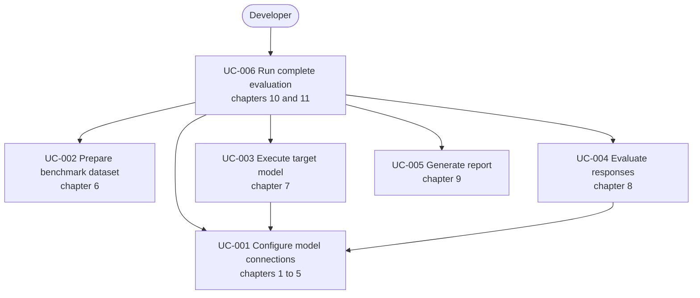

# Codealongs: Building JudgeLab v0.1

A step-by-step course that builds the whole v0.1 release: a command-line tool that runs a benchmark against a target model, has a second model judge every answer, and writes a reviewable JSON report.

The course follows the **use cases** of the [v0.1 plan](../../docs/releases/v0.1/README.md). Each part delivers one use case, and each chapter is a **slice**: a thin, end-to-end piece of the use case, delivered by one or more tasks, that makes some of its acceptance criteria pass. The criteria live in the use case's README ([docs/usecases/](../../docs/usecases/)), tests are marked with them, and `uv run pytest` prints which ones pass, grouped by use case, so you always know which user goals already work.

Type the code yourself: these are guided codealongs, so record the work as **AI-Assist L4**.

Here is how the use cases fit together. UC-006 is the whole evaluation; it relies on the other five:

## Part 1: UC-001 Configure model connections

| # | Chapter | Tasks | Criteria |
|---|---|---|---|
| 1 | [Building an OpenAI Connector](01-openai-connector.md) (notebook warm-up) | T-001-03 | |
| 2 | [The Connector, Properly Built](02-openai-connector-package.md) | T-001-03 | AC-001-01 … 08 |
| 3 | [Abstracting the Connector](03-abstracting-the-connector.md) | T-001-03 | AC-001-09, 10 |
| 4 | [A Claude Connector](04-claude-connector.md) | T-001-05 | AC-001-01 … 06, 09 for a second provider, + 11 |
| 5 | [Connection Profiles and Switching Models](05-connection-profiles.md) | T-001-01, T-001-02, T-001-04 | AC-001-12 … 22, AC-004-05 |

## Part 2: UC-002 Prepare benchmark dataset

| # | Chapter | Tasks | Criteria |
|---|---|---|---|
| 6 | [Benchmark Datasets](06-benchmark-datasets.md) | T-002-01, T-002-02 | AC-002-01 … 08 |

## Part 3: UC-003 Execute target model

| # | Chapter | Tasks | Criteria |
|---|---|---|---|
| 7 | [Running the Target Model](07-running-the-target.md) | T-003-01 | AC-003-01 … 05 |

## Part 4: UC-004 Evaluate responses

| # | Chapter | Tasks | Criteria |
|---|---|---|---|
| 8 | [The LLM Judge](08-the-llm-judge.md) | T-004-01, T-004-02 | AC-004-01 … 04 (from your plan), 06, 07 |

## Part 5: UC-005 Generate report

| # | Chapter | Tasks | Criteria |
|---|---|---|---|
| 9 | [Scoring and the JSON Report](09-scoring-and-reports.md) | T-005-01, T-005-02 | AC-005-01 … 07 |

## Part 6: UC-006 Run complete evaluation

| # | Chapter | Tasks | Criteria |
|---|---|---|---|
| 10 | [Evaluating a Benchmark from the Command Line](10-command-line.md) | T-006-01 | AC-006-01 … 07 |
| 11 | [The First Live Evaluation and the v0.1 Release](11-live-evaluation-and-release.md) | T-006-02 | AC-006-08 … 11 |

**Stuck, or want to compare?** A reference solution exists on the local branch `reference/v0.1-solution`, one commit per chapter. To see exactly what a chapter adds without switching branches, run `git log --oneline reference/v0.1-solution`, then `git show <commit>` for the chapter you want. Try the chapter on your own first.
